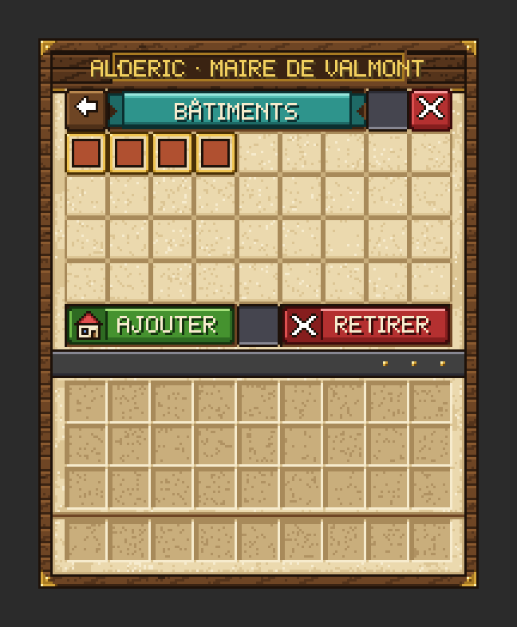

# Les bâtiments

Une construction ne devient un **bâtiment** qu'une fois **déclarée** : vous lui donnez un type, un nom et une zone. La ville l'**inspecte** alors en permanence et lui attribue un **niveau de 0 à 5**.
{ .chapeau }

## Les quatre types

| Type | Usage | Exigences propres |
|---|---|---|
| **Habitation** | Maison des habitants : **1 lit = 1 place** | Au moins 1 lit |
| **Atelier** | Logis et commerce d'**un** artisan | Celles de l'artisan (un atelier « libre » n'a que les exigences communes) |
| **Mairie** | Siège de la Charte. **Une seule par ville** | 1 pupitre et 1 bannière |
| **Divers** | Entrepôt, place, rempart, décor… | Aucune |

Un atelier peut être **réservé** à un artisan déjà rencontré, ou laissé **libre** : le premier artisan qui s'y installe le réserve. Tous les types comptent pour les quêtes de la cité qui demandent un nombre de bâtiments. Les exigences de chaque artisan sont regroupées dans l'[aide-mémoire des ateliers](../personnages/ateliers.md).

## Créer un bâtiment, pas à pas

<ol class="vm-frise" markdown>
<li markdown>**Lancez la création** : `/city build new`, ou Alderic → Bâtiments → { .vm-ui }</li>
<li markdown>**Choisissez le type** (et, pour un atelier, l'artisan ou « Atelier libre »). La bulle de chaque choix affiche ses prérequis.</li>
<li markdown>**Donnez un nom dans le chat** : un seul mot, 24 caractères au plus, unique. Un nom vous est proposé : cliquez dessus pour le reprendre. Tapez `annuler` pour abandonner.</li>
<li markdown>**Délimitez la zone avec le bâton « 🏗 Sélection »** : **clic gauche** sur un bloc du sol pour le premier coin (colonne de flammes), **clic droit** sur le coin opposé (colonne d'étincelles).</li>
<li markdown>**Placez le poste de l'artisan** avec le bâton de Blaze « 📍 Point NPC » : **clic gauche** sur le sol, dans la zone, là où l'artisan se tiendra. Pour une habitation, une mairie ou un bâtiment divers, tapez plutôt `/city build skip` **en gardant l'outil en main**.</li>
<li markdown>**C'est fait !** Une première inspection vous dit ce qu'il manque.</li>
</ol>

!!! warning "Bien délimiter la zone"

    La zone est un rectangle **entièrement dans la ville**, qui ne doit pas chevaucher un autre bâtiment. Cliquez **au niveau du sol du rez-de-chaussée** : c'est à partir de là que le toit est mesuré. La hauteur est gérée automatiquement : tout ce qui est construit de **40 blocs sous le sol à 100 blocs au-dessus** compte, caves et tours comprises.

Le raccourci en une commande existe aussi : `/city build new <type> [artisan|libre] [nom]`, par exemple `/city build new atelier thorvald Forge`.

## L'inspection et les niveaux

L'inspection est automatique : elle se refait une demi-seconde après chaque modification dans la zone.

### Les exigences communes

Elles s'appliquent aux habitations, aux ateliers et à la mairie.

| Exigence | Ce qui compte |
|---|---|
| **Une porte** | Une vraie porte (bois, fer, cuivre). Les trappes et portillons ne comptent pas |
| **Un toit** couvrant **60 %** du sol | Tout bloc plein au-dessus du sol. Le feuillage ne compte pas |
| **Deux sources de lumière** | Torches, lanternes, pierre lumineuse, lanternes aquatiques, champilampes, bougies, feux de camp… (même éteints) |

Certains métiers en plein air demandent moins de toit, voire pas de porte : c'est indiqué sur la fiche de chaque artisan.

### Les niveaux

| Niveau | Condition |
|---|---|
| 0 — Incomplet | Une exigence manque |
| 1 ★ — Conforme | Toutes les exigences sont remplies |
| 2 ★★ | Conforme + 15 points |
| 3 ★★★ | Conforme + 30 points |
| 4 ★★★★ | Conforme + 50 points |
| 5 ★★★★★ | Conforme + 75 points |

### Les points de détail

| Catégorie | Barème | Maximum |
|---|---|---|
| **Variété** | +1 par type de bloc de construction différent | 30 |
| **Décor** | +1 par décoration (4 identiques au plus) | 40 |
| **Bonus du métier** | +5 par bloc bonus présent | 15 |
| **Surface couverte** | +1 par tranche de 10 blocs de sol sous un toit | 15 |

- **Ne comptent pas pour la variété** : les blocs naturels (terre, herbe, roche naturelle, sable, gravier, neige, glace, feuillages, plantes, minerais, eau…).
- **Décorations reconnues** : pots de fleurs, tapis, bannières, bougies, panneaux, trappes, lanternes, chaînes, bibliothèques, poteries décorées, cloches, tableaux, cadres et porte-armures.
- **Bonus** : l'habitation en a trois (coffre, établi, four), la mairie deux (cloche, bibliothèque), et chaque atelier a les siens, liés au métier de son artisan.

### Ce que vous verrez

- Le bâtiment devient conforme ou gagne un niveau : un **titre** s'affiche avec un son, pour le joueur qui a fait le changement (« Forge est conforme », « Niveau 3 ★★★ »).
- Il perd un niveau ou devient incomplet : un avertissement s'affiche au-dessus de la barre d'objets.
- En entrant dans un bâtiment : son nom, son type et ses étoiles s'affichent au-dessus de la barre d'objets.
- **Le détail complet** : `/city build inspect` (dans le bâtiment) ou `/city build inspect <nom>`.

### À quoi sert le niveau ?

- Une **habitation** doit être **conforme** (niveau 1 ou plus) pour accueillir des habitants.
- Pour un **atelier**, chaque niveau au-delà du premier agrandit **l'entrepôt de l'artisan de 25 %**. Au niveau 5, l'entrepôt est doublé : l'artisan peut stocker davantage et vous payer le prix plein plus longtemps.

## Gérer les bâtiments

- **La liste** : Alderic → Bâtiments, ou `/city build`. Un clic gauche affiche les **bordures** du bâtiment (particules bleues, 5 secondes, visibles par vous seul).
- **Changer le type** : clic droit sur le bâtiment dans la liste d'Alderic, ou `/city build type <nom> <type>`. Un bâtiment habité par un artisan reste son atelier.
- **Supprimer** : Alderic → Bâtiments → { .vm-ui }, ou `/city build remove <nom>`. **Les blocs restent en place**, seule la déclaration disparaît. Les habitants s'en vont et l'artisan devient « sans logis ».

!!! danger "Tout joueur peut supprimer n'importe quel bâtiment"

    Concertez-vous avant de réorganiser la ville. Un bâtiment supprimé par erreur se redéclare avec `/city build new` : les blocs, eux, n'ont pas bougé.

<figure markdown>
  { width="320" loading="lazy" }
  <figcaption>La liste des bâtiments chez Alderic — illustration, données d'exemple</figcaption>
</figure>

## Conseils de bâtisseur

1. **Délimitez au plus près des murs** : une cour ou un jardin inclus dans la zone font baisser le pourcentage de toit.
2. **Variez les matériaux** : pierre taillée, briques, planches de plusieurs essences, verre… Chaque bloc différent rapporte un point.
3. **Décorez sans répéter** : au-delà de 4 exemplaires d'une même décoration, les suivants ne rapportent plus rien. Alternez les couleurs.
4. **Posez un exemplaire de chaque bonus du métier** : +5 points chacun, c'est souvent l'écart entre deux niveaux.
5. **Pensez au sous-sol** : une cave sous le bâtiment est inspectée elle aussi.
6. **Vérifiez avant d'installer un artisan** : `/city build inspect <nom>` liste ce qui manque.

Avancé : régler la hauteur inspectée

| Commande | Effet |
|---|---|
| `/city build hauteur <nom> auto` | Revient à la règle normale (40 blocs sous le sol, 100 au-dessus) |
| `/city build hauteur <nom> <sol>` | Définit un nouveau niveau de sol (Y) pour le bâtiment |
| `/city build hauteur <nom> <bas> <haut>` | Fixe à la main la tranche verticale inspectée (au moins 2 blocs de haut) |

