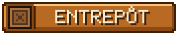
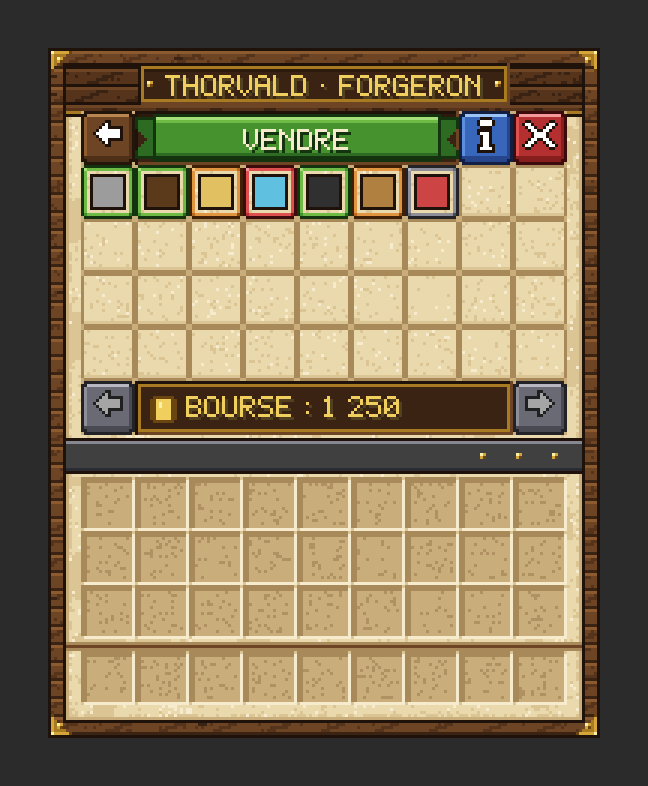
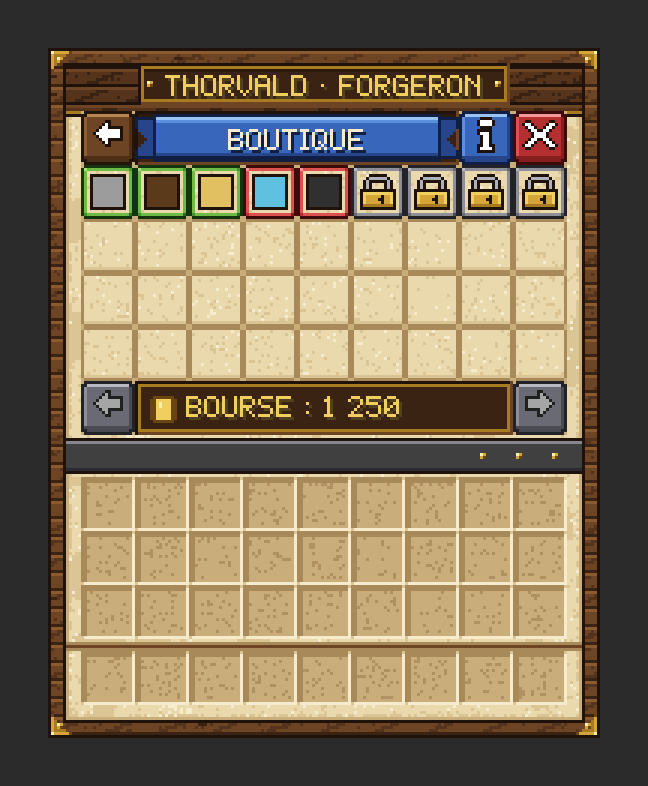

# Commerce et économie

À Valmont, l'argent circule entre les joueurs, les artisans et la caisse de la ville. Les artisans rachètent vos ressources, les stockent, les transforment et vous vendent leurs fabrications. Leurs stocks forment la **réserve de la ville**, où chacun se sert gratuitement. Ce marché est **vivant** : il réagit à ce que tout le monde vend et achète.
{ .chapeau }

## 1. Les coins

{ .vm-icone } La monnaie du serveur s'appelle le **coin**. Il en existe deux réserves :

| Réserve | À qui ? | Où la voir ? |
|---|---|---|
| { .vm-icone } **Votre bourse** | À vous seul | Panneau ++tab++, menus des artisans, Alderic → Trésor |
| { .vm-icone } **La caisse de la ville** | À toute la ville | Panneau ++tab++, Alderic → Trésor, `/city info` |

**Votre bourse se remplit** grâce aux ventes aux artisans, à leurs quêtes, à leurs récits et aux [raids](raids.md) réussis. **La caisse se remplit** grâce à vos dépôts, à l'impôt des habitants, aux sièges remportés et aux raids réussis : c'est elle qui paie les chartes et les parcelles.

## 2. Les trois façons de commercer

Un artisan ne commerce qu'une fois **installé dans son atelier**. Son écran d'accueil propose trois menus :

| Menu | Ce que vous faites |
|---|---|
| { .vm-ui } | Vous lui vendez les ressources de son domaine. **Clic gauche** : tout vendre. **Clic droit** : vendre un seul lot |
| { .vm-ui } | Vous vous servez **gratuitement** dans son stock, la réserve de la ville. **Clic** : un lot. ++shift++ + **clic** : une pile. Ce que vous y prenez est marqué non revendable |
| { .vm-ui } | Vous achetez ses fabrications et ses raretés. De nouveaux articles se débloquent avec son rang |

**Survolez toujours avant de vendre** : la bulle affiche le prix plein, le prix actuel, la demande et le remplissage de l'entrepôt, ainsi que ce que vous rapporterait « Tout vendre ».

> Dans les menus, les objets sont affichés sous leur **nom anglais** (par exemple « Oak Log » pour la bûche de chêne). Les fiches des personnages donnent les deux noms.

<figure markdown>
  { width="280" loading="lazy" }
  <figcaption>L'écran « Vendre » — illustration</figcaption>
</figure>

<figure markdown>
  { width="280" loading="lazy" }
  <figcaption>L'écran « Boutique » — illustration</figcaption>
</figure>

## 3. Les règles du marché

### Le stock est réel et commun

Tout ce que vous vendez entre **réellement** dans l'entrepôt de l'artisan, et cet entrepôt est **le même pour tous les joueurs**. Chaque ressource a, en principe, **un seul acheteur** en ville : le bois chez Bastien, le blé chez Hélène, les minerais chez Godefroy…

### La réserve de la ville

L'entrepôt d'un artisan est la **réserve de la ville** : y déposer (en vendant) est payé, s'y servir (menu Entrepôt) est **gratuit**. Les chantiers d'Alderic y puisent aussi gratuitement quand vous réquisitionnez. Les [employés](habitants.md#le-travail-des-habitants) de l'artisan la remplissent chaque jour, jusqu'à la moitié de sa capacité.

### L'offre et la demande

| Remplissage de l'entrepôt | Prix payé | Demande affichée |
|---|---|---|
| Moins de 40 % | **100 %** du prix plein | Forte |
| 50 à 60 % | environ 80 à 90 % | Normale |
| 70 à 80 % | environ 55 à 70 % | Faible |
| 90 % et plus | jusqu'à 35 % | Très faible |
| Plein | L'artisan n'achète plus | Entrepôt plein |

La vente se calcule **lot par lot** : si vous vendez une grosse quantité d'un coup, chaque lot fait monter le stock et le suivant est payé un peu moins cher. Le montant affiché dans « Tout vendre » en tient déjà compte.

### Les artisans consomment

Chaque artisan écoule environ **8 % de son entrepôt par heure**, tant qu'au moins un joueur est connecté, sans descendre sous **25 % de sa capacité**. Hélène et Rosalie (3 % par heure) et frère Anselme (4 % par heure) en écoulent moins, car leurs entrepôts nourrissent et soignent aussi les habitants à chaque aube (voir [Les habitants](habitants.md#besoins-et-satisfaction)). **La demande revient toujours** : un marché saturé redevient intéressant après quelques heures.

### L'entrepôt grandit avec l'atelier

L'entrepôt d'un artisan grandit avec le **niveau de son atelier** : ×1,25 au niveau 2, ×1,5 au niveau 3, ×1,75 au niveau 4 et ×2 au niveau 5 (voir [Les bâtiments](batiments.md#a-quoi-sert-le-niveau)).

### Les fabrications dépendent des stocks

Les articles de la boutique **consomment des ingrédients** dans le stock de l'artisan, ou dans celui d'un autre artisan. Sans le bon métal en réserve, pas d'armure ; sans céréales, pas de pain. Si un article est en **rupture**, sa bulle indique l'ingrédient qui manque : vendez-le à l'artisan concerné !

Certaines **raretés** n'ont pas d'ingrédient. Leur stock est limité et se reconstitue avec le temps (« Disponible : 3/16 (+1 dans 12 min) »).

### Les objets marqués

**Tout objet acheté en boutique ou pris dans l'entrepôt d'un artisan est marqué** : *« Acheté chez … — non revendable »* ou *« Réserve de … — non revendable »*. La marque **se transmet** : ce que vous fabriquez, cuisez, forgez ou taillez avec un objet marqué est marqué à son tour (*« Fait avec des réserves de la ville — non revendable »*), et un bloc marqué que vous posez redonne un objet marqué quand on le casse. Les plantations, elles, ne transmettent pas la marque : cultiver reste votre travail.

Un objet marqué :

- ❌ ne se revend à **aucun** artisan ;
- ❌ ne compte **pas** pour les quêtes des artisans ;
- ✅ s'utilise normalement pour **construire**, **fabriquer** et **livrer les chantiers** de la ville.

Le marché est conçu pour qu'acheter ou se servir, transformer puis revendre ne soit jamais rentable : inutile de chercher une combine.

## 4. Gagner plus

| Levier | Effet |
|---|---|
| **Devenir employé** d'un artisan | +10 % sur vos ventes à cet artisan, −15 % sur vos achats chez lui |
| **Faire ses quêtes** | Principale : valeur × 1,25. Spéciale : valeur × 1,5, **toujours au prix plein** |
| **Faire monter son rang** | Quêtes plus grosses et mieux payées (jusqu'à ×3), nouveaux articles |
| **Améliorer son atelier** | Un entrepôt plus grand (jusqu'à ×2) : il paie le prix plein plus longtemps |
| **Faire les récits** | De 30 à 1 000 coins chacun, une fois par joueur |

Le détail des rangs, de l'emploi, des quêtes et des récits est dans [Travailler avec les artisans](../personnages/artisans.md).

## 5. Ordres de grandeur

Prix plein, valeurs par défaut.

=== "Ce que les artisans vous paient"

    | Ressource | Acheteur | Prix plein | Soit environ |
    |---|---|---|---|
    | Bûches communes (chêne, sapin, bouleau) | [Bastien](../personnages/survivants/bastien.md) | 5 coins / 16 | **20 coins la pile de 64** |
    | Bûches d'acajou, d'acacia, de chêne noir, de palétuvier | Bastien | 6 coins / 16 | 24 coins la pile |
    | Blé | [Hélène](../personnages/survivants/helene.md) | 10 coins / 32 | **20 coins la pile** |
    | Pierre (cobblestone) | [Brennan](../personnages/survivants/brennan.md) | 3 coins / 64 | **3 coins la pile** |
    | Morue | [Martin](../personnages/survivants/martin.md) | 6 coins / 16 | 24 coins la pile |
    | Charbon | [Godefroy](../personnages/survivants/godefroy.md) | 6 coins / 16 | 24 coins la pile |
    | Fer brut | Godefroy | 20 coins / 16 | **1,25 coin l'unité** |
    | Diamant | Godefroy | 48 coins / 4 | **12 coins l'unité** |
    | Bœuf cru | [Rosalie](../personnages/survivants/rosalie.md) | 10 coins / 16 | 40 coins la pile |
    | Lingot de fer | [Thorvald](../personnages/survivants/thorvald.md) | 24 coins / 16 | 1,5 coin l'unité |
    | Laine blanche | [Agathe](../personnages/survivants/agathe.md) | 8 coins / 16 | 32 coins la pile |
    | Lingot d'or | [Béatrice](../personnages/survivants/beatrice.md) | 20 coins / 8 | 2,5 coins l'unité |

=== "Ce que vous payez en boutique"

    | Article | Artisan | Prix |
    |---|---|---|
    | 32 torches | Godefroy | 7 coins |
    | 8 pains | Rosalie | 18 coins |
    | 32 flèches | [Roland](../personnages/survivants/roland.md) | 9 coins |
    | Épée en fer | Thorvald | 7 coins |
    | Pioche en fer | Thorvald | **11 coins** |
    | Plastron en fer | Thorvald | 28 coins |
    | Enclume (rang Compagnon) | Thorvald | **107 coins** |
    | Pioche en diamant (rang Expert) | Thorvald | **83 coins** |
    | 16 bûches de chêne prises à l'entrepôt | Bastien | **Gratuit** (non revendables) |

=== "Ce que paie la caisse"

    | Dépense de la ville | Prix |
    |---|---|
    | Premier emplacement acheté | 50 coins (+3 % par emplacement, plafond 300) |
    | Toutes les chartes jusqu'à la Capitale | 35 850 coins au total |

    | Recette de la ville | Montant |
    |---|---|
    | Impôt de l'aube | 2 coins par habitant et par jour de jeu |
    | Siège remporté | 150 + 50 × chapitre (350 coins au chapitre IV) |
    | Raid réussi | Selon son niveau (voir [Les raids](raids.md)) |

## 6. Votre niveau de joueur

Vous gagnez de l'expérience de joueur à chaque vente et à chaque achat. Votre **niveau** s'affiche dans le panneau ++tab++, avec une barre d'expérience. Il faut 100 × (niveau actuel)² XP pour passer au niveau suivant : 100 XP pour le niveau 2, 400 de plus pour le niveau 3, et ainsi de suite. Ce niveau reflète votre activité commerciale.

## 7. Les bons réflexes

1. **Vendez quand la demande est « Forte »**, et testez le prix avec un seul lot (clic droit).
2. **Variez vos ressources et vos clients** : un entrepôt plein chez l'un n'empêche pas de vendre à un autre.
3. **Revenez plus tard** : les stocks baissent d'eux-mêmes.
4. **Privilégiez les quêtes** et enchaînez celles de plusieurs artisans pour ne pas subir les délais.
5. **Coordonnez-vous** : si trois joueurs vident leurs coffres de la même ressource le même soir, le prix s'effondre pour tout le monde.
6. **Approvisionnez les fournisseurs** : sans matières premières chez les uns, les boutiques des autres tombent en rupture.
7. **Combinez chasse et sièges** : les monstres abattus pendant un siège comptent pour vos contrats de chasse.
8. **Gardez vos objets marqués à part** : parfaits pour bâtir et livrer les chantiers d'Alderic.
9. **Servez-vous dans la réserve** pour bâtir : c'est gratuit, et les employés des artisans la regarnissent.
