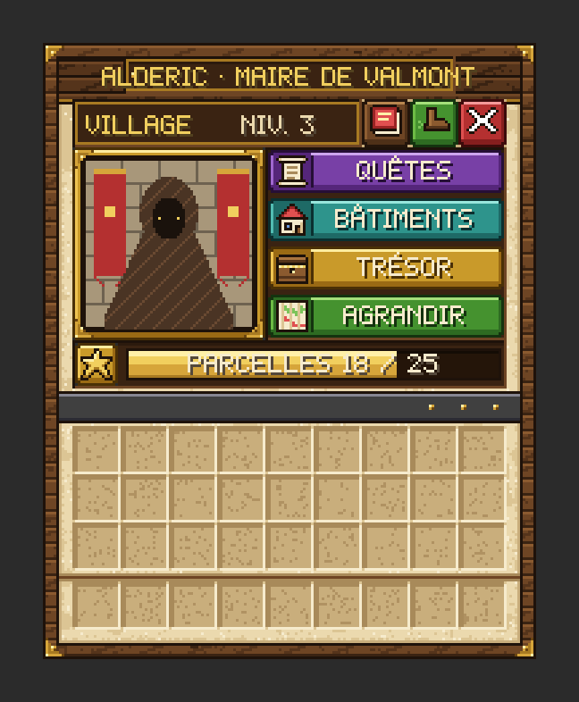
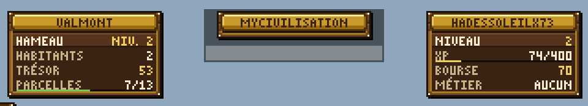

# Premiers pas

Vous venez d'arriver à Valmont ? Cette page vous guide pendant vos premières heures : qui aller voir, comment lire votre écran et par quoi commencer.
{ .chapeau }

## 1. Rencontrer Alderic

**Alderic**, le maire, se tient au cœur de Valmont. **Faites un clic droit sur lui** : il se présente et vous raconte la Nuit Noire. C'est votre point d'entrée pour presque tout.

{ .vm-fiche__decor }

Le menu d'Alderic

| Bouton | À quoi il sert |
|---|---|
| { .vm-ui } | Les objectifs du chapitre en cours, le récit d'Alderic et la signature de la charte |
| { .vm-ui } | La liste des bâtiments de la ville ; en ajouter, en supprimer, en changer le type |
| { .vm-ui } | La caisse de la ville et votre bourse ; déposer des coins ; acheter un emplacement de parcelle (payé par la caisse) |
| { .vm-ui } | Lancer un [raid](raids.md), consulter le calendrier des sièges |
| Barre « Parcelles » | Revendiquer ou rendre la parcelle où vous êtes |

!!! note "Si Valmont n'existe pas encore"

    La ville est fondée **une seule fois pour tout le serveur**, par l'équipe du serveur, avec `/city create` : le chunk où se tient le fondateur devient le cœur de la ville et Alderic apparaît devant lui. Le premier joueur qui lui parle reçoit pour la ville un **cadeau de bienvenue** : 10 emplacements de parcelles et 100 coins dans la caisse.

Tout savoir sur le maire : [Alderic](../personnages/alderic.md).

## 2. Comprendre votre écran

-   ++tab++ **La touche Tab**

    ---

    Au-dessus de la liste des joueurs : **à gauche, la cité** (palier et niveau, habitants, satisfaction, trésor, parcelles) ; **à droite, vous** (niveau, expérience, bourse et métier).

-   ++l++ **La touche L**

    ---

    Le menu Progrès de Minecraft, onglet **« La Renaissance de Valmont »** : la progression de toute la ville.

-   { .vm-icone } **Le panneau « Quêtes »**

    ---

    À gauche de l'écran : vos quêtes en cours et leur avancement. `/city quests` permet de choisir ce qu'il affiche et où.

-   { .vm-icone } **Les dialogues**

    ---

    Les personnages parlent lettre par lettre **au-dessus de votre barre d'objets**, pas dans le chat.

<figure markdown>
  { loading="lazy" }
  <figcaption>Les panneaux de la touche Tab — illustration, données d'exemple</figcaption>
</figure>

En entrant dans la ville, vous lisez **« 🏰 Territoire de Valmont »** au-dessus de la barre d'objets. Le détail de chaque écran est dans [Les interfaces](interfaces.md).

## 3. Par où commencer ?

<ol class="vm-frise" markdown>
<li markdown>**Parlez à Alderic** et ouvrez **Quêtes de la cité** pour voir ce que la ville attend.</li>
<li markdown>**Lancez la recherche du premier survivant** depuis ce menu : vous recevez une **piste** et une **barre** en haut de l'écran qui vous guide vers lui (voir [Retrouver un personnage](../personnages/recrutement.md)).</li>
<li markdown>**Agrandissez la ville** en revendiquant des parcelles voisines avec la barre **Parcelles** d'Alderic (voir [Le territoire](territoire.md)).</li>
<li markdown>**Construisez et déclarez des bâtiments** : une maison pour accueillir des habitants, un atelier pour chaque artisan (voir [Les bâtiments](batiments.md)).</li>
<li markdown>**Commercez** avec les artisans installés : vendez-leur vos ressources, faites leurs quêtes, gagnez des coins (voir [Commerce et économie](commerce.md)).</li>
<li markdown>**Alimentez la caisse** chez Alderic, **Trésor** → **Déposer des coins** : c'est elle qui paie la charte pour passer au chapitre suivant (voir [La trame principale](trame.md)).</li>
</ol>

Plus tard, dès le chapitre II, Alderic peut lever des expéditions contre des places lointaines : les [raids](raids.md). À partir du chapitre IV, c'est Valmont qui est assiégée (voir [Les sièges](sieges.md)).

!!! tip "Le premier chapitre, en bref"

    Au chapitre I, la ville doit revendiquer **12 parcelles**, déclarer **2 bâtiments**, livrer **192 rondins** pour la palissade et installer **Bastien**, le charbonnier des bois. Puis il suffit de signer la charte : **150 coins** pris dans la caisse.

## 4. Les règles d'or, en un coup d'œil

- **Tout est commun** : la caisse, les stocks des artisans, leurs rangs et l'avancement des chapitres sont partagés.
- **En ville, vous ne craignez rien** : pas de dégâts, pas d'explosion, pas d'incendie. **Seule exception : les sièges.**
- **Un objet acheté à un artisan est « marqué »** : il sert à construire, à fabriquer et à livrer les chantiers, mais ne se revend pas.
- **Les menus se lisent au survol** : passez la souris sur un bouton pour afficher sa bulle d'aide.
- **Pour annuler une saisie dans le chat**, tapez `annuler`.

[Toutes les règles d'or](../serveur/regles.md){ .md-button }
[La trame principale](trame.md){ .md-button .md-button--primary }
