# Les interfaces

Les menus des personnages existent en deux styles, qui donnent accès **exactement aux mêmes actions**. Cette page vous apprend à les lire, ainsi que les panneaux affichés à l'écran.
{ .chapeau }

## 1. Menus illustrés ou classiques

| Style | Comment l'obtenir |
|---|---|
| **Illustré « Valmont »** : écrans en pixel art, portraits, panneaux à l'écran | Accepter le pack de ressources à la connexion, ou `/city ui valmont` |
| **Classique** : fenêtres de coffre avec des objets | Refuser le pack, ou `/city ui classique` |

`/city ui` bascule d'un style à l'autre. Les coffres, fours, villageois et autres menus de Minecraft ne changent jamais.

## 2. Lire un écran illustré

{ .vm-fiche__decor }

Les repères communs

| | |
|---|---|
| En haut | Le nom du personnage et son métier |
| En-tête | { .vm-icone } retour, le ruban qui nomme l'écran, { .vm-icone } aide et légende, { .vm-icone } fermer |
| Au milieu | Portrait et grands boutons, ou une grille de cases |
| En bas | Une barre de progression ou un pied de page, et 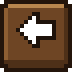{ .vm-icone } 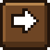{ .vm-icone } pour changer de page |

**Survolez tout** : les bulles contiennent les détails (prix, exigences, progression). Dans ces écrans, rien ne peut être pris ni déposé : chaque clic déclenche seulement l'action du bouton. Votre inventaire reste visible en bas, c'est normal.

### Le code couleur

| Cadre | Sens général |
|---|---|
| { .vm-anneau } Vert | Disponible, conforme, accompli, à jour |
| 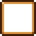{ .vm-anneau } Ambre | En cours, prix réduit, stock entamé |
| 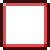{ .vm-anneau } Rouge | Bloqué, incomplet, plein, en rupture |
| 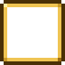{ .vm-anneau } Doré | Réservé, choix actuel, à accepter |
| { .vm-anneau } Gris | Masqué, indisponible |
| 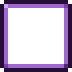{ .vm-anneau } Violet | Quête bonus, garde |
| { .vm-anneau } Cadenas | Verrouillé (rang ou personnage pas encore atteint) |

Le sens exact est rappelé dans la bulle { .vm-icone } de chaque écran.

### Les écrans de commerce

| Écran | Cadres de couleur |
|---|---|
| 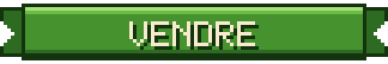{ .vm-ui } | Vert : prix plein · Ambre : prix réduit · Rouge : entrepôt plein · Gris : vous n'en avez pas assez |
| 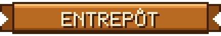{ .vm-ui } | Vert : disponible · Ambre : stock entamé · Rouge : vide |
| 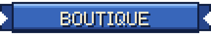{ .vm-ui } | Vert : disponible · Rouge : en rupture (ingrédients manquants) · Cadenas : rang insuffisant |

### L'écran des quêtes d'un artisan

Deux cartes : **Principale** (à gauche) et **Spéciale** (à droite), avec la récompense ou le temps de repos, les objectifs et leur progression, et un bouton d'action :

| Bouton | Signification |
|---|---|
| 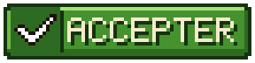{ .vm-ui } | Une quête vous est proposée |
| 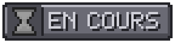{ .vm-ui } | Réunissez ce qui est demandé |
| 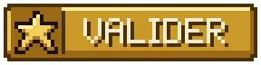{ .vm-ui } | Tout est prêt : cliquez pour toucher la récompense |
| 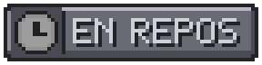{ .vm-ui } | L'artisan prépare sa prochaine quête |

Au centre, le bouton vertical 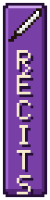{ .vm-ui .vm-ui--grand } ouvre les récits du personnage.

<figure markdown>
  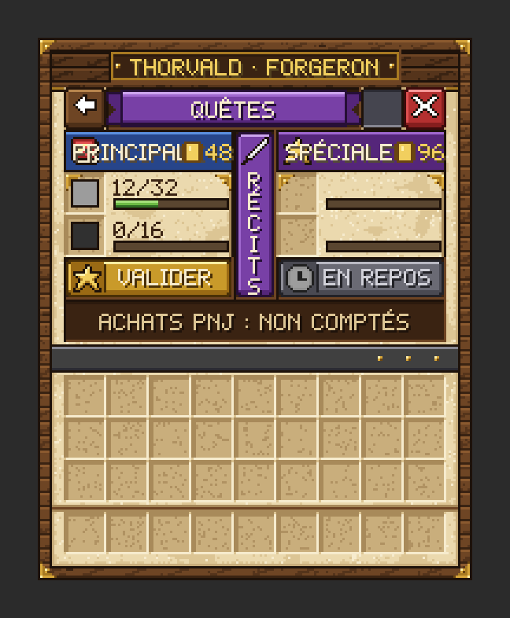{ width="280" loading="lazy" }
  <figcaption>Les quêtes d'un artisan — illustration</figcaption>
</figure>

<figure markdown>
  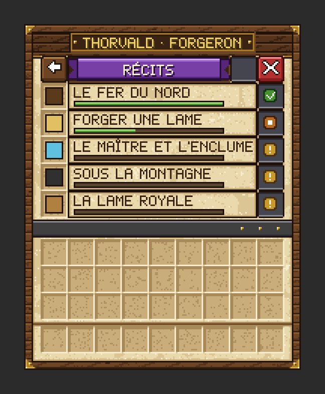{ width="280" loading="lazy" }
  <figcaption>Les récits d'un personnage — illustration</figcaption>
</figure>

## 3. Le panneau de la touche Tab

En maintenant ++tab++, deux panneaux s'affichent au-dessus de la liste des joueurs, de part et d'autre de la plaque **MyCivilisation** :

| Panneau | Contenu |
|---|---|
| **La cité** (à gauche) | Nom, palier et niveau, **habitants** (vivants / places), **trésor** (caisse), **parcelles** (revendiquées / emplacements) |
| **Vous** (à droite) | Pseudo, **niveau**, **XP**, **bourse**, **métier** |

<figure markdown>
  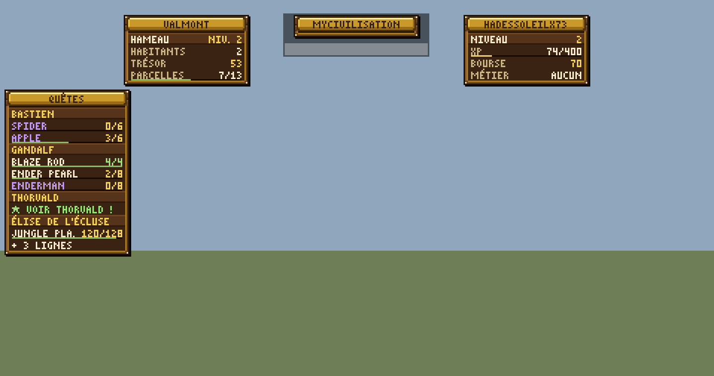{ loading="lazy" }
  <figcaption>Les panneaux à l'écran en 1080p — illustration, données d'exemple</figcaption>
</figure>

## 4. Le panneau « Quêtes »

Un panneau titré **Quêtes** reste affiché à gauche de l'écran :

- une ligne par personnage chez qui vous avez une quête en cours, puis chaque objectif avec son compteur et une fine barre ;
- texte **violet** pour une quête spéciale, **vert** quand l'objectif est atteint ;
- **« ★ Voir … ! »** quand une quête est prête à être validée.

### Le régler : `/city quests`

Le **journal de quêtes**, onglet 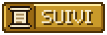{ .vm-ui }, permet de :

- choisir **les personnages suivis** (cadre vert = affiché, gris = masqué) ;
- choisir **la position du panneau** selon votre écran ;
- **afficher ou masquer** tout le panneau (aussi avec `/city quests toggle`), ou tout **suivre** d'un clic (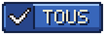{ .vm-ui }).

| Position | Pour quels écrans |
|---|---|
| 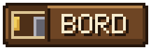{ .vm-ui } (par défaut) | 1080p avec l'interface à l'échelle 4 |
| 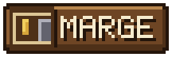{ .vm-ui } | 1440p, 720p ou 1366 × 768 |
| 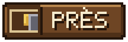{ .vm-ui } (contre l'inventaire) | Écrans 16:10 ou interface agrandie |

Vos réglages sont conservés d'une connexion à l'autre.

### L'onglet « Récits » : `/city quests recits`

Tous les personnages et l'état de leurs récits, dans l'ordre de l'histoire :

| Repère | Signification |
|---|---|
| { .vm-anneau } Doré | Au moins un récit à accepter |
| { .vm-anneau } Ambre | Un récit en cours |
| { .vm-anneau } Vert | À jour |
| { .vm-anneau } Gris | En ville, mais pas encore installé |
| { .vm-anneau } Cadenas | Pas encore à Valmont |

Un clic sur un personnage installé ouvre ses récits. En bas, un compteur affiche tous les récits accomplis.

<figure markdown>
  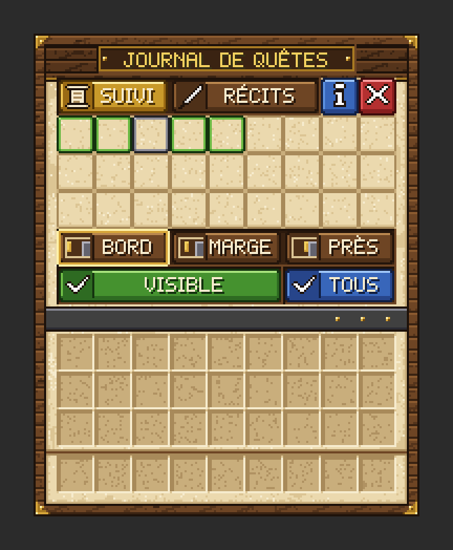{ width="280" loading="lazy" }
  <figcaption>Le journal, onglet « Suivi » — illustration</figcaption>
</figure>

<figure markdown>
  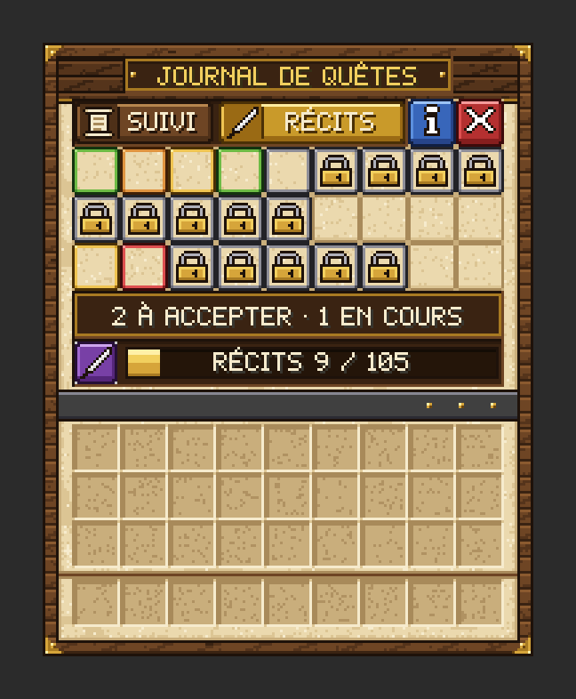{ width="280" loading="lazy" }
  <figcaption>Le journal, onglet « Récits » — illustration</figcaption>
</figure>

## 5. Les dialogues

Les personnages parlent **au-dessus de votre barre d'objets**, lettre par lettre, jamais dans le chat. Les longues répliques s'affichent en plusieurs morceaux. Un seul dialogue se joue à la fois.

!!! dialogue "Un personnage vous parle"

    C'est ainsi que les répliques des personnages sont présentées dans ce guide.

Pour réentendre un personnage : 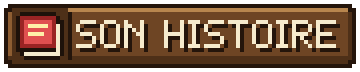{ .vm-ui }. Pour réentendre Alderic : 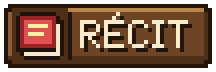{ .vm-ui }

## 6. Les notifications

| Événement | Ce que vous voyez |
|---|---|
| Entrée / sortie de la ville | « 🏰 Territoire de Valmont » / « 🌲 Quitter le territoire de la ville » |
| Entrée dans un bâtiment | Son nom, son type et ses étoiles |
| Bâtiment conforme ou qui gagne un niveau | Un titre et un son |
| Nouveau palier pour la ville | Grand titre, fanfare, puis le récit d'Alderic |
| Un artisan monte de rang | « 🎉 … est passé Apprenti ! De nouveaux articles sont disponibles. » |
| Quête remplie | « ✅ Quête remplie ! » avec un petit son |
| Étape de progression accomplie | La notification de progrès de Minecraft (touche ++l++) |
| Siège | Titre « ⚔ Siège ! », barre rouge en haut de l'écran, puis « Victoire ! » ou « Siège perdu » |
| { .vm-icone } **!** rouge au-dessus d'un personnage | Une nouveauté vous attend auprès de lui (quête à valider, récit à accepter…) |
| **/!\\** jaune au-dessus d'un artisan | Il ne parvient pas à rejoindre son poste : dégagez le passage |

## 7. Avec les menus classiques

Sans le pack, tout reste accessible :

- les menus s'ouvrent dans des fenêtres de coffre ;
- le choix du type d'un bâtiment se fait avec des boutons cliquables dans le chat ;
- le suivi des quêtes est un tableau **« Quêtes actives »** à droite de l'écran ;
- le panneau ++tab++ s'affiche en texte.
