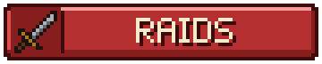

# Les raids

Valmont ne fait pas que se défendre : elle lève aussi des **expéditions**. Depuis le menu d'Alderic, les joueurs choisissent une cible (camp de bandits, avant-poste pillard, village, fort, château, navire, repaire…) et partent la faire tomber, ensemble, avant la fin du chrono.
{ .chapeau }

!!! nouveau "Fonctionnalité récente"

    Les raids sont arrivés récemment sur le serveur : certains comportements peuvent encore évoluer. Signalez tout comportement étrange à l'équipe.

-   { .vm-icone } **Une expédition commune**

    ---

    Tous les joueurs réunis autour d'Alderic partent ensemble. Plus vous êtes nombreux, plus l'adversaire l'est aussi.

-   { .vm-icone } **Un monde à part**

    ---

    Les cibles se trouvent dans un **monde réservé aux raids**, jamais autour de la ville. Il est effacé et recréé à chaque redémarrage du serveur.

-   { .vm-icone } **Rien à perdre**

    ---

    Mort pendant un raid ? Vous gardez **tout votre inventaire et votre expérience**, et vous repartez du camp. Une défaite ne coûte rien.

-   { .vm-icone } **Une récompense pour la ville**

    ---

    Une victoire remplit la **caisse de Valmont** et verse des coins à **chaque combattant**.

## Lancer un raid

Tout part d'Alderic. Avec le pack de ressources, ce sont des écrans illustrés ; sans lui, les mêmes choix passent par des menus classiques (case « Événements » du menu d'Alderic).

<ol class="vm-frise" markdown>
<li markdown>**Événements** : sur l'accueil de la mairie, le bouton { .vm-ui } porte un badge quand un raid est prêt à partir.</li>
<li markdown>**Raids** : l'écran des événements propose { .vm-ui }, à côté des **Sièges** (le prochain siège du calendrier, en consultation) et des **Fêtes** (bientôt).</li>
<li markdown>**Difficulté** : sept niveaux, de I à VII. Au survol, chacun indique ses conditions (cochées ou non), son nombre de cibles, ses défenseurs, son chrono, sa récompense, vos victoires et le temps de repos des troupes.</li>
<li markdown>**Cibles** : une grille de cartes, à filtrer par type (camp, avant-poste, village…). Le bouton **🎲 Au hasard** tire une cible parmi celles affichées. Une cible déjà prise porte la mention « Déjà prise ×N ».</li>
<li markdown>**Fiche** : type, occupants, mods, objectifs, chrono, récompense et bonus, et le nombre de joueurs déjà dans le cercle d'Alderic. Le bouton { .vm-ui } lance l'expédition. Grisé, il explique au survol ce qui bloque (recharge, siège en cours, autre expédition…).</li>
</ol>

## Le rassemblement et le départ

1. **Les éclaireurs partent repérer la cible.** Le menu se ferme, une cloche sonne et tout le serveur lit « ⚔ Les éclaireurs de Valmont partent repérer … ». Le serveur peut marquer une **courte pause** pendant cette recherche : c'est normal.
2. **Le rassemblement sonne.** Annonce à tous les joueurs connectés : « ⚔ Alderic lève une expédition contre … : rejoignez Alderic (30 s) ! ». Alderic reste sur place, entouré d'un **cercle de particules de 10 blocs**.
3. **Au bout des 30 secondes**, tous les joueurs vivants qui se tiennent dans le cercle partent au **camp**, à côté de la cible. Les autres restent à Valmont.

!!! tip "Prévenez les autres avant de sonner"

    Le rassemblement ne dure que 30 secondes : réunissez d'abord votre groupe autour d'Alderic, puis lancez l'expédition. Un seul joueur suffit pour partir.

## Les sept niveaux

Un niveau s'ouvre quand la ville a atteint son **chapitre** et que l'expédition a déjà remporté **une victoire au niveau précédent**. Il n'y a qu'**une expédition à la fois** pour tout le serveur. Après chaque expédition, les troupes du niveau se reposent (la **recharge**, commune à tous les joueurs).

| Niveau | Nom | Chapitre requis | Défenseurs (1 joueur) | Chrono | Renforts | Recharge | Caisse de la ville | Par combattant | Cibles |
|---|---|---|---|---|---|---|---|---|---|
| I | Escarmouche | II | 3 à 6 | 6 min | — | 30 min | 100 | 15 | 16 |
| II | Coup de main | III | 5 à 12 | 8 min | — | 45 min | 150 | 25 | 53 |
| III | Expédition | IV | 8 à 15 | 10 min | 1 vague | 1 h | 220 | 35 | 40 |
| IV | Assaut | V | 15 à 25 | 15 min | 1 vague | 1 h 30 | 300 | 50 | 25 |
| V | Offensive | VI | 20 à 35 | 18 min | 2 vagues | 2 h | 400 | 70 | 18 |
| VI | Grande offensive | VIII | 25 à 45 | 20 min | 3 vagues | 3 h | 520 | 90 | 12 |
| VII | Légende | X | 30 à 60 | 25 min | 3 vagues | 6 h | 700 | 120 | 12 |

- Le nombre de cibles est celui du catalogue complet : une cible dont le mod manque sur le serveur n'apparaît pas.
- Chaque joueur en plus ajoute la moitié des défenseurs : **défenseurs × (1 + 0,5 × (joueurs − 1))**, avec au plus **60 défenseurs** debout à la fois.
- Les défenseurs gagnent en force avec le niveau :

| Niveaux | Vie | Dégâts | Armure (créatures qui n'en ont pas) |
|---|---|---|---|
| I et II | × 1 | × 1 | Aucune |
| III et IV | × 1,1 à 1,2 | × 1,1 à 1,15 | Cuir |
| V et VI | × 1,3 à 1,4 | × 1,2 à 1,25 | Cotte de mailles |
| VII | × 1,5 | × 1,3 | Fer |

## Les cibles

Les cibles sont des structures de Minecraft et des mods du serveur (Valarian Conquest, Towns and Towers, ATi Structures, Mo' Structures, Medieval Buildings, Iron's Spells, Mowzie's Mobs, Tax' Ocean Villager, Supplementaries). Chacune naît dans le monde des raids **sur son terrain naturel** : un village du désert dans le désert, un navire en mer, une forteresse dans le Nether.

| Type | Exemples | Objectifs habituels |
|---|---|---|
| ⛺ **Camp** | Camp de bandits, camp nomade, ferme illageoise | La garnison |
| 🗼 **Avant-poste** | Avant-postes pillards (un par région), tour illageoise | Garnison, bannières, captifs |
| 🏘 **Village** | Villages des plaines, du désert, de la taïga, bosquet des Umvuthana | Garnison, cloche |
| 🏙 **Ville** | Huit villes fortifiées (Brumeval, Skarholm, Haut-Bois…), la cité de l'End | Garnison, tours, bannières, chef, tenir la place |
| 🏰 **Fort** | Fortin du désert, vieux fort, forteresse du Nether, vestiges de bastion | Garnison, cages, chef |
| 🏯 **Château** | Commanderie du Temple, château valarien, citadelle maudite, château dans le ciel | Bannières, garnison, chef, tenir la place |
| ⚓ **Abordage** | Bateau pirate, galion, navire pirate maudit, vaisseau du roi pirate | Aborder, garnison, pavillon, capitaine |
| 🕸 **Repaire** | Hutte de la sorcière, catacombes, antre du Frostmaw, monument du Warden | Le maître des lieux, cages |

La fiche de chaque cible donne ses objectifs exacts : un objectif dont la cible n'a pas l'élément (pas de cloche, pas de bannière) est retiré.

??? info "Les villes fortifiées (niveau V)"

    Une ville fortifiée part d'un **village** qui naît dans le monde des raids. Valmont y trouve, du côté opposé au camp, le **siège du pouvoir** (manoir, donjon, château, fort…) gardé par le **bailli**, et **trois tours** de la faction ennemie, chacune avec sa garnison et sa bannière au sommet. Une tour est **prise** quand toute sa garnison est tombée (ses deux derniers soldats se mettent à briller). Les villageois du village restent : épargnez-les pour le bonus.

## L'assaut

### La défiance et le chrono

Une **barre rouge** en haut de l'écran suit l'assaut : « ⚔ *cible* · Défiance 64 % · 11:42 ». La **défiance** de l'adversaire part de **100 %** ; chaque objectif rempli en retire sa part. À **0 %**, l'adversaire **capitule** : les défenseurs restants jettent les armes et disparaissent. Si le chrono arrive à zéro avant, c'est la défaite.

Les objectifs s'affichent aussi en tête du **panneau Quêtes**, cochés au fur et à mesure, et chaque objectif rempli est annoncé à l'écran.

### Les objectifs

| Objectif | Ce qu'il faut faire |
|---|---|
| **Garnison abattue** | Abattre **80 %** des défenseurs. Les trois derniers se mettent à briller |
| **Cloche sonnée** | Sonner la cloche une fois la place dégagée : **aucun défenseur à moins de 16 blocs** |
| **Bannières arrachées** | Casser les bannières ennemies (le pavillon, sur un navire) |
| **Cages détruites** | Casser les cages à monstres. À partir du niveau IV et dans les repaires ; en dessous, les cages sont retirées |
| **Captifs libérés** | Délivrer d'un clic les prisonniers (les allays en cage des avant-postes) |
| **Tours prises** | Vider chaque tour de sa garnison (villes fortifiées) |
| **Place tenue** | Rester **45 secondes** dans un rayon de **8 blocs** autour de la place (la cloche, sinon le cœur de la cible) sans aucun défenseur dedans. Un cercle de particules au sol la signale (doré, rouge quand un défenseur y entre, ce qui met le compte en pause), avec une colonne de lumière visible de loin |
| **Navire abordé** | Poser le pied sur le navire ennemi : debout à bord, hors de l'eau et hors d'une barque |
| **Chef abattu** obligatoire | Abattre le chef nommé et lumineux (capitaine, bailli…). Dès le niveau V, et toujours dans les villes et sur les navires |
| **Maître vaincu** obligatoire | Vaincre le maître du repaire (boss ou mage, lumineux) |

Tant qu'un objectif **obligatoire** reste à faire, la défiance ne descend pas sous **10 %** : pas de victoire sans le chef ou le maître.

### Les défenseurs, les renforts et le chef

- Les défenseurs sont les occupants de la structure, complétés par le plugin jusqu'au nombre du niveau, ou une **garnison** envoyée par une faction ennemie (les mêmes armées que pendant les [sièges](sieges.md)). Ils tiennent des postes près des portes, de la cloche et au cœur de la cible, jamais à moins de 14 blocs du camp.
- Un défenseur sans adversaire s'en prend au **joueur le plus proche** qu'il voit.
- **Renforts** : dès le niveau III, quand la défiance baisse, des vagues arrivent du **côté opposé au camp** et marchent sur le cœur de la cible (une vague sous 50 % ; deux vagues vers 67 et 33 % ; trois vagues sous 75, 50 et 25 %). Chaque vague compte environ un quart de la garnison.
- Les morts-vivants ne brûlent pas au soleil, et aucun défenseur ne disparaît de lui-même.

## Le camp et le héraut

Le **camp** est votre base, à quelques dizaines de blocs de la cible : un camp de bandits vidé de ses occupants (ou un petit camp de Valmont) sur la terre ferme, un petit bateau sur l'eau, une plateforme dans le Nether et l'End. Le monde des raids reste figé à **midi**.

Le **Héraut de Valmont** vous y attend. Un clic sur lui propose :

- pendant l'assaut, **[Battre en retraite]** : vous rentrez à Valmont, l'expédition continue sans vous ;
- pendant le bilan, **[Rentrer à Valmont]** : vous rentrez tout de suite, sans attendre la fin du décompte.

`/city raid quitter` fait la même chose que la retraite.

!!! warning "Pas de raccourci dans le monde des raids"

    Les commandes de téléportation y sont bloquées (`/home`, `/spawn`, `/back`, `/tpa`, `/warp`…) : on rentre par le héraut, ou à la fin de l'expédition.

**Mourir pendant un raid** : vous gardez **tout votre inventaire et votre expérience**, et vous réapparaissez **au camp**, invulnérable pendant 3 secondes. Il n'y a pas de limite de vies.

**Déconnexion** : si vous vous reconnectez pendant l'expédition, vous revenez au camp. Après la fin du raid, ou en cas de problème (arrêt du serveur…), vous revenez **auprès d'Alderic**.

### Cibles particulières

=== "⚓ Abordage"

    Le camp est un petit bateau, qui sert aussi de point de réapparition sur son pont. Des **barques** sont amarrées autour (une par joueur, plus une), indestructibles. Un joueur tombé à l'eau nage, ou réapparaît sur le pont s'il se noie. Le chef du navire est un **capitaine**.

=== "🕸 Repaires enfouis"

    Pour un repaire sous terre (catacombes, monument souterrain, temple pourrissant enfoui, salle du Wroughtnaut), un **puits à échelles**, marqué d'un poteau à lanterne au bord du camp, descend jusqu'à une **galerie éclairée** qui mène à la première salle.

=== "☁ Dans le ciel"

    Le château dans le ciel se rejoint par une **tour d'échelles** montée contre un pilier de pierre, jusqu'au bord de la structure le plus proche du camp.

=== "🔥 Nether et End"

    La forteresse du Nether, les vestiges de bastion, la citadelle maudite et la cité de l'End ont leurs propres mondes des raids. Le camp y est une **plateforme** près de la cible, avec une **passerelle** quand il n'y a autour que du vide ou de la lave.

## Victoire ou défaite

Le chat de chaque participant affiche un **bilan** : durée, défiance finale, défenseurs abattus, objectifs, trois meilleurs combattants, bonus et gains. Vous avez ensuite **20 secondes** pour souffler, puis chacun revient **là où il était** avant de partir.

| | Résultat |
|---|---|
| 🏆 **Victoire** | Titre « ⚔ Victoire ! » et annonce à tout le serveur. La **caisse de la ville** et **chaque combattant** reçoivent la récompense du niveau, majorée des bonus et de la renommée |
| ⚔ **Défaite** (chrono écoulé, ou plus aucun joueur de l'expédition sur place) | Aucune récompense, **rien de perdu**. Le niveau se recharge **deux fois plus vite** |

**Qui est payé ?** Chaque joueur parti au camp et resté jusqu'au bout, ainsi que celui qui a abattu au moins un défenseur avant de battre en retraite.

**Les bonus**, +15 % de récompense chacun, comptent seulement en cas de victoire :

| Bonus | Condition |
|---|---|
| **Épargner** | Aucun civil tué (villages et villes) |
| **Sans perte** | Aucun joueur mort pendant l'assaut |
| **Éclair** | Victoire avant la **moitié du chrono** |

**La renommée** : chaque victoire à un niveau ajoute **+5 %** aux récompenses suivantes de ce niveau, jusqu'à **+25 %**. Mais l'adversaire s'y prépare : ses défenseurs gagnent autant en vie (+5 % par victoire, jusqu'à +25 %).

??? example "Exemple : un Coup de main (niveau II) réussi"

    Victoire avec les bonus « sans perte » et « éclair » (+30 %), après une victoire précédente à ce niveau (renommée +5 %) : la caisse reçoit 150 × 1,30 × 1,05 ≈ **205 coins**, et chaque combattant 25 × 1,30 × 1,05 ≈ **34 coins**.

## Ce qu'un raid ne rapporte pas

Un raid rapporte sa récompense, et seulement elle. Dans le monde des raids :

- les défenseurs ne laissent **aucun butin** (l'expérience, elle, reste) ;
- les blocs cassés et les explosions ne donnent **rien** ;
- coffres, tonneaux et pots des structures sont **vides** ;
- le **commerce avec les villageois** est impossible.

Les créatures abattues comptent quand même pour vos **contrats de chasse** auprès des artisans.

## Raids et sièges

- Pas de rassemblement pendant un **siège** de Valmont.
- Si l'heure d'un siège du calendrier tombe pendant une expédition, le siège est **reporté de 30 minutes**, avec une annonce.

## Commandes utiles

| Commande | Effet |
|---|---|
| `/city raid` | État de l'expédition en cours : cible, étape (repérage, rassemblement, assaut, retour), joueurs engagés, défiance et objectifs |
| `/city raid quitter` | Battre en retraite et rentrer à Valmont ; l'expédition continue sans vous. Alias : `retraite` |
| `/city event` | Calendrier des sièges et compte à rebours jusqu'au prochain |
