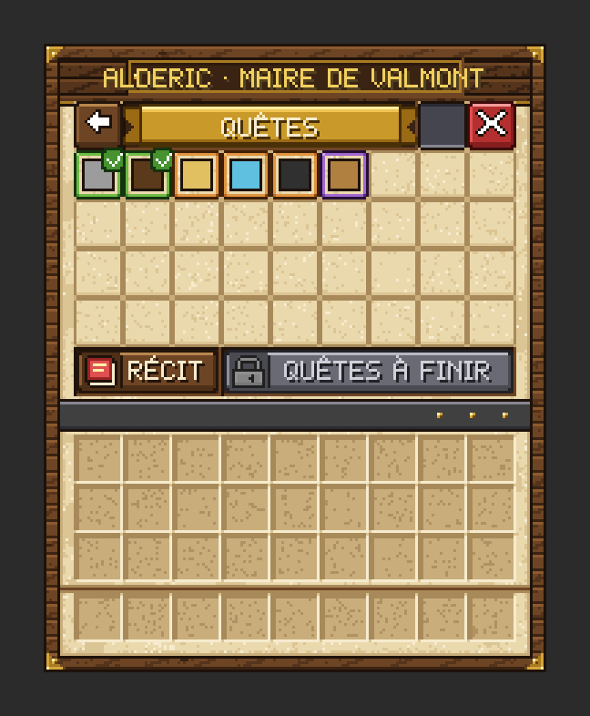
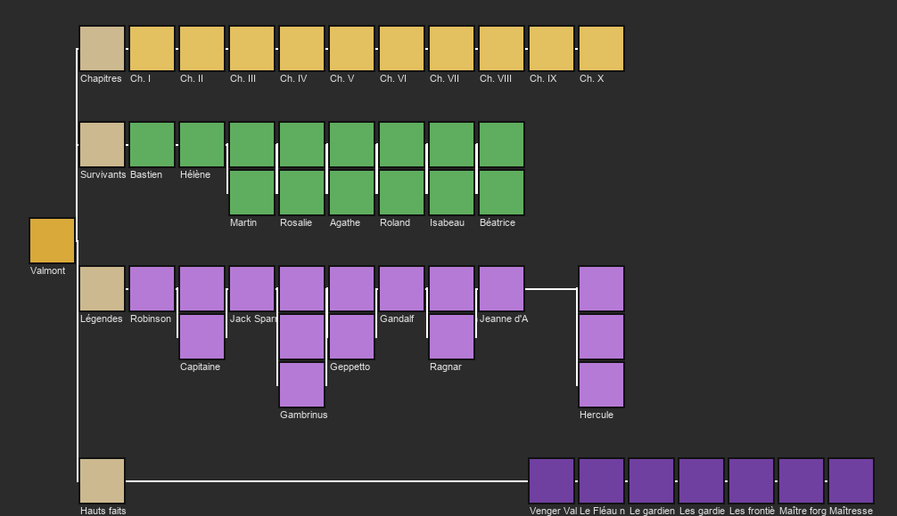

# La trame principale

La renaissance de Valmont se raconte en **dix chapitres**. Chacun fait passer la ville à un nouveau **palier**, du simple Campement jusqu'à la Capitale. L'histoire suit la progression naturelle de Minecraft : on commence par survivre et s'installer, puis on développe les métiers, jusqu'à affronter les plus grands dangers du monde.
{ .chapeau }

!!! info "La progression est collective"

    Tous les joueurs travaillent sur les mêmes chapitres et les mêmes quêtes. Peu importe qui fait quoi : chaque effort compte pour toute la ville.

## 1. Les paliers de la ville

<ol class="vm-frise" markdown>
<li markdown>**Campement**</li>
<li markdown>**Hameau**</li>
<li markdown>**Village**</li>
<li markdown>**Bourg**</li>
<li markdown>**Ville**</li>
<li markdown>**Ville franche**</li>
<li markdown>**Cité**</li>
<li markdown>**Grande cité**</li>
<li markdown>**Citadelle**</li>
<li markdown>**Capitale**, le plus haut palier</li>
</ol>

Le palier actuel s'affiche dans le panneau de la touche ++tab++ et en haut du menu d'Alderic.

## 2. Comment se déroule un chapitre

1. **Alderic raconte.** À l'ouverture de chaque chapitre, Alderic fait le récit de la suite de l'histoire, lettre par lettre, à tous les joueurs connectés. Vous pouvez le réécouter depuis son menu (bouton **Récit d'Alderic**, ou **RÉCIT** dans ses quêtes). Seul le récit du chapitre en cours se réécoute en jeu ; ils sont tous recopiés sur la page d'[Alderic](../personnages/alderic.md).
2. **La ville a des objectifs.** Le menu **Quêtes de la cité** d'Alderic liste les quêtes du chapitre. Survolez-en une pour lire son objectif et sa progression.
3. **On les accomplit ensemble.** Une quête terminée le reste, même si la situation change ensuite (parcelle rendue, bâtiment supprimé, stock vendu).
4. **On signe la charte.** Quand toutes les quêtes obligatoires sont faites, le bouton des quêtes porte la mention **[PRÊT]**. Il ne reste qu'à signer la charte, c'est-à-dire **payer son prix depuis la caisse de la ville**.
5. **La ville passe au palier suivant.** Le nouveau palier s'affiche en grand titre pour tous, une fanfare retentit, la ville reçoit des **emplacements de parcelles offerts**, et Alderic raconte la suite…

<figure markdown>
  { width="320" loading="lazy" }
  <figcaption>Le menu « Quêtes de la cité » — illustration, données d'exemple</figcaption>
</figure>

## 3. Les types de quêtes de la cité

| Type | Ce qu'il faut faire | Comment ça compte |
|---|---|---|
| **Territoire** | Atteindre un nombre de parcelles (chunks) | Nombre total de parcelles de la ville |
| **Bâtiments** | Atteindre un nombre de bâtiments déclarés | Tous les types de bâtiments comptent |
| **Recruter** | Retrouver un survivant, le ramener en ville et l'installer dans son atelier | Terminée à l'installation (voir [Retrouver un personnage](../personnages/recrutement.md)) |
| **Livrer au chantier** | Apporter une quantité de matériaux | Voir ci-dessous |
| **Réserve** | Remplir le stock d'un artisan jusqu'à un seuil | Vendez-lui la ressource demandée ; acquis dès que le seuil est atteint |
| **Rang** | Faire progresser un artisan jusqu'à un rang donné | Commercez avec lui et faites ses quêtes |
| **Chasse** | Abattre des créatures | Les créatures tuées par **n'importe quel joueur** comptent, pendant le chapitre en cours |

### Livrer au chantier

Dans le menu des quêtes d'Alderic, sur une quête de livraison :

- **Clic gauche** : vous livrez depuis votre inventaire tout ce qui est accepté, jusqu'à la quantité restante. Les objets achetés aux artisans sont acceptés ici.
- ++shift++ **+ clic droit : réquisitionner.** Le chantier **puise gratuitement dans les entrepôts des artisans**, la réserve de la ville, en commençant par les plus gros stocks. Le survol indique combien d'unités sont disponibles chez les artisans.

Les deux méthodes se combinent : chaque livraison s'ajoute au total.

### La chasse collective

« Monstres » désigne toute créature hostile ; certaines quêtes visent une créature précise (pillards, blazes…). À chaque créature qui compte, vous voyez l'avancement au-dessus de votre barre d'objets, par exemple « 🏰 Les abords sûrs — 12/50 ».

## 4. Les quêtes bonus ★

Certaines quêtes sont marquées d'une **★** : elles sont **facultatives**.

- Elles **ne bloquent jamais** la signature de la charte.
- Une quête bonus non terminée **reste proposée** dans les chapitres suivants : rien n'est perdu si vous passez à la suite.
- Elles mènent aux **rencontres des légendes de passage** et aux **hauts faits** réservés aux plus aventureux.
- Chaque chapitre accueille une à trois légendes, sauf le chapitre IX, volontairement sans recrue. Onze d'entre elles sont liées à un mod du serveur : sans ce mod, elles se recrutent et s'installent quand même, mais ne commercent pas (voir [Mods et plugins](../serveur/mods-et-plugins.md#les-mods-de-contenu)).

## 5. La charte

La charte se signe dans **Quêtes de la cité**, en bas à droite. Son bouton change selon la situation :

| Bouton | Signification |
|---|---|
| { .vm-ui } | Il reste des quêtes obligatoires (leur nombre est indiqué au survol) |
| { .vm-ui } | Les quêtes sont faites, mais la caisse ne couvre pas le prix |
| { .vm-ui } | Cliquez pour passer au chapitre suivant |
| { .vm-ui } | Valmont a atteint son plus haut palier |

La charte est payée par **la caisse de la ville**, jamais par votre bourse. Pensez à la remplir chez Alderic : **Trésor** → **Déposer des coins**.

| Passage | Prix de la charte | Emplacements offerts |
|---|---|---|
| Campement → Hameau | 150 coins | +10 |
| Hameau → Village | 400 coins | +12 |
| Village → Bourg | 800 coins | +15 |
| Bourg → Ville | 1 500 coins | +18 |
| Ville → Ville franche | 2 500 coins | +20 |
| Ville franche → Cité | 4 000 coins | +25 |
| Cité → Grande cité | 6 000 coins | +28 |
| Grande cité → Citadelle | 8 500 coins | +32 |
| Citadelle → Capitale | 12 000 coins | +40 |
| **Total** | **35 850 coins** | **+200** |

Les emplacements offerts ne font **pas** monter le prix des emplacements que vous achetez ensuite chez Alderic.

## 6. Suivre la progression : la touche L

La vue d'ensemble de Valmont se trouve dans le **menu Progrès** de Minecraft (touche ++l++), onglet **« La Renaissance de Valmont »**. Il est normalement sélectionné d'office. Sinon, cliquez sur son onglet ou tapez `/city progression`.

L'arbre part de l'étape « La Renaissance de Valmont » et se divise en **quatre lignes**, chacune dans l'ordre de l'histoire :

1. **Les chapitres** ;
2. **Les survivants de Valmont** ;
3. **Les légendes de passage** (★) ;
4. **Les hauts faits**.

Chaque personnage et chaque haut fait est placé **sous la colonne de son chapitre** : on voit tout de suite qui retrouver à quel moment. Quand un chapitre accueille plusieurs personnages, ils s'empilent l'un sous l'autre, jusqu'à trois légendes aux chapitres IV (Obélix, Miyamoto Musashi et Gambrinus) et X (Geralt de Riv, Harold et Hercule) ; la hauteur de chaque ligne s'adapte au chapitre le plus fourni.

| Étape | Ce qu'elle compte |
|---|---|
| **Chapitre** | Son ouverture, chacune de ses quêtes obligatoires et la signature de sa charte |
| **Personnage** | Trois étapes : **rencontré**, **arrivé en ville**, **installé** |
| **Haut fait** | Les créatures abattues, le rang atteint, ou un exploit unique |

- **Cadre gris** : étape à faire. **Cadre coloré** : étape accomplie.
- **Au survol**, la barre de titre se remplit et affiche l'avancement (par exemple « 3/7 »).
- La bulle d'une **légende liée à un mod** nomme ce mod, et précise s'il manque au serveur (« ni boutique ni quêtes ») ; celle de Robin des Bois, d'Indiana Jones ou de Gandalf signale le contenu en plus qu'apporte leur mod facultatif.
- Quand une étape est accomplie, chaque joueur connecté reçoit la notification habituelle de Minecraft.

C'est l'état **de la ville** qui s'affiche : tous les joueurs voient la même chose, et un nouveau venu découvre d'un coup tout ce que Valmont a déjà accompli.

!!! warning "Attention aux spoilers !"

    L'arbre est **entièrement visible dès le départ**, y compris les chapitres et les personnages à venir. Si vous préférez garder la surprise, évitez de survoler les étapes lointaines.

??? spoiler "Schéma de l'arbre de progression"

    <figure markdown>
      { loading="lazy" }
      <figcaption>Schéma de l'onglet de progression — ce n'est pas un rendu en jeu</figcaption>
    </figure>

## 7. Ce qui change au fil des chapitres

- Chaque palier offre de **nouveaux emplacements** et ouvre de **nouvelles rencontres**.
- De nouveaux artisans, ce sont de **nouveaux marchés** : de nouvelles ressources à vendre, de nouvelles fabrications à acheter.
- **À partir du chapitre II**, Alderic peut lever des expéditions contre des places lointaines : les **raids**. Les niveaux de difficulté suivants s'ouvrent au fil des chapitres et des victoires (voir [Les raids](raids.md)).
- **À partir du chapitre IV**, Valmont devient assez importante pour attirer les convoitises : les **sièges** commencent (voir [Les sièges](sieges.md)).
- Plus la ville grandit, plus ses quêtes et ses ennemis deviennent **ambitieux**.

## 8. Les dix chapitres en détail

Le premier chapitre est visible ci-dessous ; les suivants sont repliés pour préserver la surprise. Dépliez-les quand votre ville y arrive.

???+ abstract "Chapitre I — Les cendres et la charte · Campement"

    | Quête | Objectif | Type |
    |---|---|---|
    | Planter les jalons | Revendiquer 12 parcelles pour délimiter le campement | Territoire |
    | Le charbonnier des bois | Trouver [Bastien](../personnages/survivants/bastien.md) en forêt, le ramener et l'installer | Recruter |
    | Les premiers abris | Déclarer 2 bâtiments (maison commune, cabane du bûcheron…) | Bâtiments |
    | La palissade | Livrer 192 rondins (toutes essences, ni bûches écorcées ni tiges du Nether) | Livrer |
    | ★ L'homme de l'île | Ramener au campement un naufragé barbu qui vit seul sur la côte : [Robinson Crusoé](../personnages/legendes/robinson-crusoe.md) (mod Tough As Nails) | Bonus |

    Charte : **150 coins** → la ville devient **Hameau** (+10 emplacements). Avec le cadeau d'Alderic, la ville dispose dès le départ de 11 emplacements : il en reste un à acheter chez Alderic (50 coins).

??? spoiler "Chapitre II — Du pain pour l'hiver · Hameau"

    | Quête | Objectif | Type |
    |---|---|---|
    | Étendre les champs | Revendiquer 24 parcelles au total | Territoire |
    | La fermière des plaines | Trouver [Hélène](../personnages/survivants/helene.md), la ramener et l'installer dans une grange | Recruter |
    | Les maisons du hameau | Déclarer 4 bâtiments | Bâtiments |
    | Le grenier | Constituer une réserve de 384 blés dans le stock d'Hélène | Réserve |
    | ★ Le prince des voleurs | Gagner la confiance d'un archer hors-la-loi : [Robin des Bois](../personnages/legendes/robin-des-bois.md) | Bonus |
    | ★ Le vieux capitaine | Trouver un capitaine à la jambe d'ivoire qui pêche sur la rive : [le capitaine Achab](../personnages/legendes/capitaine-achab.md) (mod Tide) | Bonus |

    Charte : **400 coins** → la ville devient **Village** (+12 emplacements).

??? spoiler "Chapitre III — Les pierres et la rivière · Village"

    | Quête | Objectif | Type |
    |---|---|---|
    | Le village s'étend | Revendiquer 40 parcelles au total | Territoire |
    | Le tailleur errant | Trouver [Brennan](../personnages/survivants/brennan.md) dans les collines et lui offrir un atelier | Recruter |
    | Le passeur de la rivière | Trouver [Martin](../personnages/survivants/martin.md) sur les rives et l'installer près de l'eau | Recruter |
    | Le cœur du village | Déclarer 6 bâtiments | Bâtiments |
    | Les fondations | Livrer 320 pierres (cobblestone uniquement) | Livrer |
    | ★ Une voile à l'horizon | Ramener un capitaine pirate sans navire : [Jack Sparrow](../personnages/legendes/jack-sparrow.md) (mod Tax' Ocean Villager) | Bonus |

    Charte : **800 coins** → la ville devient **Bourg** (+15 emplacements).

??? spoiler "Chapitre IV — La Fosse et le Chaudron · Bourg"

    | Quête | Objectif | Type |
    |---|---|---|
    | Le bourg s'étend | Revendiquer 60 parcelles au total | Territoire |
    | Le mineur de la Fosse | Trouver [Godefroy](../personnages/survivants/godefroy.md) près des montagnes et lui offrir une mine | Recruter |
    | La tavernière | Trouver [Rosalie](../personnages/survivants/rosalie.md) sur les routes et lui ouvrir une taverne | Recruter |
    | Les échoppes du bourg | Déclarer 8 bâtiments | Bâtiments |
    | Réserve de charbon | Constituer une réserve de 256 charbons chez Godefroy | Réserve |
    | Le maître et ses apprentis | Brennan doit atteindre le rang Apprenti | Rang |
    | Les abords sûrs | Éliminer 50 monstres (tous joueurs confondus) | Chasse |
    | ★ Ils sont fous ces Valmontois | Offrir un festin à un géant moustachu qui porte un menhir : [Obélix](../personnages/legendes/obelix.md) (mods Wilder Nature et Farmer's Delight) | Bonus |
    | ★ La voie du sabre | Gagner le respect d'un rōnin qui défie les brigands : [Miyamoto Musashi](../personnages/legendes/miyamoto-musashi.md) (mod Epic Fight) | Bonus |
    | ★ Le roi de la bière | Offrir une brasserie, près de la taverne, à un roi en tablier de brasseur qui cueille le houblon des taïgas : [Gambrinus](../personnages/legendes/gambrinus.md) (mod Let's Do Brewery) | Bonus |

    Charte : **1 500 coins** → la ville devient **Ville** (+18 emplacements). Les **sièges** commencent à ce chapitre.

??? spoiler "Chapitre V — Le marteau et le métier · Ville"

    | Quête | Objectif | Type |
    |---|---|---|
    | Les faubourgs | Revendiquer 85 parcelles au total | Territoire |
    | Le forgeron du nord | Trouver [Thorvald](../personnages/survivants/thorvald.md) dans les terres enneigées et lui offrir une forge | Recruter |
    | La teinturière | Trouver [Agathe](../personnages/survivants/agathe.md) parmi les fleurs et installer son métier à tisser | Recruter |
    | Les ateliers | Déclarer 10 bâtiments | Bâtiments |
    | Les remparts | Livrer 640 briques de pierre (toutes variantes) | Livrer |
    | L'arsenal | Constituer une réserve de 192 lingots de fer chez Thorvald | Réserve |
    | La Fosse s'agrandit | Godefroy doit atteindre le rang Apprenti | Rang |
    | ★ L'archéologue | Attirer un aventurier au chapeau de feutre : [Indiana Jones](../personnages/legendes/indiana-jones.md) | Bonus |
    | ★ Le menuisier et sa marionnette | Retrouver un vieil ébéniste qui cherche du bon bois : [Geppetto](../personnages/legendes/geppetto.md) (mods Handcrafted et Furniture) | Bonus |

    Charte : **2 500 coins** → la ville devient **Ville franche** (+20 emplacements).

??? spoiler "Chapitre VI — Les routes et la garde · Ville franche"

    | Quête | Objectif | Type |
    |---|---|---|
    | La ville franche | Revendiquer 110 parcelles au total | Territoire |
    | Le maître des écuries | Trouver [Edmond](../personnages/survivants/edmond.md) dans la savane et lui bâtir des écuries | Recruter |
    | Le sergent sans compagnie | Trouver [Roland](../personnages/survivants/roland.md) sur les routes et lui confier la garde de la ville | Recruter |
    | Les quartiers | Déclarer 12 bâtiments | Bâtiments |
    | Les routes marchandes | Chasser 15 pillards | Chasse |
    | La milice | Éliminer 150 monstres (un pillard compte aussi pour la quête précédente) | Chasse |
    | Le maître forgeron | Thorvald doit atteindre le rang Compagnon | Rang |
    | Les bannières de la ville | Agathe doit atteindre le rang Apprentie | Rang |
    | ★ Le magicien gris | Offrir une tour à un vieil homme en gris qui marche sur les routes : [Gandalf](../personnages/legendes/gandalf.md) (contenu en plus avec Iron's Spells 'n Spellbooks) | Bonus |

    Charte : **4 000 coins** → la ville devient **Cité** (+25 emplacements).

??? spoiler "Chapitre VII — La foi et le savoir · Cité"

    | Quête | Objectif | Type |
    |---|---|---|
    | La cité | Revendiquer 140 parcelles au total | Territoire |
    | L'ermite de Saint-Clair | Trouver [frère Anselme](../personnages/survivants/frere-anselme.md) dans son ermitage et lui bâtir une infirmerie | Recruter |
    | L'archiviste | Trouver [Isabeau](../personnages/survivants/isabeau.md) et offrir un scriptorium à ses archives | Recruter |
    | L'abbaye et le scriptorium | Déclarer 14 bâtiments | Bâtiments |
    | La bibliothèque | Livrer 24 bibliothèques (blocs) | Livrer |
    | ★ L'inventeur fou | Offrir un laboratoire à un savant tombé du ciel : [Doc Brown](../personnages/legendes/doc-brown.md) | Bonus |
    | ★ Une voile carrée sur la rivière | Convaincre le chef d'un drakkar de commercer plutôt que de piller : [Ragnar](../personnages/legendes/ragnar.md) (mod Small Ships) | Bonus |

    Charte : **6 000 coins** → la ville devient **Grande cité** (+28 emplacements).

??? spoiler "Chapitre VIII — L'or, le verre et le feu · Grande cité"

    | Quête | Objectif | Type |
    |---|---|---|
    | La grande cité | Revendiquer 175 parcelles au total | Territoire |
    | Le verrier du désert | Trouver [Léon](../personnages/survivants/leon.md) dans les dunes | Recruter |
    | L'orfèvre | Trouver [Béatrice](../personnages/survivants/beatrice.md) près des terres d'or et lui ouvrir un comptoir | Recruter |
    | Le parvis de la cathédrale | Déclarer 16 bâtiments | Bâtiments |
    | Les vitraux de la cathédrale | Livrer 256 blocs de verre teinté, toutes couleurs (les vitres ne comptent pas) | Livrer |
    | La cloche de la cathédrale | Livrer 1 cloche | Livrer |
    | Le trésor de la cité | Constituer une réserve de 128 lingots d'or chez Béatrice | Réserve |
    | Les gardiens de feu | Abattre 20 blazes dans les forteresses du Nether | Chasse |
    | ★ La Pucelle | Offrir un quartier général à une jeune femme en armure qui mène une compagnie vers la cathédrale : [Jeanne d'Arc](../personnages/legendes/jeanne-d-arc.md) (mod Valarian Conquest) | Bonus |

    Charte : **8 500 coins** → la ville devient **Citadelle** (+32 emplacements).

??? spoiler "Chapitre IX — La Porte du Néant · Citadelle"

    | Quête | Objectif | Type |
    |---|---|---|
    | Les clés de la Porte | Livrer 12 yeux de l'Ender pour rouvrir la Porte du Néant | Livrer |
    | Les lames de la vengeance | Thorvald doit atteindre le rang Expert | Rang |
    | Les potions de la Porte | Frère Anselme doit atteindre le rang Compagnon | Rang |
    | La garde de Valmont | Roland doit atteindre le rang Compagnon | Rang |
    | Venger Valmont | Terrasser le dragon de l'Ender, celui qui a brûlé Valmont | Chasse |

    Ce chapitre n'a ni quête de territoire, ni quête de bâtiments, ni recrue, pas même une légende. Le dragon ne compte que s'il est abattu pendant ce chapitre. Charte : **12 000 coins** → la ville devient **Capitale** (+40 emplacements).

??? spoiler "Chapitre X — La nouvelle Valmont · Capitale"

    Toutes les quêtes de ce dernier chapitre sont **facultatives** : des hauts faits et trois dernières légendes.

    | Quête | Objectif | Type |
    |---|---|---|
    | ★ Le Fléau noir | Invoquer et terrasser le Wither | Haut fait |
    | ★ Le gardien des profondeurs | Abattre un Warden dans une cité antique | Haut fait |
    | ★ Les gardiens des abysses | Terrasser 3 gardiens des abysses | Haut fait |
    | ★ Les frontières du royaume | Revendiquer 300 parcelles au total | Haut fait |
    | ★ Maître forgeron | Thorvald atteint le rang Maître | Haut fait |
    | ★ Maîtresse orfèvre | Béatrice atteint le rang Maître | Haut fait |
    | ★ Le sorceleur | Trouver un chasseur de monstres dans les marais : [Geralt de Riv](../personnages/legendes/geralt-de-riv.md) | Bonus |
    | ★ Le dompteur de dragons | Trouver un jeune Viking sur les sommets glacés : [Harold](../personnages/legendes/harold.md) (mod Dragon Mounts Remastered) | Bonus |
    | ★ Les travaux du héros | Trouver un colosse vêtu d'une peau de lion qui cherche des monstres dignes de lui : [Hercule](../personnages/legendes/hercule.md) (mod Mowzie's Mobs) | Bonus |

    Pas de charte : Valmont est la capitale des Marches.

!!! tip "Prévoir l'achat d'emplacements"

    Valmont est pensée comme une grande ville : les chartes offrent la plus grande part des emplacements, et le reste s'achète à petit prix auprès d'Alderic (voir [Le territoire](territoire.md#obtenir-plus-demplacements)).

    | Chapitre | Parcelles demandées | Emplacements sans aucun achat | Achats cumulés nécessaires | Coût cumulé des achats |
    |---|---|---|---|---|
    | I | 12 | 11 | 1 | 50 coins |
    | II | 24 | 21 | 3 | 155 coins |
    | III | 40 | 33 | 7 | 384 coins |
    | IV | 60 | 48 | 12 | 709 coins |
    | V | 85 | 66 | 19 | 1 255 coins |
    | VI | 110 | 86 | 24 | 1 721 coins |
    | VII | 140 | 111 | 29 | 2 261 coins |
    | VIII | 175 | 139 | 36 | 3 165 coins |
    | X (haut fait ★) | 300 | 211 | 89 | 16 852 coins |

    Au total, **36 emplacements achetés** (environ 3 200 coins) suffisent jusqu'au chapitre VIII, et 89 pour le haut fait « Les frontières du royaume ».
