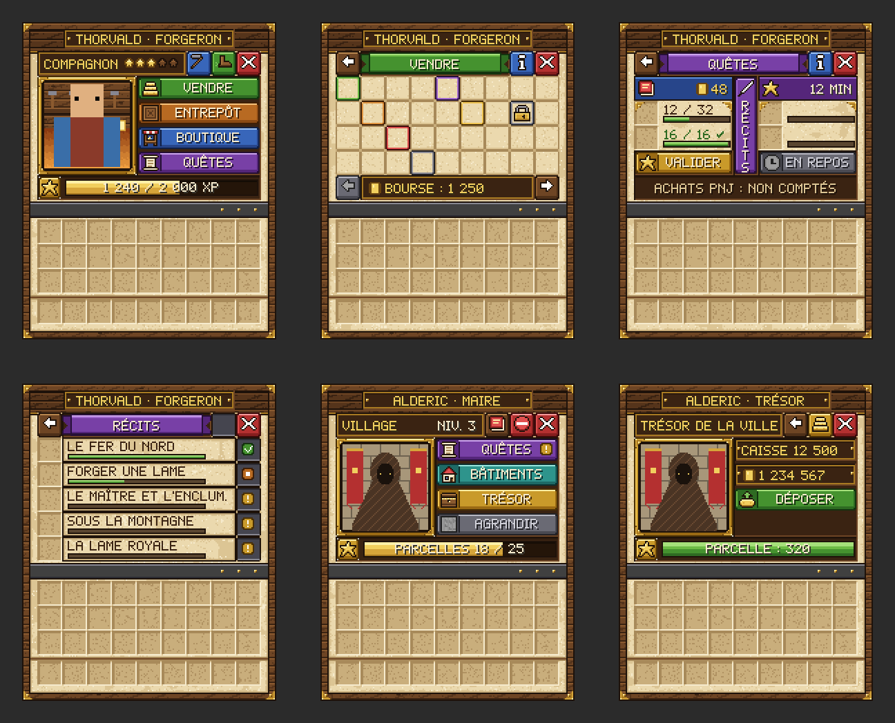

MyCivilisation · Serveur Minecraft médiéval et coopératif

# Valmont

Une cité réduite en cendres. Tout un serveur pour la rebâtir.

[Rejoindre le serveur](serveur/index.md){ .md-button .md-button--primary }
[Premiers pas](guide/index.md){ .md-button }
[L'histoire](histoire/index.md){ .md-button }

Il y a vingt hivers, un dragon venu du Néant a réduit en cendres **Valmont**, la perle des Marches. Ses artisans se sont dispersés dans les terres sauvages, et seul son intendant, **Alderic**, a sauvé des flammes la **Charte de la ville**. Sur **MyCivilisation**, tous les joueurs bâtissent **ensemble une seule et même cité** : retrouvez les survivants, installez-les dans des ateliers construits pour eux, commercez avec eux et faites renaître Valmont, chapitre après chapitre, du simple campement jusqu'à la capitale.
{ .lettrine }

## L'essentiel en 30 secondes

-   { .vm-icone } **Une seule ville pour tous**

    ---

    Les chapitres, la caisse, les stocks des marchands et la progression sont **partagés** par tous les joueurs. Chaque effort compte pour toute la ville.

-   { .vm-icone } **Alderic, le maire**

    ---

    Votre point de départ : il donne les **quêtes de la cité**, gère la **caisse**, vend les nouvelles **parcelles** et lève les **raids**. Un clic droit sur lui suffit.

-   { .vm-icone } **Des artisans à retrouver**

    ---

    Les survivants de Valmont vivent cachés dans le monde. **Retrouvez-les**, ramenez-les et **construisez-leur un atelier** : ils ouvrent alors leur commerce.

-   { .vm-icone } **Dix chapitres**

    ---

    Du **Campement** à la **Capitale**, l'histoire suit la progression naturelle de Minecraft : le bois, le pain, la pierre, la mine, la forge… et bien plus loin.

-   { .vm-icone } **En ville, vous êtes protégé**

    ---

    Pas de dégâts, pas d'explosion, pas d'incendie. **Une seule exception : les sièges**, chaque soir à 22 h à partir du chapitre IV.

-   { .vm-icone } **Trois réflexes**

    ---

    Un clic droit sur les personnages pour agir, ++l++ pour la progression de la ville, ++tab++ pour l'état de la ville et le vôtre. `/city` (ou `/c`) sert aux consultations.

## Explorer le guide

-   **[Le serveur](serveur/index.md)**

    Se connecter, installer le pack de ressources, connaître les mods et plugins utilisés.

-   **[L'histoire de Valmont](histoire/index.md)**

    La Nuit Noire, la Charte d'Alderic, les Chroniques de Valmont et le lexique des Marches.

-   **[Guide du joueur](guide/index.md)**

    Premiers pas, chapitres et charte, territoire, bâtiments, commerce, habitants, garde, sièges et raids.

-   **[Les personnages](personnages/index.md)**

    Alderic, les quatorze survivants et les seize légendes de passage : où les trouver, ce qu'ils achètent et vendent.

-   **[Commandes](aide/commandes.md)**

    Toutes les commandes `/city` des joueurs, et tout ce qui se fait sans commande.

-   **[Foire aux questions](aide/faq.md)**

    Les réponses aux questions les plus fréquentes, du recrutement aux sièges.

<figure markdown>
  { width="760" loading="lazy" }
  <figcaption>Les menus illustrés du pack de ressources « Valmont » — illustration, données d'exemple</figcaption>
</figure>

!!! info "Les chiffres de ce guide"

    Les prix, délais et quantités indiqués sont les **réglages par défaut** du serveur. L'équipe peut les ajuster : en cas de doute, le jeu fait foi.
