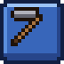
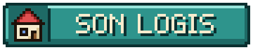
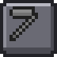
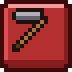

# Travailler avec les artisans

Une fois installé, un artisan ouvre son commerce. Vous pouvez lui vendre vos ressources, lui acheter ses fabrications, faire ses quêtes et ses récits, et même travailler pour lui.
{ .chapeau }

## 1. Commercer avec un artisan installé

Un clic droit sur un artisan installé ouvre son **écran d'accueil** :

{ .vm-fiche__decor }

| Élément | Rôle |
|---|---|
| **Rang et étoiles** | Son niveau de maîtrise, de Novice à Maître |
| { .vm-ui } | Vendez-lui les ressources de son domaine |
| { .vm-ui } | Servez-vous gratuitement dans son stock, la réserve de la ville (objets non revendables) |
| { .vm-ui } | Achetez ses fabrications et ses raretés |
| { .vm-ui } | Sa quête principale, sa quête spéciale et ses récits |
| { .vm-icone } Métier | Devenez son employé (voir plus bas) |
| { .vm-icone } Suivre | Demandez-lui de vous accompagner (ou d'arrêter) |
| **Portrait** | Un clic ouvre la **gestion de son bâtiment** |
| **Barre du bas** | Son expérience jusqu'au prochain rang |

Le fonctionnement du marché (prix, stocks, objets marqués) est détaillé dans [Commerce et économie](../guide/commerce.md).

### La gestion du bâtiment (clic sur le portrait)

| Bouton | Ce qu'il affiche |
|---|---|
| { .vm-ui } | L'inspection détaillée de son atelier : exigences remplies (✔) ou manquantes (✘), bonus du métier présents ou à ajouter, points obtenus et ce qu'il faut pour le niveau suivant |
| { .vm-ui } | Les services que l'artisan rend à toute la ville : ses **employés**, des habitants qui remplissent son entrepôt, et leur **annexe de travail** (voir [Le travail des habitants](../guide/habitants.md#le-travail-des-habitants)). Le capitaine de la garde y forme aussi les gardes |
| { .vm-ui } | Son passé, raconté à nouveau |

Un nouveau clic sur le portrait ramène au commerce.

!!! tip "Pourquoi soigner l'atelier ?"

    Plus son niveau est élevé, plus **l'entrepôt de l'artisan est grand** (+25 % de capacité par niveau au-delà du premier) : il peut stocker davantage et vous payer le prix plein plus longtemps.

## 2. Les rangs

Chaque artisan progresse sur **cinq rangs** :

| Rang | Nom |
|---|---|
| { .vm-etoiles } | Novice |
| { .vm-etoiles } | Apprenti |
| { .vm-etoiles } | Compagnon |
| { .vm-etoiles } | Expert |
| { .vm-etoiles } | Maître |

- **Le rang est commun à toute la ville** : chaque vente, chaque achat et chaque quête de chaque joueur le fait progresser.
- **Ce qu'un nouveau rang débloque** :
    - de **nouveaux articles** en boutique (les articles verrouillés affichent le rang requis) ;
    - des **quêtes plus grosses et mieux payées** (quantités et récompenses ×1 ; ×1,5 ; ×2 ; ×2,5 ; ×3 au rang Maître) ;
    - de nouveaux objets dans ses quêtes ;
    - un **nouveau récit** ;
    - parfois, de nouveaux **services** pour la ville.
- Certaines quêtes de la cité demandent qu'un artisan atteigne un rang donné.

### Gagner de l'expérience pour un artisan

| Action | Expérience gagnée par l'artisan |
|---|---|
| Lui vendre des ressources | 1 XP par coin reçu + 1 XP par lot vendu (2 XP par lot chez Brennan et Léon) |
| Lui acheter un article en boutique | 1 XP par coin dépensé |
| Valider sa **quête principale** | 20 à 30 XP × son rang actuel, selon l'artisan |
| Valider sa **quête spéciale** | 50 à 70 XP × son rang actuel, selon l'artisan |
| Remporter un siège (Roland uniquement) | 40 + 10 × chapitre de la ville |

Exemple : vendre une pile de 64 bûches de chêne à Bastien (20 coins, 4 lots) lui rapporte 24 XP.

??? info "Expérience totale nécessaire pour chaque rang"

    | Artisans | Apprenti | Compagnon | Expert | Maître |
    |---|---|---|---|---|
    | Brennan, Léon | 200 | 800 | 2 500 | 6 000 |
    | Bastien, Hélène, Martin, Agathe | 300 | 1 200 | 3 500 | 8 000 |
    | Robin des Bois | 400 | 1 500 | 4 500 | 10 000 |
    | Godefroy, Rosalie, Edmond, Roland, Frère Anselme, Isabeau, Robinson Crusoé, Capitaine Achab, Jack Sparrow, Obélix, Miyamoto Musashi, Gambrinus, Indiana Jones, Geppetto, Doc Brown, Ragnar, Jeanne d'Arc | 500 | 2 000 | 5 500 | 12 000 |
    | Thorvald | 600 | 2 500 | 7 000 | 15 000 |
    | Harold, Hercule | 600 | 2 400 | 6 000 | 13 000 |
    | Béatrice, Gandalf, Geralt de Riv | 800 | 3 000 | 8 000 | 18 000 |

## 3. Devenir l'employé d'un artisan

Dans l'écran d'accueil d'un artisan, l'icône **métier** { .vm-icone } vous permet de **travailler pour lui** :

| Avantage | Valeur |
|---|---|
| Vos ventes à cet artisan | **+10 %** |
| Vos achats dans sa boutique | **−15 %** |

- **Un seul métier à la fois**, et l'avantage ne vaut qu'auprès de **votre** artisan. Chez les autres, l'icône est grisée : { .vm-icone }
- Vous pouvez le quitter à tout moment, sans frais, avec la même icône : { .vm-icone }
- Votre métier s'affiche dans le panneau de la touche ++tab++.

Choisissez l'artisan à qui vous vendez le plus !

## 4. Les quêtes des artisans

Chaque artisan installé propose **à chaque joueur** deux quêtes à la fois :

| | 📖 Quête principale | ✦ Quête spéciale |
|---|---|---|
| Contenu | En général deux ressources liées à son métier | Des objets plus rares et/ou des **créatures à chasser** |
| Récompense | Valeur des objets demandés **× 1,25** | Valeur des objets et créatures **× 1,5** |
| Délai avant la suivante | **20 minutes** | **60 minutes** |

**Déroulement :**

1. Ouvrez **Quêtes** chez l'artisan et cliquez sur { .vm-ui }
2. Réunissez les objets dans votre inventaire. **La progression se met à jour quand vous fermez votre inventaire.** Pour la chasse, seules les créatures que **vous** abattez comptent.
3. Le panneau des quêtes affiche **« ★ Voir … ! »** quand tout est prêt : retournez voir l'artisan et cliquez sur { .vm-ui }

!!! info "À savoir"

    - **Les objets achetés à un artisan, pris dans un entrepôt ou fabriqués avec ne comptent pas** pour les quêtes des artisans.
    - Les objets livrés rejoignent le stock de l'artisan, s'il les rachète.
    - Le délai est **propre à chaque joueur et à chaque artisan** : enchaînez les quêtes de plusieurs artisans pour ne jamais attendre.
    - Les quêtes paient **toujours au prix plein**, même quand l'entrepôt de l'artisan déborde. C'est souvent la meilleure façon de gagner des coins.

## 5. Les récits

Chaque personnage propose **cinq récits**, un par rang. Ce sont des quêtes personnelles liées à son métier et à son histoire : explorer un paysage précis, obtenir un succès Minecraft, pêcher, élever, fabriquer, chasser, rapporter un objet…

- Ils sont **à votre nom** et ne se font **qu'une seule fois**.
- Ils rapportent de **30 à 1 000 coins** selon leur difficulté.
- Les récits d'un rang pas encore atteint apparaissent **verrouillés** (cadenas et rang requis).
- Un succès Minecraft que vous possédez déjà compte pour le récit.
- Pour accepter un récit : **Quêtes → RÉCITS**, puis cliquez sur la ligne marquée **!**.
- **Les récits « Rapporter… »** demandent de remettre des objets au personnage, **en personne** : ouvrez ses récits depuis son propre menu (pas depuis le journal de quêtes) et cliquez sur le récit en cours quand vous avez tout sur vous. Si vous avez déjà les objets au moment d'accepter, ils sont remis aussitôt. Les objets achetés à un PNJ ou pris dans une réserve sont refusés.
- **Les légendes liées à un mod** n'ont de récits que si leur mod est installé. Robin des Bois et Indiana Jones gagnent des récits supplémentaires avec leurs mods facultatifs, et Gambrinus en propose six (deux au rang Apprenti) : au-delà de cinq récits, l'écran les affiche quatre par page, avec des flèches.

| Pastille | Signification |
|---|---|
| { .vm-icone } | Accompli |
| { .vm-icone } | En cours |
| { .vm-icone } | À accepter |

Le **journal de quêtes** (`/city quests recits`) rassemble les récits de tous les personnages. Chaque fiche de personnage détaille ses cinq récits.
