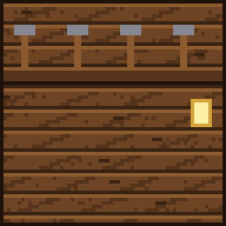

# Geppetto

{ .vm-fiche__decor }

✦ Maître ébéniste ✦

| | |
|---|---|
| Statut | Légende ★ |
| Chapitre | V — Le marteau et le métier (quête bonus ★, facultative) |
| Domaine | Le bois et le mobilier |
| Où le trouver | Forêts, forêts de bouleaux, forêts fleuries et prés, à 300–600 blocs de la ville |
| Atelier | Une échoppe d'ébéniste |

!!! info "Personnage lié à deux mods"

    Geppetto est lié à **deux** mods de mobilier : **Handcrafted** (chaises, tables, bancs, coussins, commodes…) et **Furniture** (horloges, lampes, aquariums, télescope…). Il faut les deux : s'il en manque un seul, il se recrute et s'installe normalement, mais il **ne commerce pas** et **ne donne ni quêtes ni récits**. Quand vous lui parlez, il récite un dialogue (« Sans mes gabarits ni mes outils fins, je ne fais que des bancs grossiers. ») à la place de son menu, et le chat précise en gris :

    > (Les mods Handcrafted et Furniture ne sont pas tous les deux installés sur ce serveur : Geppetto ne peut ni commercer ni confier de quêtes.)

    Pour en savoir plus sur ces mods : [Mods et plugins](../../serveur/mods-et-plugins.md#les-mods-de-contenu).

> Il a taillé un pantin dans une bûche qui parlait. Depuis, il cherche son fils de bois sur toutes les routes.
>
> — *Sa biographie en jeu*

Geppetto n'est pas un survivant de Valmont : c'est un vieil ébéniste parti à la recherche d'un pantin au nez un peu long. Une ville qui se rebâtit a besoin de chaises, de tables et de lits : il rachète **le bois et la laine**, et vend les **meubles** de Handcrafted et de Furniture, des chaises en chêne au télescope. Aucun artisan ne dépend de lui pour avancer dans l'histoire.

## Le retrouver

| | |
|---|---|
| Quête de la cité | **★ Le menuisier et sa marionnette** (bonus, à partir du chapitre V) |
| Objectif | « [Bonus] Un vieil ébéniste cherche du bon bois... et une marionnette qui a pris la fuite. » |
| Paysages | Forêt, forêt de bouleaux, forêt fleurie, pré |
| Distance | Entre 300 et 600 blocs du centre de la ville |

Au chapitre V, Alderic l'annonce : « Un vieil artisan sculpte des pantins au coin du feu, sur la route du sud. Il paraît que l'un d'eux s'est enfui. »

Lancez les recherches depuis **Alderic → Quêtes de la cité**, puis suivez la barre « 🗺 Geppetto » en haut de l'écran. Au-delà de 500 blocs, la barre reste vide : avancez vers les forêts et les prés jusqu'à ce qu'elle commence à se remplir. Le déroulement complet est expliqué dans [Retrouver et installer un personnage](../recrutement.md). Le recrutement fonctionne **même sans les mods**.

C'est une **quête bonus** : elle ne bloque jamais la signature de la charte. Si vous ne la terminez pas au chapitre V, elle reste proposée dans les quêtes de la cité aux chapitres suivants, jusqu'à ce qu'elle soit faite (voir [Les quêtes bonus](../../guide/trame.md#4-les-quetes-bonus)). Dans l'écran des progrès (touche ++l++), Geppetto figure sur la ligne **Les légendes de passage**, et sa bulle rappelle les mods dont il dépend.

!!! tip "Préparez son échoppe pendant le voyage"

    Dès qu'un joueur l'a rencontré, vous pouvez déclarer un atelier **réservé à Geppetto** et le préparer pendant qu'il fait la route jusqu'à la ville.

!!! dialogue "Geppetto, à la première rencontre"

    Vous n'auriez pas vu un petit pantin au nez un peu... long ?

    Une ville qui se rebâtit a besoin de chaises, de tables, de lits. Je sais faire tout cela.

    Emmenez-moi. Si mon garçon passe par votre ville, je veux y être.

## Son atelier

Un bâtiment de type **Atelier**, libre ou réservé à Geppetto (nom proposé : `Echoppe_d_ebeniste`).

| Exigence | Quantité |
|---|---|
| Établi | 1 |
| Meule | 1 |
| Planches (toutes essences) | 16 |
| Exigences communes | 1 porte, un toit sur 60 % du sol, 2 sources de lumière |

- **Bonus du métier** (+5 points chacun) : table (Handcrafted, toutes essences), horloge comtoise (Furniture, toutes essences), lampe (Furniture, toutes couleurs).
- Les blocs requis sont tous du jeu de base : l'échoppe se construit même sans les mods.

!!! dialogue "Geppetto, une fois installé"

    Un établi, des copeaux, l'odeur du bois. Je suis chez moi.

    Apportez-moi du bon bois : je vous ferai des meubles dignes d'un roi.

!!! dialogue "Geppetto, une fois installé (sans les mods)"

    Mes gabarits... mes outils fins... tout est resté en route.

    Je ne peux faire que des bancs grossiers.

## Ce qu'il rachète

Les prix sont ceux d'un **lot complet**, au prix plein (entrepôt rempli à moins de 40 %). La taille du lot change d'un objet à l'autre. Pour les familles (planches, bûches, laine), chaque essence ou couleur a son propre entrepôt. Au menu **Entrepôt**, vous vous servez **gratuitement** dans son stock, qui fait partie de la réserve de la ville (clic : un lot, ++shift++ + clic : une pile) ; ce que vous y prenez, et ce que vous en fabriquez, est marqué non revendable.

| Ressource (nom affiché) | Lot | Prix plein du lot | Entrepôt de base |
|---|---|---|---|
| Bûche de cerisier (« Cherry Log ») | 16 | 7 coins | 256 |
| Planches, toutes essences (« Oak Planks »…) | 64 | 6 coins | 2 048 par essence |
| Bûches et bois des arbres du monde normal, écorcés ou non (« Oak Log »…) | 32 | 8 coins | 1 024 par essence |
| Laine, toutes couleurs (« White Wool »…) | 8 | 4 coins | 256 par couleur |

## Ce qu'il vend

Le prix est celui **d'un achat**, qui donne la quantité indiquée. Les meubles fabriqués puisent leurs planches et leur laine dans son stock : s'il est vide, l'article est en rupture. Les articles **limités** se reconstituent avec le temps, en temps réel. Les objets des mods s'affichent sous leur nom français.

=== "★ Novice"

    | Article | Prix | Quantité | Matières ou disponibilité |
    |---|---|---|---|
    | Chaise en chêne | 12 coins | 1 | 6 planches de son stock |
    | Table en chêne | 18 coins | 1 | 8 planches de son stock |
    | Banc en chêne | 14 coins | 1 | 6 planches de son stock |
    | Marteau d'ébéniste | 20 coins | 1 | Limité : 1, +1 toutes les 4 h |

=== "★★ Apprenti"

    | Article | Prix | Quantité | Matières ou disponibilité |
    |---|---|---|---|
    | Commode en chêne | 30 coins | 1 | 10 planches de son stock |
    | Placard en chêne | 32 coins | 1 | 10 planches de son stock |
    | Bureau en chêne | 35 coins | 1 | 12 planches de son stock |
    | Coussin blanc | 6 coins | 1 | 1 laine de son stock |
    | Coussin rouge | 6 coins | 1 | 1 laine de son stock |
    | Coussin bleu | 6 coins | 1 | 1 laine de son stock |

=== "★★★ Compagnon"

    | Article | Prix | Quantité | Matières ou disponibilité |
    |---|---|---|---|
    | Canapé en chêne | 45 coins | 1 | 12 planches et 2 laines de son stock |
    | Lit raffiné en chêne | 60 coins | 1 | Limité : 1, +1 toutes les 8 h |
    | Horloge en chêne | 40 coins | 1 | Limité : 1, +1 toutes les 8 h |
    | Lampe blanche | 25 coins | 1 | Limité : 2, +1 toutes les 4 h |
    | Lampe rouge | 25 coins | 1 | Limité : 2, +1 toutes les 4 h |

=== "★★★★ Expert"

    | Article | Prix | Quantité | Matières ou disponibilité |
    |---|---|---|---|
    | Horloge comtoise en chêne | 120 coins | 1 | Limité : 1, +1 toutes les 24 h |
    | Aquarium en fer | 150 coins | 1 | Limité : 1, +1 toutes les 24 h |
    | Tableau de maître | 60 coins | 1 | Limité : 1, +1 toutes les 12 h |

=== "★★★★★ Maître"

    | Article | Prix | Quantité | Matières ou disponibilité |
    |---|---|---|---|
    | Télescope | 300 coins | 1 | Limité : 1, +1 tous les 7 jours |
    | Armoire en chêne | 150 coins | 1 | Limité : 1, +1 tous les 3 jours |
    | **Pinocchio** (porte-armure renommé) | 50 coins | 1 | Limité : 1, +1 tous les 7 jours |

    - Pinocchio : *Un pantin de bois, bien sage. Son nez ne bouge pas. Pour l'instant.*

Tout achat porte la mention « Acheté chez Geppetto — non revendable ».

## Ses quêtes

Deux quêtes renouvelables par joueur, à accepter dans son menu **Quêtes** (seulement si les deux mods sont installés). Les quantités augmentent avec son rang (de ×1 au rang Novice à ×3 au rang Maître). Les objets achetés à un PNJ ou pris dans une réserve ne comptent pas. Le fonctionnement général est décrit dans [Travailler avec les artisans](../artisans.md#4-les-quetes-des-artisans).

=== "📖 Quête principale"

    Le bois de l'échoppe. Deux objectifs tirés au hasard. Récompense : valeur des objets × 1,25. Délai de 20 minutes avant la suivante.

    | Objet demandé | Novice | Apprenti | Compagnon | Expert | Maître | Valeur unitaire |
    |---|---|---|---|---|---|---|
    | Planches (toutes essences) | 64 | 96 | 128 | 160 | 192 | 0,094 coin |
    | Bûches (toutes essences, sauf cerisier) | 32 | 48 | 64 | 80 | 96 | 0,3125 coin |
    | Bâtons | 64 | 96 | 128 | 160 | 192 | 0,05 coin |
    | Laine (toutes couleurs) | — | 24 | 32 | 40 | 48 | 0,5 coin |
    | Bûches de cerisier | — | — | 32 | 40 | 48 | 0,4375 coin |

    Exemple : au rang Novice, « 64 planches + 32 bûches » rapporte **20 coins**.

=== "✦ Quête spéciale"

    Des meubles faits de vos mains. Deux objectifs tirés au hasard. Récompense : valeur × 1,5. Délai de 60 minutes avant la suivante.

    | Objectif | Novice | Apprenti | Compagnon | Expert | Maître | Valeur unitaire |
    |---|---|---|---|---|---|---|
    | Chaises (toutes essences) | 4 | 6 | 8 | 10 | 12 | 5 coins |
    | Tables (toutes essences) | 2 | 3 | 4 | 5 | 6 | 8 coins |
    | Coussins | — | 6 | 8 | 10 | 12 | 2 coins |
    | Lampes | — | — | 4 | 5 | 6 | 10 coins |
    | Horloge comtoise | — | — | — | 3 | 3 | 50 coins |

    Exemple : au rang Novice, « 4 chaises + 2 tables » rapporte **54 coins**.

!!! note "Quantités par rang"

    Quantité de base × coefficient du rang (×1 ; ×1,5 ; ×2 ; ×2,5 ; ×3), arrondie à l'unité la plus proche (une demie est arrondie vers le haut).

## Ses récits

Cinq quêtes personnelles, une par rang, à faire **une seule fois** (menu **Quêtes → Récits**). Un récit ne compte qu'une fois accepté.

| Rang | Récit | Objectif | Récompense |
|---|---|---|---|
| ★ Novice | 🪵 Un bon morceau de bois | **Rapporter** 16 bûches de cerisier | 100 coins |
| ★★ Apprenti | 🪑 La première chaise | **Rapporter** 4 chaises de Handcrafted que vous avez fabriquées (toutes essences) | 180 coins |
| ★★★ Compagnon | 🏠 Une maison meublée | Entrer dans une **habitation** de la ville qui contient au moins 6 blocs de meubles de Handcrafted ou de Furniture | 300 coins |
| ★★★★ Expert | 🕰 Le temps qui passe | **Rapporter** une horloge comtoise (toutes essences) | 450 coins |
| ★★★★★ Maître | 🤥 Le pantin qui voulait être un vrai garçon | **Rapporter** un porte-armure et une bûche de cerisier « qui parle », c'est-à-dire renommée à l'enclume | 900 coins |

- **Les récits « Rapporter… »** se remettent en personne : ouvrez ses récits depuis **son** menu (pas depuis le journal de quêtes) et cliquez sur le récit en cours quand vous avez les objets sur vous. Si vous les avez déjà en acceptant le récit, ils sont remis aussitôt. Les objets achetés à un PNJ ou pris dans une réserve sont refusés : son « Pinocchio » de boutique ne convient pas pour le dernier récit.
- **Une maison meublée** : le bâtiment doit être déclaré comme **Habitation**. Le jeu compte les blocs des deux mods posés dans sa zone, quelle que soit leur origine : des meubles achetés chez lui et posés comptent aussi.
- **Le pantin** : n'importe quel nom donné à la bûche à l'enclume convient. Ce récit remplace la recherche d'un Pinocchio caché, imaginée au départ.

## Ses rangs

Le rang de Geppetto est **commun à toute la ville** : chaque vente, achat et quête de chaque joueur le fait progresser.

| Rang | XP totale | Ce qui se débloque |
|---|---|---|
| ★ Novice | 0 | Chaise, table et banc en chêne, marteau d'ébéniste ; récit « Un bon morceau de bois » |
| ★★ Apprenti | 500 | Commode, placard et bureau en chêne, coussins ; récit « La première chaise » ; laine et coussins dans ses quêtes |
| ★★★ Compagnon | 2 000 | Canapé, lit raffiné et horloge en chêne, lampes ; récit « Une maison meublée » ; bûches de cerisier et lampes dans ses quêtes |
| ★★★★ Expert | 5 500 | Horloge comtoise, aquarium en fer, tableau de maître ; récit « Le temps qui passe » ; horloge comtoise dans ses quêtes |
| ★★★★★ Maître | 12 000 | Télescope, armoire en chêne, Pinocchio ; récit « Le pantin qui voulait être un vrai garçon » |

Pour lui faire gagner de l'expérience : lui vendre du bois ou de la laine (1 XP par lot + 1 XP par coin reçu), lui acheter des articles (1 XP par coin dépensé), valider ses quêtes (25 XP × son rang pour la principale, 60 XP × son rang pour la spéciale).

## Bon à savoir

- **Sans Handcrafted ou sans Furniture**, Geppetto s'installe mais n'ouvre ni boutique, ni entrepôt, ni quêtes, ni récits (voir l'encadré en haut de page). Il lui faut les deux.
- **Le cerisier au prix de Bastien** : il paie la bûche de cerisier comme [Bastien](../survivants/bastien.md), par lots de 16. Les autres bûches, il les prend par 32, moins cher que Bastien : vendez-les plutôt au bûcheron tant que son entrepôt n'est pas plein.
- **Ses meubles fabriqués** consomment les planches et la laine que vous lui vendez.
- **Pinocchio** est un porte-armure renommé, purement décoratif.
- Son entrepôt se vide d'environ 8 % de sa capacité par heure tant qu'un joueur est connecté, sans descendre sous le quart de celle-ci.
- Vous pouvez **travailler pour Geppetto** (un seul employeur à la fois) : +10 % sur vos ventes, −15 % sur vos achats chez lui.
