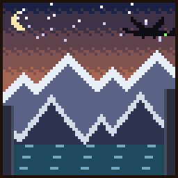
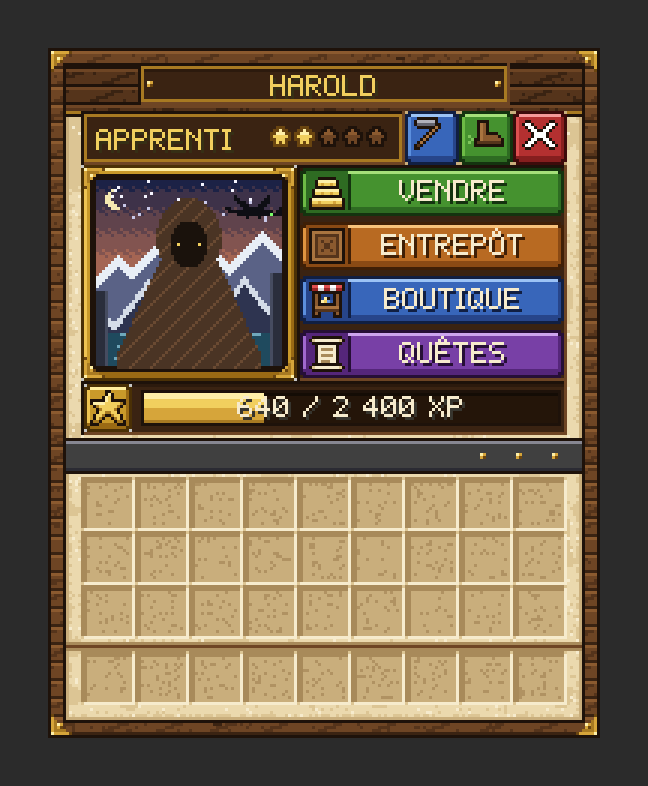

# Harold

{ .vm-fiche__decor }

✦ Dresseur de dragons ✦

| | |
|---|---|
| Statut | Légende ★ |
| Chapitre | X — La nouvelle Valmont (quête bonus ★, facultative) |
| Domaine | Les dragons : poisson, cuir et membranes rachetés ; selles, sifflets, potions et œuf de dragon vierge vendus |
| Où le trouver | Sommets des montagnes (pics, pentes enneigées, bosquets), à 550–1 100 blocs de la ville |
| Atelier | Un nid de dragon à ciel ouvert |

!!! info "Personnage lié à un mod"

    Harold est lié au mod **Dragon Mounts Remastered**, qui ajoute des dragons à élever et à monter. Sans ce mod, il se recrute et s'installe normalement, mais il **ne commerce pas** et **ne donne ni quêtes ni récits**. À la place de son menu, il récite un court dialogue, suivi en gris dans le chat de : « (Le mod Dragon Mounts Remastered n'est pas installé sur ce serveur : Harold ne peut ni commercer ni confier de quêtes.) ».

    Pour savoir si le mod est présent, consultez [Mods et plugins](../../serveur/mods-et-plugins.md#les-mods-de-contenu).

> Jeune Viking de Beurk, fils du chef. Il a prouvé qu'un dragon peut être un ami en soignant Krokmou, une Furie Nocturne à la queue blessée.
>
> — *Sa biographie en jeu*

Légende de passage du chapitre X, Harold veut prouver à Valmont qu'on peut **voler avec les dragons** plutôt que les combattre. Il rachète le **poisson**, le cuir et les membranes de phantom, et vend de quoi devenir dragonnier : selles, sifflets, potions et même un œuf de dragon vierge. Ses récits suivent le parcours du dragonnier, de l'œuf trouvé dans un coffre jusqu'au vol au-dessus des îles du bout du monde. Son recrutement est facultatif.

<figure markdown>
  { width="320" loading="lazy" }
  <figcaption>Le portrait de Harold dans les menus illustrés — illustration, données d'exemple</figcaption>
</figure>

??? spoiler "Son rôle dans l'histoire"

    Au chapitre X, l'Ender Dragon qui avait brûlé Valmont est tombé. Alderic en est encore marqué :

    > Et l'on parle d'un jeune Viking qui apprivoise les dragons. Après la Nuit Noire... j'ai peine à y croire.
    >
    > — *Alderic, au chapitre X*

    Pour Harold, c'est la Porte qui avait rendu fou le dragon du Néant : les autres dragons ne sont pas comme lui. Depuis la chute de ce dragon, des portails mènent aux îles extérieures de l'End, où nicheraient les plus vieux dragons. Harold n'est pas un survivant de Valmont, et la ville n'a besoin de lui pour aucune étape de l'histoire.

## Le retrouver

| | |
|---|---|
| Quête de la cité | **★ Le dompteur de dragons** (bonus, chapitre X) |
| Objectif | « [Bonus] Un jeune Viking affirme qu'on peut apprivoiser les dragons. Trouvez-le sur les sommets glacés. » |
| Paysages | Pics déchiquetés, pics gelés, pentes enneigées, pics rocheux, bosquet |
| Distance | Entre 550 et 1 100 blocs du centre de la ville |

Lancez les recherches depuis **Alderic → Quêtes de la cité**, puis suivez la piste et la barre en haut de l'écran. La barre reste vide au-delà de 500 blocs : comme Harold peut se trouver jusqu'à 1 100 blocs, il faut parfois parcourir un long chemin avant qu'elle ne se remplisse, et le retour depuis les sommets peut être long. Si le message « ❌ Impossible de trouver un endroit sûr (explorez davantage autour de la ville). » s'affiche, explorez les montagnes autour de la ville et relancez. Le déroulement complet est expliqué dans [Retrouver et installer un personnage](../recrutement.md).

Il n'apparaît qu'au **chapitre X**, l'épilogue, qui s'ouvre une fois la dernière charte signée. Cette quête est **bonus** : elle ne bloque rien, puisqu'au chapitre X toutes les quêtes sont des bonus ou des hauts faits (voir [Les quêtes bonus](../../guide/trame.md#4-les-quetes-bonus)). Le recrutement et l'installation fonctionnent **même sans le mod**. Son avancement apparaît sur la ligne « Les légendes de passage » de l'[écran des progrès](../../guide/trame.md#6-suivre-la-progression-la-touche-l) (touche ++l++).

!!! tip "Préparez son nid pendant le voyage"

    Dès qu'un joueur l'a rencontré, vous pouvez déclarer un atelier **réservé à Harold** et le préparer pendant qu'il fait la route jusqu'à la ville.

!!! dialogue "Harold, à la première rencontre"

    Oh ! Euh... salut. Pas de gestes brusques, d'accord ? Les dragons détestent ça. Moi aussi.

    Harold, de Beurk. Fils du chef... et dresseur de dragons, même si mon père a mis des années à l'accepter.

    Emmenez-moi à Valmont. Je vais vous prouver qu'on peut voler avec eux plutôt que les combattre.

??? spoiler "Sa réplique sur le dragon du Néant"

    Juste avant sa dernière phrase, Harold ajoute :

    > Vous avez abattu le dragon du Néant ? La Porte l'avait rendu fou. Les autres ne sont pas comme lui.

## Son atelier

Un bâtiment de type **Atelier**, libre ou réservé à Harold (nom proposé : `Nid_de_dragon`). C'est un nid de dragon **à ciel ouvert** : ni porte ni toit.

| Exigence | Quantité |
|---|---|
| Bloc de magma | 2 |
| Bloc de glace compactée | 2 |
| Botte de foin (nid) | 2 |
| Exigences communes | **Modifiées** : ni porte ni toit exigés, **une seule** source de lumière (au lieu de 2) |

- **Bonus du métier** (+5 points chacun) : glace bleue, obsidienne, tête de dragon.

!!! dialogue "Harold, une fois installé"

    Une dragonnière ! Krokmou adorerait se rouler dans cette paille.

    Apportez-moi poisson et membranes de phantom : en échange, selles, sifflets et tous mes secrets de dresseur.

!!! dialogue "Harold, une fois installé (sans le mod)"

    Merci pour le toit. Mais une dragonnière sans dragons...

    Si un jour des œufs apparaissent dans ce monde, vous saurez où me trouver.

## Ce qu'il rachète

Les prix sont ceux d'un **lot complet**, au prix plein (entrepôt rempli à moins de 40 %). La taille du lot change d'un objet à l'autre. Au menu **Entrepôt**, vous vous servez **gratuitement** dans son stock, qui fait partie de la réserve de la ville (clic : un lot, ++shift++ + clic : une pile) ; ce que vous y prenez, et ce que vous en fabriquez, est marqué non revendable.

| Ressource (nom affiché) | Lot | Prix plein du lot | Entrepôt de base |
|---|---|---|---|
| Morue crue (« Raw Cod ») | 16 | 6 coins | 512 |
| Saumon cru (« Raw Salmon ») | 16 | 8 coins | 512 |
| Poisson tropical (« Tropical Fish ») | 8 | 6 coins | 128 |
| Poisson-globe (« Pufferfish ») | 8 | 8 coins | 128 |
| Membrane de phantom (« Phantom Membrane ») | 4 | 6 coins | 64 |
| Cuir (« Leather ») | 8 | 8 coins | 256 |

Il ne rachète **pas** les œufs de dragon.

## Ce qu'il vend

Chaque article est vendu **à l'unité**. Les articles **limités** se reconstituent avec le temps (temps réel). Ses potions puisent leurs ingrédients dans son stock ou dans celui de [Frère Anselme](../survivants/frere-anselme.md) : s'il est vide, l'article est en rupture.

=== "★ Novice"

    | Article | Prix | Matières ou disponibilité |
    |---|---|---|
    | Selle (« Saddle ») | 24 coins | Limité : 2, +1 toutes les 2 h |
    | **Le manuel du dragonnier** (livre écrit, voir plus bas) | 10 coins | Limité : 5, +1 toutes les heures |

=== "★★ Apprenti"

    | Article | Prix | Matières ou disponibilité |
    |---|---|---|
    | Sifflet de dragon noir (objet du mod) | 30 coins | Limité : 2, +1 toutes les 2 h |
    | Sifflet de dragon rouge (objet du mod) | 30 coins | Limité : 2, +1 toutes les 2 h |
    | Sifflet de dragon bleu (objet du mod) | 30 coins | Limité : 2, +1 toutes les 2 h |
    | Sifflet de dragon vert (objet du mod) | 30 coins | Limité : 2, +1 toutes les 2 h |
    | Étiquette (« Name Tag ») | 25 coins | Limité : 2, +1 toutes les 6 h |

=== "★★★ Compagnon"

    | Article | Prix | Matières ou disponibilité |
    |---|---|---|
    | **Potion du vol plané** (potion de chute lente) — « Pour ceux qui tombent de leur dragon. (Ça arrive à tout le monde.) » | 16 coins | 1 verrue du Nether du stock de [Frère Anselme](../survivants/frere-anselme.md), 1 membrane de phantom de son stock |

=== "★★★★ Expert"

    | Article | Prix | Matières ou disponibilité |
    |---|---|---|
    | **Écaille de Furie** (potion de résistance au feu) — « Le souffle d'un dragon de feu ne vous fera plus rien. » | 18 coins | 1 verrue du Nether et 1 crème de magma du stock de [Frère Anselme](../survivants/frere-anselme.md) |

=== "★★★★★ Maître"

    | Article | Prix | Matières ou disponibilité |
    |---|---|---|
    | Œuf de dragon vierge (objet du mod) | 600 coins | Limité : 1, +1 toutes les 24 h |

Tout achat porte la mention « Acheté chez Harold — non revendable ». L'achat des objets du mod (sifflets, œuf de dragon vierge) reste à vérifier en jeu à vérifier.

??? chronique "Le manuel du dragonnier (livre écrit, auteur « Harold de Beurk »)"

    **Page 1 — Le manuel du dragonnier** — par Harold, fils de Stoïck, de Beurk. Tout ce qu'on m'a appris sur les dragons était faux. Voici ce que j'ai appris ensuite.

    **Page 2 — Les œufs** — On les trouve dans les coffres : temples du désert (feu) et de la jungle (forêt), igloos (glace), trésors enfouis (eau), bastions et forteresses du Nether.

    **Page 3** — Mais aussi : mines abandonnées (fantôme), donjons (éther), forts de l'End (améthyste, End), cités antiques (sculk), manoirs des bois (luxuriant).

    **Page 4 — L'éclosion** — Posez l'œuf, clic droit, et patientez. Le lieu compte : lave, neige, eau ou jungle décident de ce qui sortira de la coquille.

    **Page 5 — L'apprivoisement** — Un dragon n'aime ni les cris ni les armes. Il aime le poisson. Beaucoup de poisson.

    **Page 6 — Le vol** — Une selle sur le dos, et en avant ! Un sifflet (fer, planches, teinture) le rappelle de loin. Et surtout : ne regardez pas en bas.

    ??? spoiler "Page 7 — Au bout du monde"

        Depuis la chute du dragon du Néant, des portails mènent aux îles extérieures de l'End. Les plus vieux dragons y nicheraient.

## Ses quêtes

Deux quêtes renouvelables par joueur, à accepter dans son menu **Quêtes** (uniquement si le mod est présent). Les quantités augmentent avec son rang (de ×1 au rang Novice à ×3 au rang Maître). Les créatures comptent quand vous les tuez vous-même, une fois la quête acceptée. Le fonctionnement général est décrit dans [Travailler avec les artisans](../artisans.md#4-les-quetes-des-artisans).

=== "📖 Quête principale"

    Nourrir et loger les dragons. Deux objectifs tirés au hasard. Récompense : valeur des objets × 1,25. Délai de 20 minutes avant la suivante.

    | Objet demandé | Novice | Apprenti | Compagnon | Expert | Maître | Valeur unitaire |
    |---|---|---|---|---|---|---|
    | Morue crue | 32 | 48 | 64 | 80 | 96 | 0,375 coin |
    | Saumon cru | 24 | 36 | 48 | 60 | 72 | 0,5 coin |
    | Cuir | 12 | 18 | 24 | 30 | 36 | 1 coin |
    | Poisson tropical | — | 12 | 16 | 20 | 24 | 0,75 coin |
    | Membrane de phantom | — | 6 | 8 | 10 | 12 | 1,5 coin |
    | Bloc de magma (pour les nids) | — | — | 24 | 30 | 36 | 1,5 coin |
    | Glace compactée (pour les nids) | — | — | 32 | 40 | 48 | 1 coin |

    Exemple : au rang Novice, « 32 morues + 24 saumons » rapporte **30 coins**.

=== "✦ Quête spéciale"

    L'End et les œufs. Deux objectifs tirés au hasard, objets ou créatures. Récompense : valeur × 1,5. Délai de 60 minutes avant la suivante.

    | Objectif | Novice | Apprenti | Compagnon | Expert | Maître | Valeur unitaire |
    |---|---|---|---|---|---|---|
    | Chorus | 32 | 48 | 64 | 80 | 96 | 0,25 coin |
    | Tuer des phantoms | 8 | 12 | 16 | 20 | 24 | 4 coins |
    | Carapace de shulker | — | 3 | 4 | 5 | 6 | 12 coins |
    | Tuer des endermen | — | 9 | 12 | 15 | 18 | 4 coins |
    | Souffle du dragon | — | — | 4 | 5 | 6 | 4 coins |
    | **Œuf de dragon** (objet du mod) | — | — | 2 | 3 | 3 | 200 coins |
    | Tuer des shulkers | — | — | 8 | 10 | 12 | 8 coins |
    | Éclat d'écho | — | — | — | 5 | 6 | 10 coins |

    Exemple : au rang Novice, seuls le chorus et les phantoms sont possibles ; « 32 chorus + 8 phantoms » rapporte **60 coins**.

    Quantité de base × coefficient du rang (×1 ; ×1,5 ; ×2 ; ×2,5 ; ×3), arrondie à l'unité la plus proche (une demie est arrondie vers le haut).

## Ses récits

Cinq quêtes personnelles, une par rang, à faire **une seule fois** (menu **Quêtes → Récits**). Les trois premières suivent les succès du mod Dragon Mounts Remastered : si vous les avez déjà obtenus, le récit est validé dès que vous l'acceptez.

| Rang | Récit | Objectif | Récompense |
|---|---|---|---|
| ★ Novice | 🥚 Un œuf bien étrange | Trouver un œuf de dragon dans un coffre (temples, igloos, trésors enfouis, forteresses…) | 120 coins |
| ★★ Apprenti | 🐣 Ce n'est pas un chien ! | Faire éclore un œuf de dragon : le poser, clic droit, puis patienter | 200 coins |
| ★★★ Compagnon | 🐟 Pourquoi du poisson ? | Apprivoiser un dragon en le nourrissant de poisson | 300 coins |
| ★★★★ Expert | ☁ Au-dessus des nuages | Voler à dos de dragon au-dessus de Y = 500, dans le monde normal | 450 coins |
| ★★★★★ Maître | 🌌 Les îles du bout du monde | Survoler à dos de dragon les îles extérieures de l'End, au-delà de l'île centrale | 800 coins |

Pour les récits « Au-dessus des nuages » et « Les îles du bout du monde », la reconnaissance du dragon comme monture reste à vérifier en jeu à vérifier.

## Ses rangs

Le rang de Harold est **commun à toute la ville** : chaque vente, achat et quête de chaque joueur le fait progresser.

| Rang | XP totale | Ce qui se débloque |
|---|---|---|
| ★ Novice | 0 | Selles, manuel du dragonnier ; récit « Un œuf bien étrange » |
| ★★ Apprenti | 600 | Sifflets de dragon (noir, rouge, bleu, vert), étiquettes ; récit « Ce n'est pas un chien ! » ; poissons tropicaux, membranes de phantom, carapaces de shulker et endermen dans ses quêtes |
| ★★★ Compagnon | 2 400 | Potion du vol plané ; récit « Pourquoi du poisson ? » ; blocs de magma, glace compactée, souffle du dragon, œufs de dragon et shulkers dans ses quêtes |
| ★★★★ Expert | 6 000 | Écaille de Furie ; récit « Au-dessus des nuages » ; éclats d'écho dans ses quêtes |
| ★★★★★ Maître | 13 000 | Œuf de dragon vierge ; récit « Les îles du bout du monde » |

Pour lui faire gagner de l'expérience : lui vendre des ressources (1 XP par lot + 1 XP par coin reçu), lui acheter des articles (1 XP par coin dépensé), valider ses quêtes (30 XP × son rang pour la principale, 70 XP × son rang pour la spéciale).

## Bon à savoir

- **Sans le mod Dragon Mounts Remastered**, ni commerce, ni quêtes, ni récits : voir l'encadré en haut de page et [Mods et plugins](../../serveur/mods-et-plugins.md#les-mods-de-contenu).
- **Le parcours du dragonnier** suit ses récits : trouver un œuf, le faire éclore, l'apprivoiser au poisson, lui poser une selle, voler au-dessus de Y = 500, puis jusqu'aux îles extérieures de l'End.
- **Il paie le poisson au même prix que [Martin](../survivants/martin.md)**, le pêcheur : si l'un a l'entrepôt plein, vendez à l'autre.
- **Ses potions** dépendent du stock de [Frère Anselme](../survivants/frere-anselme.md) (verrues du Nether, crème de magma).
- **Les sifflets** (noir, rouge, bleu, vert) rappellent votre dragon de loin. Le manuel indique aussi qu'ils se fabriquent.
- **L'œuf de dragon vierge** (rang Maître, 600 coins, un par jour au plus) évite de chercher un œuf dans les coffres. Son comportement exact à l'éclosion reste à vérifier en jeu à vérifier.
- **Un œuf de dragon trouvé** peut servir à sa quête spéciale (dès le rang Compagnon), qui le valorise à 200 coins avant la prime de 1,5.
- **Au-dessus des nuages** : quand vous dépassez l'altitude Y = 500 (à dos de dragon ou en élytres), le message « 🐉 Vous planez au-dessus des nuages ! » s'affiche. Ce n'est pas une quête, mais un [événement d'ambiance](../../guide/ambiances.md), réglé sur la même altitude que son récit « Au-dessus des nuages » ; le déclenchement à dos de dragon reste à vérifier en jeu à vérifier.
- Son entrepôt se vide d'environ 8 % de sa capacité par heure tant qu'un joueur est connecté, sans descendre sous le quart de celle-ci.
- Vous pouvez **travailler pour Harold** : +10 % sur vos ventes, −15 % sur vos achats chez lui.
