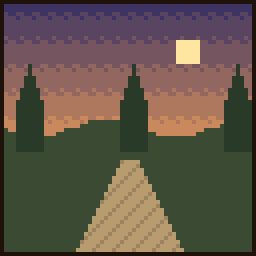

# Hercule

{ .vm-fiche__decor }

✦ Demi-dieu ✦

| | |
|---|---|
| Statut | Légende ★ |
| Chapitre | X — La nouvelle Valmont (quête bonus ★, facultative) |
| Domaine | Les monstres légendaires et leurs trophées |
| Où le trouver | Savanes, plateaux de savane, savanes venteuses et collines venteuses, à 500–1 000 blocs de la ville |
| Atelier | Une palestre |

!!! info "Personnage lié à un mod"

    Hercule est lié au mod **Mowzie's Mobs**, qui ajoute des créatures et des boss légendaires : Foliaath, guerriers Umvuthana, Naga, Ferrous Wroughtnaut, Frostmaw, Umvuthi… Sans ce mod, il se recrute et s'installe normalement, mais il **ne commerce pas** et **ne donne ni quêtes ni récits** : quand vous lui parlez, il récite un dialogue (« Des zombies, des araignées... Ce ne sont pas des monstres, ce sont des échauffements. ») à la place de son menu, et le chat précise en gris :

    > (Le mod Mowzie's Mobs n'est pas installé sur ce serveur : Hercule ne peut ni commercer ni confier de quêtes.)

    Pour en savoir plus sur ce mod : [Mods et plugins](../../serveur/mods-et-plugins.md#les-mods-de-contenu).

> Fils d'un dieu, il a accompli douze travaux pour expier une faute. Il en cherche un treizième.
>
> — *Sa biographie en jeu*

Légende de passage du chapitre X, Hercule a entendu parler d'une cité qui a vaincu un dragon : « impressionnant, pour des mortels ». Il rachète **les trophées des monstres de Mowzie's Mobs**, mais aussi les os et le cuir, et vend des armes dignes d'un héros, de la sarbacane à la Hache des mille métaux. Ses récits sont ses nouveaux **travaux**, du Foliaath à l'Oiseau-Soleil. Son recrutement est facultatif.

## Le retrouver

| | |
|---|---|
| Quête de la cité | **★ Les travaux du héros** (bonus, chapitre X) |
| Objectif | « [Bonus] Un colosse vêtu d'une peau de lion cherche des monstres dignes de lui. Valmont en a à revendre. » |
| Paysages | Savane, plateau de savane, savane venteuse, collines venteuses |
| Distance | Entre 500 et 1 000 blocs du centre de la ville |

Au chapitre X, Alderic l'annonce : « Un géant en peau de lion a étranglé un ours à mains nues près des sommets. Il demande où sont les vrais monstres. »

Lancez les recherches depuis **Alderic → Quêtes de la cité**, puis suivez la barre « 🗺 Hercule » en haut de l'écran. Comme il se trouve à plus de 500 blocs, la barre reste d'abord vide : partez vers les savanes et les collines venteuses jusqu'à ce qu'elle commence à se remplir. Si le message « ❌ Impossible de trouver un endroit sûr (explorez davantage autour de la ville). » s'affiche, explorez plus loin autour de la ville et relancez. Le déroulement complet est expliqué dans [Retrouver et installer un personnage](../recrutement.md). Le recrutement fonctionne **même sans le mod**.

Il n'apparaît qu'au **chapitre X**, l'épilogue, qui s'ouvre une fois la dernière charte signée. Cette quête est **bonus** : au chapitre X, toutes les quêtes sont des bonus ou des hauts faits (voir [Les quêtes bonus](../../guide/trame.md#4-les-quetes-bonus)). Dans l'écran des progrès (touche ++l++), Hercule figure sur la ligne **Les légendes de passage**, sous le chapitre X avec [Geralt de Riv](geralt-de-riv.md) et [Harold](harold.md), et sa bulle rappelle le mod dont il dépend.

!!! tip "Préparez sa palestre pendant le voyage"

    Dès qu'un joueur l'a rencontré, vous pouvez déclarer un atelier **réservé à Hercule** et le préparer pendant qu'il fait la route jusqu'à la ville.

!!! dialogue "Hercule, à la première rencontre"

    On m'a parlé d'une cité qui a vaincu un dragon. Impressionnant. Pour des mortels.

    Montrez-moi vos monstres. Les plus gros.

## Son atelier

Un bâtiment de type **Atelier**, libre ou réservé à Hercule (nom proposé : `Palestre`).

| Exigence | Quantité |
|---|---|
| Enclume (intacte, ébréchée ou endommagée) | 1 |
| Cible | 1 |
| Briques de pierre sculptées | 4 |
| Exigences communes | 1 porte, un toit sur 60 % du sol, 2 sources de lumière |

- **Bonus du métier** (+5 points chacun) : colonne de quartz, feu de camp, bannière. Tous les blocs de la palestre sont du jeu de base.

!!! dialogue "Hercule, une fois installé"

    Une palestre !

    Rapportez-moi les trophées de vos chasses : je saurai qui est digne.

!!! dialogue "Hercule, une fois installé (sans le mod)"

    Des zombies, des araignées... Ce ne sont pas des monstres,

    ce sont des échauffements.

## Ce qu'il rachète

Les prix sont ceux d'un **lot complet**, au prix plein (entrepôt rempli à moins de 40 %). La taille du lot change d'un objet à l'autre. Au menu **Entrepôt**, vous vous servez **gratuitement** dans son stock, qui fait partie de la réserve de la ville (clic : un lot, ++shift++ + clic : une pile) ; ce que vous y prenez, et ce que vous en fabriquez, est marqué non revendable.

| Ressource (nom affiché) | Lot | Prix plein du lot | Entrepôt de base |
|---|---|---|---|
| Graine de Foliaath (objet du mod) | 1 | 20 coins | 16 |
| Dent de Naga (objet du mod) | 1 | 40 coins | 16 |
| Cristal de glace (objet du mod) | 1 | 120 coins | 4 |
| Os (« Bone ») | 16 | 4 coins | 512 |
| Cuir (« Leather ») | 4 | 4 coins | 128 |

## Ce qu'il vend

Le prix est celui **d'un achat**, qui donne la quantité indiquée. Les articles **limités** se reconstituent avec le temps, en temps réel. La dague en dent de Naga puise sa dent dans son stock : sans dent vendue, elle est en rupture. Les objets du mod s'affichent sous leur nom français.

=== "★ Novice"

    | Article | Prix | Quantité | Matières ou disponibilité |
    |---|---|---|---|
    | Fléchettes | 12 coins | 16 | Limité : 3, +1 par heure |
    | Sarbacane | 40 coins | 1 | Limité : 1, +1 toutes les 4 h |
    | Lance | 50 coins | 1 | Limité : 1, +1 toutes les 4 h |

=== "★★ Apprenti"

    | Article | Prix | Quantité | Matières ou disponibilité |
    |---|---|---|---|
    | **Peau du lion de Némée** (tunique en cuir teinte en fauve, Protection II) | 60 coins | 1 | Limité : 1, +1 toutes les 8 h |
    | Dague en dent de Naga | 120 coins | 1 | 1 dent de Naga de son stock |

    - Peau du lion de Némée : *Aucune flèche ne l'a jamais percée.*

=== "★★★ Compagnon"

    | Article | Prix | Quantité | Matières ou disponibilité |
    |---|---|---|---|
    | Perles de géomancien | 80 coins | 1 | Limité : 1, +1 toutes les 24 h |
    | Robe de géomancien | 120 coins | 1 | Limité : 1, +1 toutes les 24 h |
    | Ceinture de géomancien | 80 coins | 1 | Limité : 1, +1 toutes les 24 h |
    | Sandales de géomancien | 80 coins | 1 | Limité : 1, +1 toutes les 24 h |

=== "★★★★ Expert"

    | Article | Prix | Quantité | Matières ou disponibilité |
    |---|---|---|---|
    | Graine de Foliaath | 40 coins | 1 | Limité : 1, +1 toutes les 12 h |
    | Casque du Chevalier Forgé | 600 coins | 1 | Limité : 1, +1 tous les 7 jours |

=== "★★★★★ Maître"

    | Article | Prix | Quantité | Matières ou disponibilité |
    |---|---|---|---|
    | Hache des mille métaux | 1 200 coins | 1 | Limité : 1, +1 tous les 7 jours |
    | **La Massue d'Hercule** (masse, Densité IV, Solidité III) | 900 coins | 1 | Limité : 1, +1 tous les 7 jours |

Tout achat porte la mention « Acheté chez Hercule — non revendable ».

## Ses quêtes

Deux quêtes renouvelables par joueur, à accepter dans son menu **Quêtes** (seulement si le mod est installé). Les quantités augmentent avec son rang (de ×1 au rang Novice à ×3 au rang Maître). Les objets achetés à un PNJ ou pris dans une réserve ne comptent pas ; les créatures comptent quand vous les tuez vous-même, une fois la quête acceptée. Le fonctionnement général est décrit dans [Travailler avec les artisans](../artisans.md#4-les-quetes-des-artisans).

=== "📖 Quête principale"

    L'entraînement du héros. Deux objectifs tirés au hasard. Récompense : valeur des objets × 1,25. Délai de 20 minutes avant la suivante.

    | Objet demandé | Novice | Apprenti | Compagnon | Expert | Maître | Valeur unitaire |
    |---|---|---|---|---|---|---|
    | Os | 32 | 48 | 64 | 80 | 96 | 0,25 coin |
    | Cuir | 16 | 24 | 32 | 40 | 48 | 1 coin |
    | Ficelle | 24 | 36 | 48 | 60 | 72 | 0,25 coin |
    | Lingots de fer | — | 18 | 24 | 30 | 36 | 1,5 coin |
    | Diamants | — | — | 6 | 8 | 9 | 12 coins |

    Exemple : au rang Novice, « 32 os + 16 cuirs » rapporte **30 coins**.

=== "✦ Quête spéciale"

    Les monstres de Mowzie's Mobs. Deux objectifs tirés au hasard, objets ou créatures (un seul au rang Novice, où seuls les Foliaath sont proposés). Récompense : valeur × 1,5. Délai de 60 minutes avant la suivante.

    | Objectif | Novice | Apprenti | Compagnon | Expert | Maître | Valeur unitaire |
    |---|---|---|---|---|---|---|
    | Tuer des Foliaath | 3 | 5 | 6 | 8 | 9 | 8 coins |
    | Tuer des guerriers Umvuthana (toutes sortes) | — | 6 | 8 | 10 | 12 | 10 coins |
    | Tuer des Naga | — | — | 4 | 5 | 6 | 25 coins |
    | Tuer des Grottol | — | — | — | 3 | 3 | 40 coins |
    | Dents de Naga | — | — | — | 5 | 6 | 40 coins |

    Exemple : au rang Novice, tuer 3 Foliaath rapporte **36 coins**.

!!! note "Quantités par rang"

    Quantité de base × coefficient du rang (×1 ; ×1,5 ; ×2 ; ×2,5 ; ×3), arrondie à l'unité la plus proche (une demie est arrondie vers le haut).

## Ses récits

Cinq quêtes personnelles, une par rang, à faire **une seule fois** (menu **Quêtes → Récits**) : les nouveaux travaux d'Hercule, tous contre des créatures de Mowzie's Mobs. Seules comptent les créatures que vous abattez vous-même après avoir accepté le récit.

| Rang | Récit | Objectif | Récompense |
|---|---|---|---|
| ★ Novice | 🌿 L'hydre végétale | Tuer un Foliaath | 120 coins |
| ★★ Apprenti | 🪶 La tribu du soleil | Tuer 3 guerriers Umvuthana | 200 coins |
| ★★★ Compagnon | ⚙ Le chevalier de fer | Vaincre le Ferrous Wroughtnaut, dans sa chambre forgée | 300 coins |
| ★★★★ Expert | ❄ La bête des glaces | Vaincre le Frostmaw | 450 coins |
| ★★★★★ Maître | ☀ L'Oiseau-Soleil | Vaincre Umvuthi, l'Oiseau-Soleil | 900 coins |

Les lieux où rencontrer ces créatures sont ceux du mod Mowzie's Mobs à vérifier.

## Ses rangs

Le rang d'Hercule est **commun à toute la ville** : chaque vente, achat et quête de chaque joueur le fait progresser.

| Rang | XP totale | Ce qui se débloque |
|---|---|---|
| ★ Novice | 0 | Fléchettes, sarbacane, lance ; récit « L'hydre végétale » |
| ★★ Apprenti | 600 | Peau du lion de Némée, dague en dent de Naga ; récit « La tribu du soleil » ; lingots de fer et guerriers Umvuthana dans ses quêtes |
| ★★★ Compagnon | 2 400 | Tenue de géomancien (perles, robe, ceinture, sandales) ; récit « Le chevalier de fer » ; diamants et Naga dans ses quêtes |
| ★★★★ Expert | 6 000 | Graine de Foliaath, Casque du Chevalier Forgé ; récit « La bête des glaces » ; Grottol et dents de Naga dans ses quêtes |
| ★★★★★ Maître | 13 000 | Hache des mille métaux, Massue d'Hercule ; récit « L'Oiseau-Soleil » |

Pour lui faire gagner de l'expérience : lui vendre des trophées ou des ressources (1 XP par lot + 1 XP par coin reçu), lui acheter des articles (1 XP par coin dépensé), valider ses quêtes (30 XP × son rang pour la principale, 70 XP × son rang pour la spéciale).

## Bon à savoir

- **Sans le mod Mowzie's Mobs**, Hercule s'installe mais n'ouvre ni boutique, ni entrepôt, ni quêtes, ni récits (voir l'encadré en haut de page).
- **Il paie au prix des autres artisans** : les os comme [Hélène](../survivants/helene.md), le cuir comme [Edmond](../survivants/edmond.md).
- **La Peau du lion de Némée** est une tunique en cuir teinte, enchantée Protection II ; **la Massue d'Hercule** une masse enchantée Densité IV et Solidité III.
- **Les dents de Naga** se vendent 40 coins pièce, et sa quête spéciale les valorise au même prix avant la prime de 1,5.
- Son entrepôt se vide d'environ 8 % de sa capacité par heure tant qu'un joueur est connecté, sans descendre sous le quart de celle-ci.
- Vous pouvez **travailler pour Hercule** (un seul employeur à la fois) : +10 % sur vos ventes, −15 % sur vos achats chez lui.
