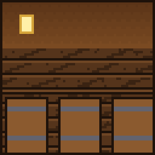

# Obélix

{ .vm-fiche__decor }

✦ Livreur de menhirs ✦

| | |
|---|---|
| Statut | Légende ★ |
| Chapitre | IV — La Fosse et le Chaudron (quête bonus ★, facultative) |
| Domaine | Le gibier et les banquets |
| Où le trouver | Forêts, forêts noires et taïgas, à 300–600 blocs de la ville |
| Atelier | Une hutte gauloise |

!!! info "Personnage lié à deux mods"

    Obélix est lié à **deux** mods : **Wilder Nature** (sangliers, cerfs, bisons et leurs trophées) et **Farmer's Delight** (plats, festins, marmites et couteaux). Il faut les deux : s'il en manque un seul, il se recrute et s'installe normalement, mais il **ne commerce pas** et **ne donne ni quêtes ni récits**. Quand vous lui parlez, il récite un dialogue (« Pas de sangliers, pas de marmite, pas de banquet. Pas un ! ») à la place de son menu, et le chat précise en gris :

    > (Les mods Wilder Nature et Farmer's Delight ne sont pas tous les deux installés sur ce serveur : Obélix ne peut ni commercer ni confier de quêtes.)

    Pour en savoir plus sur ces mods : [Mods et plugins](../../serveur/mods-et-plugins.md#les-mods-de-contenu).

> Livreur de menhirs, chasseur de sangliers, mangeur de sangliers. Tombé dans la marmite quand il était petit.
>
> — *Sa biographie en jeu*

Obélix n'est pas un survivant de Valmont : il a entendu dire que la taverne de [Rosalie](../survivants/rosalie.md) sert des sangliers, et il porte son menhir lui-même. Il rachète **le gibier** (venaison, bison, dinde, porc, jambons) et vend ses **banquets** : plats et festins de Farmer's Delight, couteaux, marmite… jusqu'à une « potion magique ». Aucun artisan ne dépend de lui pour avancer dans l'histoire.

## Le retrouver

| | |
|---|---|
| Quête de la cité | **★ Ils sont fous ces Valmontois** (bonus, à partir du chapitre IV) |
| Objectif | « [Bonus] Un géant moustachu porte un menhir sur le dos et poursuit des sangliers. Offrez-lui un festin. » |
| Paysages | Forêt, forêt noire, taïga |
| Distance | Entre 300 et 600 blocs du centre de la ville |

Au chapitre IV, Alderic l'annonce : « Un colosse traverse les forêts avec un menhir sur le dos. Il dit qu'il n'est pas gros. »

Lancez les recherches depuis **Alderic → Quêtes de la cité**, puis suivez la barre « 🗺 Obélix » en haut de l'écran. Au-delà de 500 blocs, la barre reste vide : avancez vers les forêts jusqu'à ce qu'elle commence à se remplir. Le déroulement complet est expliqué dans [Retrouver et installer un personnage](../recrutement.md). Le recrutement fonctionne **même sans les mods**.

C'est une **quête bonus** : elle ne bloque jamais la signature de la charte. Si vous ne la terminez pas au chapitre IV, elle reste proposée dans les quêtes de la cité aux chapitres suivants, jusqu'à ce qu'elle soit faite (voir [Les quêtes bonus](../../guide/trame.md#4-les-quetes-bonus)). Dans l'écran des progrès (touche ++l++), Obélix figure sur la ligne **Les légendes de passage**, et sa bulle rappelle les mods dont il dépend.

!!! tip "Préparez sa hutte pendant le voyage"

    Dès qu'un joueur l'a rencontré, vous pouvez déclarer un atelier **réservé à Obélix** et le préparer pendant qu'il fait la route jusqu'à la ville.

!!! dialogue "Obélix, à la première rencontre"

    Je ne suis pas gros ! Je suis... enveloppé de muscles.

    Il paraît que votre taverne sert des sangliers ? Alors j'en suis. Et je porte mon menhir moi-même.

## Son atelier

Un bâtiment de type **Atelier**, libre ou réservé à Obélix (nom proposé : `Hutte_gauloise`).

| Exigence | Quantité |
|---|---|
| Feu de camp (normal ou des âmes) | 1 |
| Fumoir | 1 |
| Tonneaux | 2 |
| Exigences communes | 1 porte, un toit sur 60 % du sol, 2 sources de lumière |

- **Bonus du métier** (+5 points chacun) : marmite et poêle à frire (blocs de Farmer's Delight), trophée de cerf (bloc de Wilder Nature).
- Les blocs requis sont tous du jeu de base : la hutte se construit même sans les mods.

!!! dialogue "Obélix, une fois installé"

    Une hutte, un feu, une broche.

    Ramenez-moi du gibier, je vous prépare un banquet.

!!! dialogue "Obélix, une fois installé (sans les mods)"

    Pas un sanglier dans ces bois. Pas un !

    Ils sont fous, ces Valmontois.

## Ce qu'il rachète

Les prix sont ceux d'un **lot complet**, au prix plein (entrepôt rempli à moins de 40 %). La taille du lot change d'un objet à l'autre. Au menu **Entrepôt**, vous vous servez **gratuitement** dans son stock, qui fait partie de la réserve de la ville (clic : un lot, ++shift++ + clic : une pile) ; ce que vous y prenez, et ce que vous en fabriquez, est marqué non revendable.

| Ressource (nom affiché) | Lot | Prix plein du lot | Entrepôt de base |
|---|---|---|---|
| Venaison (objet de Wilder Nature) | 8 | 6 coins | 256 |
| Viande de bison (objet de Wilder Nature) | 8 | 8 coins | 256 |
| Viande de dinde (objet de Wilder Nature) | 8 | 5 coins | 256 |
| Côtelette de porc crue (« Porkchop ») | 8 | 5 coins | 256 |
| Jambon (objet de Farmer's Delight) | 1 | 4 coins | 64 |
| Corne de bison (objet de Wilder Nature) | 1 | 12 coins | 16 |

## Ce qu'il vend

Le prix est celui **d'un achat**, qui donne la quantité indiquée. Les articles fabriqués puisent leurs matières dans son stock : s'il est vide, l'article est en rupture. Les articles **limités** se reconstituent avec le temps, en temps réel. Les objets des mods s'affichent sous leur nom français.

=== "★ Novice"

    | Article | Prix | Quantité | Matières ou disponibilité |
    |---|---|---|---|
    | Venaison cuite | 12 coins | 4 | 4 venaisons de son stock |
    | Couteau en silex | 10 coins | 1 | Limité : 2, +1 toutes les 2 h |
    | Assiette de poulet rôti | 15 coins | 1 | Limité : 3, +1 par heure |

=== "★★ Apprenti"

    | Article | Prix | Quantité | Matières ou disponibilité |
    |---|---|---|---|
    | Jambon fumé | 18 coins | 1 | 1 jambon de son stock |
    | Marmite | 60 coins | 1 | Limité : 1, +1 toutes les 12 h |
    | Couteau en fer | 30 coins | 1 | Limité : 1, +1 toutes les 4 h |

=== "★★★ Compagnon"

    | Article | Prix | Quantité | Matières ou disponibilité |
    |---|---|---|---|
    | Poulet rôti (festin) | 80 coins | 1 | Limité : 1, +1 toutes les 8 h |
    | Citrouille farcie (festin) | 70 coins | 1 | Limité : 1, +1 toutes les 8 h |
    | Cape de fourrure | 90 coins | 1 | Limité : 1, +1 toutes les 12 h |

=== "★★★★ Expert"

    | Article | Prix | Quantité | Matières ou disponibilité |
    |---|---|---|---|
    | Jambon laqué au miel (festin) | 140 coins | 1 | 2 jambons de son stock |
    | Hachis Parmentier (festin) | 120 coins | 1 | Limité : 1, +1 toutes les 12 h |
    | Couteau en diamant | 150 coins | 1 | Limité : 1, +1 toutes les 24 h |
    | **Menhir d'Obélix** (pierre lisse renommée) | 25 coins | 1 | Limité : 2, +1 toutes les 12 h |

    - Menhir d'Obélix : *Livré par Obélix en personne. Il n'est pas lourd. Si, un peu.*

=== "★★★★★ Maître"

    | Article | Prix | Quantité | Matières ou disponibilité |
    |---|---|---|---|
    | **Potion magique** (potion de Force II) | 120 coins | 1 | Limité : 1, +1 toutes les 24 h |
    | Trophée de bison | 250 coins | 1 | Limité : 1, +1 tous les 7 jours |
    | Couteau en netherite | 400 coins | 1 | Limité : 1, +1 tous les 7 jours |

    - Potion magique : *Une gorgée, et l'on soulève des menhirs. (Obélix n'y a pas droit.)*

Tout achat porte la mention « Acheté chez Obélix — non revendable ».

## Ses quêtes

Deux quêtes renouvelables par joueur, à accepter dans son menu **Quêtes** (seulement si les deux mods sont installés). Les quantités augmentent avec son rang (de ×1 au rang Novice à ×3 au rang Maître). Les objets achetés à un PNJ ou pris dans une réserve ne comptent pas ; les créatures comptent quand vous les tuez vous-même, une fois la quête acceptée. Le fonctionnement général est décrit dans [Travailler avec les artisans](../artisans.md#4-les-quetes-des-artisans).

=== "📖 Quête principale"

    Le gibier pour la broche. Deux objectifs tirés au hasard. Récompense : valeur des objets × 1,25. Délai de 20 minutes avant la suivante.

    | Objet demandé | Novice | Apprenti | Compagnon | Expert | Maître | Valeur unitaire |
    |---|---|---|---|---|---|---|
    | Venaison | 16 | 24 | 32 | 40 | 48 | 0,75 coin |
    | Viande de dinde | 16 | 24 | 32 | 40 | 48 | 0,625 coin |
    | Côtelettes de porc crues | 16 | 24 | 32 | 40 | 48 | 0,625 coin |
    | Viande de bison | — | 12 | 16 | 20 | 24 | 1 coin |
    | Jambons | — | — | 8 | 10 | 12 | 4 coins |

    Exemple : au rang Novice, « 16 venaisons + 16 côtelettes de porc » rapporte **28 coins**.

=== "✦ Quête spéciale"

    La chasse et le festin. Deux objectifs tirés au hasard, objets ou créatures. Récompense : valeur × 1,5. Délai de 60 minutes avant la suivante.

    | Objectif | Novice | Apprenti | Compagnon | Expert | Maître | Valeur unitaire |
    |---|---|---|---|---|---|---|
    | Tuer des sangliers | 6 | 9 | 12 | 15 | 18 | 3 coins |
    | Tuer des cerfs | 5 | 8 | 10 | 13 | 15 | 3 coins |
    | Tuer des bisons | — | 6 | 8 | 10 | 12 | 5 coins |
    | Assiettes de jambon laqué au miel | — | — | 4 | 5 | 6 | 10 coins |
    | Tuer des pillards (« des Romains ») | — | — | — | 25 | 30 | 3 coins |

    Exemple : au rang Novice, « 6 sangliers + 5 cerfs » rapporte **50 coins**.

!!! note "Quantités par rang"

    Quantité de base × coefficient du rang (×1 ; ×1,5 ; ×2 ; ×2,5 ; ×3), arrondie à l'unité la plus proche (une demie est arrondie vers le haut).

## Ses récits

Cinq quêtes personnelles, une par rang, à faire **une seule fois** (menu **Quêtes → Récits**). Un récit ne compte qu'une fois accepté.

| Rang | Récit | Objectif | Récompense |
|---|---|---|---|
| ★ Novice | 🐗 Sangliers à la broche | Tuer 5 sangliers (Wilder Nature) | 120 coins |
| ★★ Apprenti | 🦌 Le cerf du festin | **Rapporter** un trophée de cerf | 200 coins |
| ★★★ Compagnon | 🍖 Le banquet | **Rapporter** un jambon laqué au miel entier (le festin à poser sur la table) | 300 coins |
| ★★★★ Expert | 🛡 Ils sont fous ces Romains ! | Abattre 3 ravageurs (« les chars romains ») | 450 coins |
| ★★★★★ Maître | 🦬 Le bison du chef | **Rapporter** un trophée de bison | 900 coins |

Les objets des récits « Rapporter… » se remettent **en personne** : ouvrez ses récits depuis **son** menu (pas depuis le journal de quêtes) et cliquez sur le récit en cours quand vous avez l'objet sur vous. Si vous l'avez déjà en acceptant le récit, il est remis aussitôt. Un objet acheté à un PNJ ou pris dans une réserve est refusé : le jambon laqué et le trophée de bison de sa propre boutique ne comptent pas. La façon d'obtenir un trophée dépend du mod Wilder Nature à vérifier.

## Ses rangs

Le rang d'Obélix est **commun à toute la ville** : chaque vente, achat et quête de chaque joueur le fait progresser.

| Rang | XP totale | Ce qui se débloque |
|---|---|---|
| ★ Novice | 0 | Venaison cuite, couteau en silex, assiette de poulet rôti ; récit « Sangliers à la broche » |
| ★★ Apprenti | 500 | Jambon fumé, marmite, couteau en fer ; récit « Le cerf du festin » ; viande de bison et bisons dans ses quêtes |
| ★★★ Compagnon | 2 000 | Poulet rôti et citrouille farcie (festins), cape de fourrure ; récit « Le banquet » ; jambons et assiettes de jambon laqué au miel dans ses quêtes |
| ★★★★ Expert | 5 500 | Jambon laqué au miel et hachis Parmentier (festins), couteau en diamant, Menhir d'Obélix ; récit « Ils sont fous ces Romains ! » ; pillards dans ses quêtes |
| ★★★★★ Maître | 12 000 | Potion magique, trophée de bison, couteau en netherite ; récit « Le bison du chef » |

Pour lui faire gagner de l'expérience : lui vendre du gibier (1 XP par lot + 1 XP par coin reçu), lui acheter des articles (1 XP par coin dépensé), valider ses quêtes (25 XP × son rang pour la principale, 60 XP × son rang pour la spéciale).

## Bon à savoir

- **Sans Wilder Nature ou sans Farmer's Delight**, Obélix s'installe mais n'ouvre ni boutique, ni entrepôt, ni quêtes, ni récits (voir l'encadré en haut de page). Il lui faut les deux.
- **Le porc au prix de la taverne** : il paie la côtelette de porc crue au même prix que [Rosalie](../survivants/rosalie.md), par lots de 8. Si l'une a l'entrepôt plein, vendez à l'autre.
- **Ses festins fabriqués** viennent de ce que vous lui vendez : la venaison pour la venaison cuite, les jambons pour le jambon fumé et le jambon laqué au miel.
- **Le Menhir d'Obélix** est un bloc de pierre lisse renommé, purement décoratif ; la **Potion magique** est une potion de Force II.
- Son entrepôt se vide d'environ 8 % de sa capacité par heure tant qu'un joueur est connecté, sans descendre sous le quart de celle-ci.
- Vous pouvez **travailler pour Obélix** (un seul employeur à la fois) : +10 % sur vos ventes, −15 % sur vos achats chez lui.
