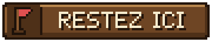

# Retrouver et installer un personnage

Les artisans de Valmont se sont dispersés dans les terres sauvages. Les ramener se fait toujours de la même façon : **lancer les recherches**, **le rencontrer**, **le ramener en ville**, puis **l'installer dans son atelier**.
{ .chapeau }

## 1. Lancer les recherches

Les recrutements se lancent depuis **Alderic → Quêtes de la cité**. Cliquez sur la quête de recrutement (*« Cliquez pour lancer les recherches. »*) : le personnage apparaît alors **quelque part hors de la ville**. Tous les joueurs connectés sont prévenus et reçoivent de quoi le retrouver.

### La piste

Une feuille de papier au nom de la quête, placée dans votre inventaire (dans le dernier emplacement de la barre d'objets s'il est libre ; elle n'écrase jamais un objet). Elle rappelle qui chercher et **ce que son futur atelier devra contenir** : vous pouvez préparer l'atelier pendant les recherches.

### La barre de recherche

La barre en haut de l'écran, au nom du personnage, **se remplit à mesure que vous vous approchez** :

| Couleur | Distance |
|---|---|
| Vide | À 500 blocs ou plus |
| 🔴 Rouge | Au-delà de 100 blocs |
| 🟡 Jaune | Entre 20 et 100 blocs |
| 🟢 Verte | À moins de 20 blocs |

Dans le Nether ou l'End, elle reste rouge et vide. Elle fonctionne aussi à cheval et en bateau.

!!! tip "Conseils de recherche"

    - Chaque personnage se cache **dans un paysage qui correspond à son métier** (forêts, plaines, rivages, montagnes, neige, désert…). Les paysages de chacun sont indiqués sur sa fiche.
    - Plus l'histoire avance, plus les personnages sont loin : les premiers sont à une ou deux centaines de blocs de la ville, les plus lointains **jusqu'à un millier de blocs**. Si la barre reste vide, partez dans la direction des paysages qui lui ressemblent jusqu'à ce qu'elle commence à se remplir.
    - Un personnage n'apparaît que dans des **zones déjà explorées**. Si le jeu répond *« Impossible de trouver un endroit sûr »*, explorez davantage autour de la ville.
    - **Piste perdue ?** Cliquez de nouveau sur la quête chez Alderic (*« Cliquez pour récupérer la piste. »*). Un joueur qui se connecte pendant une recherche reçoit aussi la piste.

## 2. Le recrutement en trois étapes

Chaque recrutement passe par trois étapes, visibles chez Alderic et dans l'onglet de progression (touche ++l++).

<ol class="vm-frise" markdown>
<li markdown>**La rencontre.** Faites un **clic droit** sur le personnage : il se présente et raconte un peu de son passé. Son menu indique **« ÉTRANGER »** : il n'a pas encore rejoint la ville.</li>
<li markdown>**L'arrivée en ville.** Ramenez-le sur le territoire de Valmont. Dès qu'il y entre, tout le serveur est prévenu (*« 🏰 … est arrivé en ville ! »*) et il annonce ce dont il a besoin pour son atelier. La piste et la barre disparaissent.</li>
<li markdown>**L'installation.** Préparez-lui un **atelier**, parlez-lui et cliquez sur **🏠 Choisir son logis**. Une fois installé, la quête de recrutement est terminée et l'artisan ouvre son commerce.</li>
</ol>

### Pendant le voyage

Hors de la ville, son menu propose :

| Bouton | Effet |
|---|---|
| { .vm-ui } | Il vous accompagne jusqu'à Valmont. Il nage, **monte dans votre barque** et vous rejoint s'il est distancé |
| { .vm-ui } | Il s'arrête où il est |
| { .vm-ui } | Il vous raconte à nouveau son passé |

Une fois en ville, son menu indique **« EN VILLE »**. En attendant son atelier, vous pouvez lui dire de **se promener** ({ .vm-ui }) ou de **rester ici** ({ .vm-ui }).

### Choisir son logis

Seuls les ateliers **libres** ou **réservés à lui** sont proposés, chacun avec un cadre de couleur :

| Cadre | Signification |
|---|---|
| { .vm-anneau } Vert | Conforme : cliquez pour l'installer |
| { .vm-anneau } Doré | Réservé à lui |
| { .vm-anneau } Rouge | Incomplet : il manque quelque chose (la liste est au survol) |

> « ❌ Thorvald ne peut pas s'installer dans Forge : il manque 1 enclume. »
>
> « ✅ Thorvald assigné au bâtiment Forge ! »

La commande `/city build assign <bâtiment> <artisan>` fait la même chose, pour un artisan déjà arrivé en ville.

## 3. Ce que demande un atelier

Chaque artisan a ses propres exigences, liées à son métier (un établi, une enclume, des tonneaux, un accès à l'eau…). Elles s'ajoutent aux **exigences communes** à tous les bâtiments : **une porte**, **un toit** sur 60 % du sol et **deux sources de lumière**. Certains métiers en plein air demandent moins de toit, voire pas de porte.

Vous trouverez toujours ses exigences :

- sur la **piste** de recrutement ;
- dans son **dialogue d'arrivée** en ville ;
- dans la bulle du bouton **🏠 Choisir son logis** ;
- avec `/city build inspect <nom de l'atelier>` ;
- sur sa fiche dans ce guide, et dans l'[aide-mémoire des ateliers](ateliers.md).

Chaque atelier propose aussi **des blocs bonus liés au métier** : ils rapportent des points et font monter le niveau de l'atelier (voir [Les bâtiments](../guide/batiments.md)).

!!! tip "Préparez l'atelier à l'avance"

    Dès qu'un joueur a rencontré un personnage, vous pouvez déclarer un atelier **réservé à lui** et le préparer pendant qu'il fait la route jusqu'à la ville.

## 4. Si un artisan perd son atelier

Si l'atelier d'un artisan est **supprimé**, il devient **« sans logis »** :

- il se promène en ville et son commerce est fermé ;
- ses quêtes sont **en pause** ;
- **rien n'est perdu** : son rang, son stock, vos quêtes en cours et sa progression sont conservés.

Choisissez-lui un nouvel atelier conforme avec **🏠 Choisir son logis**, et tout reprend comme avant. Une fois installé, un artisan **reste** dans son atelier même si celui-ci redevient incomplet (son entrepôt perd alors son bonus).

## 5. Les signes au-dessus des personnages

| Signe | Signification |
|---|---|
| { .vm-icone } **!** rouge | Une nouveauté vous attend auprès de lui (quête à valider, récit à accepter…) |
| **/!\\** jaune | L'artisan n'arrive pas à rejoindre son poste de travail. Dégagez le passage ou l'endroit où il doit se tenir |
