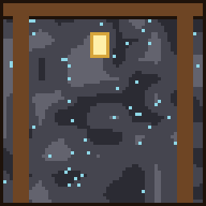

# Godefroy

{ .vm-fiche__decor }

✦ Mineur ✦

| | |
|---|---|
| Statut | Survivant |
| Chapitre | IV — La Fosse et le Chaudron |
| Domaine | Les mines : charbon, minerais bruts, redstone, lapis-lazuli, diamants ; torches, lanternes, rails, wagonnets, pioches |
| Où le trouver | Montagnes (collines venteuses, pics rocheux, pentes enneigées), à 225–450 blocs de la ville |
| Atelier | Une mine |

> Maître mineur de la Fosse aux Corbeaux. Il était sous terre quand Valmont a brûlé ; remonté trois jours plus tard, il n'a trouvé que des cendres.
>
> — *Sa biographie en jeu*

Le maître de la Fosse aux Corbeaux rachète **tout ce que vous remontez des profondeurs** et équipe les mineurs de la ville. Ses **diamants** et sa **redstone** font tourner les ateliers de plusieurs autres artisans.

## Le retrouver

| | |
|---|---|
| Quête de la cité | **Le mineur de la Fosse** (obligatoire au chapitre IV) |
| Objectif | « Trouvez Godefroy près des montagnes et offrez-lui une mine. » |
| Paysages | Collines venteuses, collines graveleuses venteuses, pics rocheux, bosquet, pentes enneigées |
| Distance | Entre 225 et 450 blocs du centre de la ville |

Lancez les recherches depuis **Alderic → Quêtes de la cité**, puis suivez la barre « 🗺 Godefroy » en haut de l'écran. Le déroulement complet est expliqué dans [Retrouver et installer un personnage](../recrutement.md).

!!! tip "Préparez sa mine pendant le voyage"

    Dès qu'un joueur l'a rencontré, vous pouvez déclarer un atelier **réservé à Godefroy** et le préparer pendant qu'il fait la route jusqu'à la ville.

!!! dialogue "Godefroy, à la première rencontre"

    *tousse* Qui va là ? Baisse ta torche, tu m'aveugles !

    Godefroy, maître de la Fosse aux Corbeaux. On était sous terre quand Valmont a brûlé... on n'a rien vu, rien entendu.

    Valmont se relève ? Elle aura besoin de fer et de charbon. Je connais les veines. Guide-moi vers la lumière.

## Son atelier

Un bâtiment de type **Atelier**, libre ou réservé à Godefroy (nom proposé : `Mine`).

| Exigence | Quantité |
|---|---|
| Rails (rails ordinaires) | 4 |
| Coffre à minerai (coffre) | 1 |
| Exigences communes | **Pas de porte**, un toit sur 60 % du sol, 2 sources de lumière |

- **Aucune porte n'est exigée** : une entrée de galerie suffit.
- **Creusez en profondeur** : tout ce qui est construit jusqu'à 40 blocs sous le sol de la zone du bâtiment est pris en compte, ce qui permet d'installer sa mine sous terre.
- **Bonus du métier** (+5 points chacun) : rail de propulsion, chaîne (treuil), meule.

!!! dialogue "Godefroy, une fois installé"

    Une mine à moi, avec des étais solides !

    Rapportez-moi vos minerais bruts : charbon, fer, cuivre, or, gemmes... je paie bien.

## Ce qu'il rachète

Les prix sont ceux d'un **lot complet**, au prix plein (entrepôt rempli à moins de 40 %). La taille du lot **varie selon le minerai**, de 4 pour les diamants à 32 pour le cuivre brut et la redstone. Au menu **Entrepôt**, vous pouvez lui racheter son stock au double de ce prix.

| Ressource (nom affiché) | Lot | Prix plein du lot | Entrepôt de base |
|---|---|---|---|
| Charbon (« Coal ») | 16 | 6 coins | 1 024 |
| Fer brut (« Raw Iron ») | 16 | 20 coins | 768 |
| Cuivre brut (« Raw Copper ») | 32 | 8 coins | 1 536 |
| Or brut (« Raw Gold ») | 8 | 16 coins | 256 |
| Redstone (« Redstone ») | 32 | 8 coins | 1 536 |
| Lapis-lazuli (« Lapis Lazuli ») | 16 | 8 coins | 768 |
| Diamant (« Diamond ») | 4 | 48 coins | 64 |

Il rachète les **minerais bruts** (fer brut, cuivre brut, or brut), pas les lingots : les lingots de fer et de cuivre se vendent à [Thorvald](thorvald.md).

## Ce qu'il vend

Le prix est celui **d'un achat**, qui donne la quantité indiquée. Tous ses articles puisent leurs matières dans **son propre stock** : s'il est vide, l'article est en rupture. Sa pioche de Maître est en plus **limitée** : elle se reconstitue avec le temps.

=== "★ Novice"

    | Article | Prix | Quantité | Matières ou disponibilité |
    |---|---|---|---|
    | Torche (« Torch ») | 7 coins | 32 | 8 charbons de son stock |
    | Lanterne (« Lantern ») | 8 coins | 2 | 2 charbons + 2 fers bruts de son stock |

=== "★★ Apprenti"

    | Article | Prix | Quantité | Matières ou disponibilité |
    |---|---|---|---|
    | Rails (« Rail ») | 18 coins | 16 | 6 fers bruts de son stock |
    | Wagonnet (« Minecart ») | 15 coins | 1 | 5 fers bruts de son stock |
    | Bloc de charbon (« Coal Block ») | 32 coins | 4 | 36 charbons de son stock |

=== "★★★ Compagnon"

    | Article | Prix | Quantité | Matières ou disponibilité |
    |---|---|---|---|
    | Rails de propulsion (« Powered Rail ») | 29 coins | 6 | 6 ors bruts + 1 redstone de son stock |
    | Rails détecteurs (« Detector Rail ») | 18 coins | 6 | 6 fers bruts + 1 redstone de son stock |
    | Bloc de lapis-lazuli (« Lapis Block ») | 11 coins | 1 | 9 lapis-lazuli de son stock |
    | Bloc de redstone (« Redstone Block ») | 6 coins | 1 | 9 redstone de son stock |

=== "★★★★ Expert"

    | Article | Prix | Quantité | Matières ou disponibilité |
    |---|---|---|---|
    | **Pic de la Fosse** (pioche en fer, Efficacité III, Solidité II) | 45 coins | 1 | 3 fers bruts de son stock |

=== "★★★★★ Maître"

    | Article | Prix | Quantité | Matières ou disponibilité |
    |---|---|---|---|
    | **Pioche de la Fosse aux Corbeaux** (pioche en diamant, Efficacité IV, Fortune III, Solidité III) | 300 coins | 1 | 3 diamants de son stock ; limité : 1, +1 toutes les 12 h |

## Ses quêtes

Deux quêtes renouvelables par joueur, à accepter dans son menu **Quêtes**. Les quantités augmentent avec son rang (de ×1 au rang Novice à ×3 au rang Maître). Le fonctionnement général est décrit dans [Travailler avec les artisans](../artisans.md#4-les-quetes-des-artisans).

=== "📖 Quête principale"

    Deux objectifs tirés au hasard. Récompense : valeur des objets × 1,25. Délai de 20 minutes avant la suivante.

    | Objet demandé | Novice | Apprenti | Compagnon | Expert | Maître |
    |---|---|---|---|---|---|
    | Charbon | 64 | 96 | 128 | 160 | 192 |
    | Fer brut | 32 | 48 | 64 | 80 | 96 |
    | Cuivre brut | 64 | 96 | 128 | 160 | 192 |
    | Redstone | — | 96 | 128 | 160 | 192 |
    | Lapis-lazuli | — | 48 | 64 | 80 | 96 |

=== "✦ Quête spéciale"

    Deux objectifs tirés au hasard, objets ou créatures. Récompense : valeur × 1,5. Délai de 60 minutes avant la suivante.

    | Objectif | Novice | Apprenti | Compagnon | Expert | Maître |
    |---|---|---|---|---|---|
    | Or brut | 16 | 24 | 32 | 40 | 48 |
    | Diamant | — | — | 4 | 5 | 6 |
    | Tuer des araignées venimeuses | 8 | 12 | 16 | 20 | 24 |
    | Tuer des creepers | 5 | 8 | 10 | 13 | 15 |
    | Tuer des squelettes | 8 | 12 | 16 | 20 | 24 |

## Ses récits

Cinq quêtes personnelles, une par rang, à faire **une seule fois** (menu **Quêtes → Récits**).

| Rang | Récit | Objectif | Récompense |
|---|---|---|---|
| ★ Novice | ⛏ La descente | Descendre à Y = 0 ou plus bas, dans le monde normal | 40 coins |
| ★★ Apprenti | 🪨 Les fondements du monde | Descendre à Y = -58 ou plus bas, tout au fond | 100 coins |
| ★★★ Compagnon | 💎 Diamants ! | Miner un diamant | 150 coins |
| ★★★★ Expert | 👂 Le grondement | Pénétrer dans les Profondeurs obscures (là où vivent les Wardens) | 300 coins |
| ★★★★★ Maître | 🔥 Les débris antiques | Extraire des débris antiques dans le Nether | 500 coins |

« Diamants ! » et « Les débris antiques » correspondent à des succès Minecraft : si vous les avez déjà obtenus, le récit est validé dès que vous l'acceptez.

## Ses rangs

Le rang de Godefroy est **commun à toute la ville** : chaque vente, achat et quête de chaque joueur le fait progresser. Ses seuils sont plus élevés que ceux des premiers artisans, mais ses quêtes lui rapportent davantage d'expérience.

| Rang | XP totale | Ce qui se débloque |
|---|---|---|
| ★ Novice | 0 | Torches, lanternes ; récit « La descente » |
| ★★ Apprenti | 500 | Rails, wagonnets, blocs de charbon ; récit « Les fondements du monde » ; redstone et lapis-lazuli dans ses quêtes |
| ★★★ Compagnon | 2 000 | Rails de propulsion et détecteurs, blocs de lapis-lazuli et de redstone ; récit « Diamants ! » ; diamants dans ses quêtes |
| ★★★★ Expert | 5 500 | Pic de la Fosse ; récit « Le grondement » |
| ★★★★★ Maître | 12 000 | Pioche de la Fosse aux Corbeaux ; récit « Les débris antiques » |

Pour lui faire gagner de l'expérience : lui vendre vos minerais (1 XP par lot + 1 XP par coin reçu), lui acheter des articles (1 XP par coin dépensé), valider ses quêtes (25 XP × son rang pour la principale, 60 XP × son rang pour la spéciale).

## Bon à savoir

- **Au chapitre IV**, la quête « Réserve de charbon » demande : « Constituez une réserve de 256 charbon chez Godefroy. » Il faut donc lui vendre du charbon. Ses propres torches, lanternes et blocs de charbon, ainsi que la citrouille-lanterne d'[Hélène](helene.md), puisent dans cette réserve, et son entrepôt se vide d'environ 8 % par heure tant qu'un joueur est connecté. La quête est acquise dès que le seuil est atteint, même si le stock baisse ensuite.
- **Il fournit les diamants** : [Thorvald](thorvald.md) (outils et armures en diamant, Lame de Valmont), [Brennan](brennan.md) (Pic du maître maçon), [Edmond](edmond.md) (armure de cheval en diamant) et [Gandalf](../legendes/gandalf.md) (table d'enchantement) les prennent dans son stock. Son entrepôt ne contient que 64 diamants (capacité de base) : vendez-lui-en régulièrement pour alimenter la forge.
- **Il fournit la redstone** : [Isabeau](isabeau.md) (boussole, carte, horloge), [Béatrice](beatrice.md) (horloge), [Doc Brown](../legendes/doc-brown.md) (torches de redstone, répéteurs, pistons, comparateurs, lampes…) et [Gandalf](../legendes/gandalf.md) (boussole de récupération) puisent dans son stock.
- À son arrivée en ville, il réclame « du ragoût. Beaucoup de ragoût. » : [Rosalie](rosalie.md), recrutée au même chapitre, en sert à la taverne.
- Vous pouvez **travailler pour Godefroy** : +10 % sur ce que vous lui vendez, −15 % sur vos achats chez lui.

??? spoiler "Son rôle dans la suite de l'histoire"

    Au **chapitre V**, la quête « La Fosse s'agrandit » demande que Godefroy atteigne le rang **Apprenti** (500 XP).
