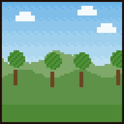

# Hélène

{ .vm-fiche__decor }

✦ Fermière ✦

| | |
|---|---|
| Statut | Survivante |
| Chapitre | II — Du pain pour l'hiver |
| Domaine | Les cultures : céréales, légumes, fruits, engrais, graines (jusqu'aux graines anciennes du renifleur) |
| Où la trouver | Plaines et prés, à 175–350 blocs de la ville |
| Atelier | Une grange |

> Fermière des champs au sud de Valmont. Veuve, elle a survécu aux hivers de famine en cachant des semences dans son tablier.
>
> — *Sa biographie en jeu*

Gardienne des dernières semences de Valmont, Hélène rachète **vos récoltes**, vend graines et engrais, et constitue le **grenier de la ville**. Plusieurs artisans cuisinent ou fabriquent avec ses réserves, à commencer par la taverne de [Rosalie](rosalie.md).

## La retrouver

| | |
|---|---|
| Quête de la cité | **La fermière des plaines** (obligatoire au chapitre II) |
| Objectif | « Trouvez Hélène, ramenez-la et installez-la dans une grange. » |
| Paysages | Plaines, plaine de tournesols, pré |
| Distance | Entre 175 et 350 blocs du centre de la ville |

Lancez les recherches depuis **Alderic → Quêtes de la cité**, puis suivez la barre « 🗺 Hélène » en haut de l'écran. Le déroulement complet est expliqué dans [Retrouver et installer un personnage](../recrutement.md).

!!! tip "Préparez sa grange pendant le voyage"

    Dès qu'un joueur l'a rencontrée, vous pouvez déclarer un atelier **réservé à Hélène** et le préparer pendant qu'elle fait la route jusqu'à la ville.

!!! dialogue "Hélène, à la première rencontre"

    Bonjour, étranger. Attention à mes semis, s'il vous plaît !

    Je suis Hélène. Depuis la Nuit Noire, je cultive ce lopin seule, saison après saison.

    Bastien vous envoie ? Ce vieux grincheux avait raison : Valmont aura besoin de pain avant les murailles. Je vous suis.

## Son atelier

Un bâtiment de type **Atelier**, libre ou réservé à Hélène (nom proposé : `Grange`).

| Exigence | Quantité |
|---|---|
| Composteur | 1 |
| Tonneaux | 2 |
| Bottes de foin | 2 |
| Exigences communes | 1 porte, un toit sur **30 %** du sol seulement, 2 sources de lumière |

- **Toit réduit** : il suffit que 30 % du sol soit couvert, au lieu des 60 % habituels.
- **Bonus du métier** (+5 points chacun) : cultures (plants de blé, carottes, pommes de terre, betteraves…), ruche, four à pain (fumoir).

!!! dialogue "Hélène, une fois installée"

    Une grange ! Mes grains seront enfin à l'abri des rats.

    Apportez-moi vos récoltes : je les paie au juste prix et je garde des réserves pour l'hiver.

## Ce qu'elle rachète

Les prix sont ceux d'un **lot complet**, au prix plein (entrepôt rempli à moins de 40 %). La taille du lot **varie selon la récolte** : 32 pour la plupart, 8 pour les citrouilles et les pommes, 64 pour les tranches de pastèque. Au menu **Entrepôt**, vous pouvez lui racheter son stock au double de ce prix.

| Ressource (nom affiché) | Lot | Prix plein du lot | Entrepôt de base |
|---|---|---|---|
| Blé (« Wheat ») | 32 | 10 coins | 2 048 |
| Carotte (« Carrot ») | 32 | 8 coins | 2 048 |
| Pomme de terre (« Potato ») | 32 | 8 coins | 2 048 |
| Betterave (« Beetroot ») | 32 | 12 coins | 1 024 |
| Citrouille (« Pumpkin ») | 8 | 8 coins | 512 |
| Tranche de pastèque (« Melon Slice ») | 64 | 8 coins | 2 048 |
| Canne à sucre (« Sugar Cane ») | 32 | 8 coins | 2 048 |
| Baies sucrées (« Sweet Berries ») | 32 | 6 coins | 1 024 |
| Fèves de cacao (« Cocoa Beans ») | 32 | 12 coins | 1 024 |
| Baies lumineuses (« Glow Berries ») | 32 | 12 coins | 512 |
| Pomme (« Apple ») | 8 | 8 coins | 256 |
| Os (« Bone ») | 32 | 8 coins | 1 024 |

## Ce qu'elle vend

Le prix est celui **d'un achat**, qui donne la quantité indiquée. Les articles fabriqués puisent leurs matières dans un stock : s'il est vide, l'article est en rupture. Les articles **limités** se reconstituent avec le temps.

=== "★ Novice"

    | Article | Prix | Quantité | Matières ou disponibilité |
    |---|---|---|---|
    | Graines de blé (« Wheat Seeds ») | 2 coins | 16 | Limité : 32, +1 toutes les 10 min |
    | Graines de betterave (« Beetroot Seeds ») | 3 coins | 16 | Limité : 32, +1 toutes les 15 min |
    | Poudre d'os (« Bone Meal ») | 4 coins | 18 | 6 os de son stock |
    | Composteur (« Composter ») | 2 coins | 1 | 2 bûches du stock de [Bastien](bastien.md) |

=== "★★ Apprenti"

    | Article | Prix | Quantité | Matières ou disponibilité |
    |---|---|---|---|
    | Botte de foin (« Hay Block ») | 26 coins | 4 | 36 blés de son stock |
    | Graines de citrouille (« Pumpkin Seeds ») | 5 coins | 8 | 2 citrouilles de son stock |
    | Graines de pastèque (« Melon Seeds ») | 3 coins | 8 | 8 tranches de pastèque de son stock |
    | Sucre (« Sugar ») | 10 coins | 16 | 16 cannes à sucre de son stock |

=== "★★★ Compagnon"

    | Article | Prix | Quantité | Matières ou disponibilité |
    |---|---|---|---|
    | Citrouille taillée (« Carved Pumpkin ») | 10 coins | 4 | 4 citrouilles de son stock |
    | Citrouille-lanterne (« Jack O Lantern ») | 11 coins | 4 | 4 citrouilles de son stock + 1 charbon du stock de [Godefroy](godefroy.md) |
    | Pastèque (« Melon ») | 11 coins | 4 | 36 tranches de pastèque de son stock |

=== "★★★★ Expert"

    | Article | Prix | Quantité | Matières ou disponibilité |
    |---|---|---|---|
    | Graines de torchiflore (« Torchflower Seeds ») | 30 coins | 1 | Limité : 2, +1 toutes les 240 min |
    | Cosse de sarracénie (« Pitcher Pod ») | 30 coins | 1 | Limité : 2, +1 toutes les 240 min |

    Les deux graines portent la même description : « Une graine ancienne, cachée depuis la Nuit Noire. »

=== "★★★★★ Maître"

    | Article | Prix | Quantité | Matières ou disponibilité |
    |---|---|---|---|
    | **Houe d'abondance** (houe en fer, Fortune III, Solidité III) | 70 coins | 1 | 2 lingots de fer du stock de [Thorvald](thorvald.md) |

« Bûches » du composteur : n'importe laquelle des essences de surface que Bastien a en réserve.

## Ses quêtes

Deux quêtes renouvelables par joueur, à accepter dans son menu **Quêtes**. Les quantités augmentent avec son rang (de ×1 au rang Novice à ×3 au rang Maître). Le fonctionnement général est décrit dans [Travailler avec les artisans](../artisans.md#4-les-quetes-des-artisans).

=== "📖 Quête principale"

    Deux objectifs tirés au hasard. Récompense : valeur des objets × 1,25. Délai de 20 minutes avant la suivante.

    | Objet demandé | Novice | Apprenti | Compagnon | Expert | Maître |
    |---|---|---|---|---|---|
    | Blé | 96 | 144 | 192 | 240 | 288 |
    | Carotte | 96 | 144 | 192 | 240 | 288 |
    | Pomme de terre | 96 | 144 | 192 | 240 | 288 |
    | Betterave | 64 | 96 | 128 | 160 | 192 |
    | Canne à sucre | 64 | 96 | 128 | 160 | 192 |
    | Citrouille | — | 24 | 32 | 40 | 48 |
    | Tranche de pastèque | — | 144 | 192 | 240 | 288 |

=== "✦ Quête spéciale"

    Deux objectifs tirés au hasard, objets ou créatures. Récompense : valeur × 1,5. Délai de 60 minutes avant la suivante.

    | Objectif | Novice | Apprenti | Compagnon | Expert | Maître |
    |---|---|---|---|---|---|
    | Fèves de cacao | — | 48 | 64 | 80 | 96 |
    | Baies sucrées | 64 | 96 | 128 | 160 | 192 |
    | Baies lumineuses | — | — | 48 | 60 | 72 |
    | Pomme | 8 | 12 | 16 | 20 | 24 |
    | Os | 64 | 96 | 128 | 160 | 192 |
    | Tuer des zombies | 6 | 9 | 12 | 15 | 18 |

## Ses récits

Cinq quêtes personnelles, une par rang, à faire **une seule fois** (menu **Quêtes → Récits**).

| Rang | Récit | Objectif | Récompense |
|---|---|---|---|
| ★ Novice | 🍞 Mains de boulangère | Fabriquer du pain 10 fois à l'établi | 50 coins |
| ★★ Apprenti | 🌻 Les tournesols | Trouver une plaine de tournesols | 100 coins |
| ★★★ Compagnon | 🌿 Les grottes luxuriantes | Descendre dans une grotte luxuriante | 150 coins |
| ★★★★ Expert | 🐄 Le cheptel | Faire naître 20 animaux (n'importe lesquels) | 200 coins |
| ★★★★★ Maître | 🌱 Les graines anciennes | Planter une graine de torchiflore ou une cosse de sarracénie (succès « Planting the Past ») | 500 coins |

« Les graines anciennes » correspond à un succès Minecraft : si vous l'avez déjà obtenu, le récit est validé dès que vous l'acceptez.

## Ses rangs

Le rang d'Hélène est **commun à toute la ville** : chaque vente, achat et quête de chaque joueur le fait progresser. Le jeu affiche les noms de rang au masculin (« Apprenti »), même pour elle.

| Rang | XP totale | Ce qui se débloque |
|---|---|---|
| ★ Novice | 0 | Graines de blé et de betterave, poudre d'os, composteur ; récit « Mains de boulangère » |
| ★★ Apprenti | 300 | Bottes de foin, graines de citrouille et de pastèque, sucre ; récit « Les tournesols » ; citrouilles, tranches de pastèque et fèves de cacao dans ses quêtes |
| ★★★ Compagnon | 1 200 | Citrouilles taillées, citrouilles-lanternes, pastèques ; récit « Les grottes luxuriantes » ; baies lumineuses dans ses quêtes |
| ★★★★ Expert | 3 500 | Graines anciennes (torchiflore, sarracénie) ; récit « Le cheptel » |
| ★★★★★ Maître | 8 000 | Houe d'abondance ; récit « Les graines anciennes » |

Pour lui faire gagner de l'expérience : lui vendre des récoltes (1 XP par lot + 1 XP par coin reçu), lui acheter des articles (1 XP par coin dépensé), valider ses quêtes (20 XP × son rang pour la principale, 50 XP × son rang pour la spéciale).

## Bon à savoir

- **Au chapitre II**, la quête « Le grenier » demande : « Constituez une réserve de 384 blé dans le stock d'Hélène. » Il faut donc lui vendre du blé. Son entrepôt se vide d'environ 8 % par heure tant qu'un joueur est connecté (environ 170 blés par heure avec l'entrepôt de base), et ses bottes de foin puisent aussi dans ce blé. La quête est acquise dès que le seuil est atteint, même si le stock baisse ensuite.
- **Elle fournit la taverne** : [Rosalie](rosalie.md) prend dans son stock le blé, les pommes de terre, les betteraves, les carottes, les citrouilles, les cannes à sucre et les fèves de cacao. Un entrepôt d'Hélène vide met une bonne partie de la carte de la taverne en rupture.
- **D'autres artisans puisent dans son stock** : [Frère Anselme](frere-anselme.md) (tranches de pastèque, cannes à sucre et carottes pour ses potions), [Béatrice](beatrice.md) (pommes, carottes et tranches de pastèque pour ses objets dorés), [Doc Brown](../legendes/doc-brown.md) (blé pour la cible).
- À l'inverse, elle **dépend** de [Bastien](bastien.md) (bûches du composteur), de [Godefroy](godefroy.md) (charbon de la citrouille-lanterne) et de [Thorvald](thorvald.md) (fer de la Houe d'abondance).
- **Astuce** : les graines anciennes qu'elle vend au rang Expert permettent de réussir son dernier récit. Un objet acheté à un PNJ se plante normalement.
- Vous pouvez **travailler pour Hélène** : +10 % sur ce que vous lui vendez, −15 % sur vos achats chez elle.
