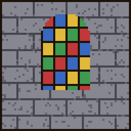

# Isabeau

{ .vm-fiche__decor }

✦ Scribe & cartographe ✦

| | |
|---|---|
| Statut | Survivante |
| Chapitre | VII — La foi et le savoir |
| Domaine | Le savoir et l'exploration : papier, livres, cartes, livres enchantés, *Chroniques de Valmont* |
| Où la trouver | Forêts de bouleaux, forêts et forêts noires, à 325–650 blocs de la ville |
| Atelier | Un scriptorium |

> Archiviste de la Grande Bibliothèque de Valmont. Elle a sauvé un coffre de registres et cherche depuis vingt ans ce qui a causé la Nuit Noire.
>
> — *Sa biographie en jeu*

Isabeau rachète **votre papier, vos livres et vos cartes vierges**. En échange, elle vend de quoi lire, écrire et s'orienter : bibliothèques, pupitres, boussoles, cartes, horloges et livres enchantés. C'est aussi elle qui écrit les **Chroniques de Valmont**, trois livres qui racontent l'histoire de la ville (voir [Les Chroniques de Valmont](../../histoire/chroniques.md)).

??? spoiler "Son rôle dans la suite de l'histoire"

    Sa découverte ouvre le chapitre VIII. Alderic l'annonce : « Isabeau a déchiffré les registres : la Nuit Noire est venue d'une Porte, ouverte avec des yeux de feu et de néant. »

    Au chapitre IX, il complète : « Les registres ne mentaient pas : la Porte dort sous la terre, au fond d'un fort oublié. »

    Le tome III des *Chroniques*, vendu au rang Maître, révèle comment rouvrir cette Porte. Ses récits suivent la même piste : la forteresse enfouie (« L'Œil de l'Ender »), puis la Porte elle-même (« La Porte du Néant »).

## La retrouver

| | |
|---|---|
| Quête de la cité | **L'archiviste** (obligatoire au chapitre VII) |
| Objectif | « Trouvez Isabeau et offrez un scriptorium à ses archives. » |
| Paysages | Forêt de bouleaux, forêt de bouleaux ancienne, forêt, forêt noire |
| Distance | Entre 325 et 650 blocs du centre de la ville |

Lancez les recherches depuis **Alderic → Quêtes de la cité**, puis suivez la barre « 🗺 Isabeau » en haut de l'écran. Elle peut apparaître à plus de 500 blocs : dans ce cas, la barre reste vide au début, explorez en direction des paysages indiqués jusqu'à ce qu'elle commence à se remplir. Le déroulement complet est expliqué dans [Retrouver et installer un personnage](../recrutement.md).

!!! tip "Préparez son scriptorium pendant le voyage"

    Dès qu'un joueur l'a rencontrée, vous pouvez déclarer un atelier **réservé à Isabeau** et le préparer pendant qu'elle fait la route jusqu'à la ville.

!!! dialogue "Isabeau, à la première rencontre"

    Pardon, je ne vous avais pas vu... j'étais plongée dans ce manuscrit.

    Isabeau, archiviste de la Grande Bibliothèque de Valmont. J'ai sauvé un coffre de registres. Personne d'autre ne s'en souciait.

    Vous bâtissez une cité ? Alors elle doit avoir une mémoire. Je viens, et mes archives aussi.

## Son atelier

Un bâtiment de type **Atelier**, libre ou réservé à Isabeau (nom proposé : `Scriptorium`).

| Exigence | Quantité |
|---|---|
| Pupitre | 1 |
| Bibliothèques | 4 |
| Table de cartographie | 1 |
| Exigences communes | 1 porte, un toit sur 60 % du sol, 2 sources de lumière |

- **Bonus du métier** (+5 points chacun) : bibliothèque sculptée, bougies, poterie (pot décoré).

!!! dialogue "Isabeau, une fois installée"

    Un scriptorium, avec de vraies fenêtres pour lire !

    Apportez-moi papier et livres : je dresse vos cartes et je recopie le savoir de Valmont.

## Ce qu'elle rachète

Les prix sont ceux d'un **lot complet**, au prix plein (entrepôt rempli à moins de 40 %). Attention : la taille du lot change selon la ressource. Au menu **Entrepôt**, vous vous servez **gratuitement** dans son stock, qui fait partie de la réserve de la ville (clic : un lot, ++shift++ + clic : une pile) ; ce que vous y prenez, et ce que vous en fabriquez, est marqué non revendable.

| Ressource (nom affiché) | Lot | Prix plein du lot | Entrepôt de base |
|---|---|---|---|
| Papier (« Paper ») | 32 | 10 coins | 1 024 |
| Livre (« Book ») | 4 | 8 coins | 256 |
| Carte vierge (« Map ») | 1 | 8 coins | 64 |

## Ce qu'elle vend

Le prix est celui **d'un achat**, qui donne la quantité indiquée. Les articles fabriqués puisent leurs matières dans un stock : s'il est vide, l'article est en rupture. Les articles **limités** se reconstituent avec le temps.

=== "★ Novice"

    | Article | Prix | Quantité | Matières ou disponibilité |
    |---|---|---|---|
    | **Chroniques de Valmont I** (livre écrit, signé Isabeau) | 5 coins | 1 | Limité : 10, +1 toutes les 10 min |
    | Livre et plume (« Writable Book ») | 7 coins | 1 | 1 livre de son stock, 1 poche d'encre de [Martin](martin.md), 1 plume de [Roland](roland.md) |
    | Pupitre (« Lectern ») | 16 coins | 1 | 3 livres de son stock, 2 bûches de [Bastien](bastien.md) |
    | Bibliothèque (« Bookshelf ») | 16 coins | 1 | 3 livres de son stock, 2 bûches de [Bastien](bastien.md) |
    | Table de cartographie (« Cartography Table ») | 3 coins | 1 | 2 papiers de son stock, 1 bûche de [Bastien](bastien.md) |

=== "★★ Apprenti"

    | Article | Prix | Quantité | Matières ou disponibilité |
    |---|---|---|---|
    | Boussole (« Compass ») | 15 coins | 1 | 4 lingots de fer de [Thorvald](thorvald.md), 1 poudre de redstone de [Godefroy](godefroy.md) |
    | Carte vierge (« Map ») | 21 coins | 1 | 8 papiers de son stock, 4 lingots de fer de [Thorvald](thorvald.md), 1 poudre de redstone de [Godefroy](godefroy.md) |
    | Bibliothèque sculptée (« Chiseled Bookshelf ») | 2 coins | 1 | 2 bûches de [Bastien](bastien.md) |

=== "★★★ Compagnon"

    | Article | Prix | Quantité | Matières ou disponibilité |
    |---|---|---|---|
    | **Chroniques de Valmont II** (livre écrit, signé Isabeau) | 8 coins | 1 | Limité : 10, +1 toutes les 10 min |
    | Motif de bannière « globe » (« Globe Banner Pattern ») | 12 coins | 1 | Limité : 2, +1 toutes les 4 h |
    | Horloge (« Clock ») | 24 coins | 1 | 4 lingots d'or de [Béatrice](beatrice.md), 1 poudre de redstone de [Godefroy](godefroy.md) |

=== "★★★★ Expert"

    | Article | Prix | Quantité | Matières ou disponibilité |
    |---|---|---|---|
    | Livre enchanté Efficacité III (« Enchanted Book — Efficiency III ») | 45 coins | 1 | Limité : 1, +1 toutes les 3 h |
    | Livre enchanté Protection III (« Enchanted Book — Protection III ») | 45 coins | 1 | Limité : 1, +1 toutes les 3 h |

    Leur description : « Copié des archives de Valmont. »

=== "★★★★★ Maître"

    | Article | Prix | Quantité | Matières ou disponibilité |
    |---|---|---|---|
    | **Chroniques de Valmont III** (livre écrit, signé Isabeau) | 10 coins | 1 | Limité : 10, +1 toutes les 10 min |
    | **Livre enchanté Raccommodage** (« Enchanted Book — Mending I ») | 250 coins | 1 | Limité : 1, +1 toutes les 24 h |

    Sa description : « Le plus précieux des registres sauvés de la Grande Bibliothèque. »

« Bûches de Bastien » : n'importe quelle essence de bûches que [Bastien](bastien.md) a en stock. Le texte des trois tomes des *Chroniques* se trouve sur la page [Les Chroniques de Valmont](../../histoire/chroniques.md) ; le tome III dévoile la suite de l'histoire.

## Ses quêtes

Deux quêtes renouvelables par joueur, à accepter dans son menu **Quêtes**. Les quantités augmentent avec son rang (de ×1 au rang Novice à ×3 au rang Maître). Le fonctionnement général est décrit dans [Travailler avec les artisans](../artisans.md#4-les-quetes-des-artisans).

=== "📖 Quête principale"

    Deux objectifs tirés au hasard. Récompense : valeur des objets × 1,25. Délai de 20 minutes avant la suivante.

    | Objet demandé | Novice | Apprenti | Compagnon | Expert | Maître |
    |---|---|---|---|---|---|
    | Papier | 32 | 48 | 64 | 80 | 96 |
    | Livre | 6 | 9 | 12 | 15 | 18 |
    | Plume | 16 | 24 | 32 | 40 | 48 |
    | Poche d'encre | 8 | 12 | 16 | 20 | 24 |
    | Carte vierge | — | 3 | 4 | 5 | 6 |

    Exemple : au rang Novice, « 32 papiers + 6 livres » rapporte **environ 28 coins**.

=== "✦ Quête spéciale"

    Deux objectifs tirés au hasard, objets ou créatures. Récompense : valeur × 1,5. Délai de 60 minutes avant la suivante.

    | Objectif | Novice | Apprenti | Compagnon | Expert | Maître |
    |---|---|---|---|---|---|
    | Poche d'encre lumineuse | 6 | 9 | 12 | 15 | 18 |
    | Cuir | 8 | 12 | 16 | 20 | 24 |
    | Poche d'encre | — | 36 | 48 | 60 | 72 |
    | Tuer des pillards | — | — | 8 | 10 | 12 |

## Ses récits

Cinq quêtes personnelles, une par rang, à faire **une seule fois** (menu **Quêtes → Récits**). Pour les récits liés à un succès Minecraft, un succès déjà obtenu valide le récit dès que vous l'acceptez.

| Rang | Récit | Objectif | Récompense |
|---|---|---|---|
| ★ Novice | 📚 Les rayonnages | Fabriquer 3 bibliothèques à l'établi | 40 coins |
| ★★ Apprenti | 🗺 Cartographe | Fabriquer 3 cartes vierges (papier + boussole) | 60 coins |
| ★★★ Compagnon | 🏺 Les ruines oubliées | Exhumer un tesson de poterie au pinceau, dans un bloc suspect (ruines, sites archéologiques) | 150 coins |
| ★★★★ Expert | 👁 L'Œil de l'Ender | Suivre un œil de l'Ender jusqu'à une forteresse (fort de l'End) | 300 coins |
| ★★★★★ Maître | 🌌 La Porte du Néant | Franchir le portail de l'End | 500 coins |

## Ses rangs

Le rang d'Isabeau est **commun à toute la ville** : chaque vente, achat et quête de chaque joueur le fait progresser.

| Rang | XP totale | Ce qui se débloque |
|---|---|---|
| ★ Novice | 0 | Chroniques tome I, livre et plume, pupitre, bibliothèque, table de cartographie ; récit « Les rayonnages » |
| ★★ Apprenti | 500 | Boussole, carte vierge, bibliothèque sculptée ; récit « Cartographe » ; cartes vierges et grosses quantités d'encre dans ses quêtes |
| ★★★ Compagnon | 2 000 | Chroniques tome II, motif de bannière « globe », horloge ; récit « Les ruines oubliées » ; chasse aux pillards dans sa quête spéciale |
| ★★★★ Expert | 5 500 | Livres enchantés Efficacité III et Protection III ; récit « L'Œil de l'Ender » |
| ★★★★★ Maître | 12 000 | Chroniques tome III, livre enchanté Raccommodage ; récit « La Porte du Néant » |

Pour lui faire gagner de l'expérience : lui vendre du papier, des livres ou des cartes (1 XP par lot + 1 XP par coin reçu), lui acheter des articles (1 XP par coin dépensé), valider ses quêtes (25 XP × son rang pour la principale, 60 XP × son rang pour la spéciale).

## Bon à savoir

- **Au chapitre VII**, la quête « La bibliothèque » demande de livrer 24 bibliothèques au chantier. Isabeau en vend dès le rang Novice, et le chantier accepte les objets achetés aux artisans. Chaque bibliothèque consomme 3 livres de son stock et 2 bûches de celui de [Bastien](bastien.md) : comptez 72 livres et 48 bûches pour les 24.
- **Ses articles puisent dans les stocks d'autres artisans** : poches d'encre de [Martin](martin.md) et plumes de [Roland](roland.md) (livre et plume), bûches de [Bastien](bastien.md) (pupitre, bibliothèques, table de cartographie), fer de [Thorvald](thorvald.md) et redstone de [Godefroy](godefroy.md) (boussole, carte vierge), or de [Béatrice](beatrice.md) (horloge). Un stock vide chez l'un d'eux met l'article en rupture.
- À l'inverse, **son papier et ses livres servent ailleurs** : motif de bannière « fleur » d'[Agathe](agathe.md), fusées de [Doc Brown](../legendes/doc-brown.md), table d'enchantement de [Gandalf](../legendes/gandalf.md) (sans le mod Iron's Spells).
- Elle arrive au même chapitre que [Frère Anselme](frere-anselme.md).
- Son entrepôt se vide d'environ 8 % de sa capacité par heure tant qu'un joueur est connecté, sans descendre sous le quart de celle-ci : la demande en papier et en livres revient toujours.
- Vous pouvez **travailler pour Isabeau** : +10 % sur vos ventes chez elle, −15 % sur vos achats chez elle.
