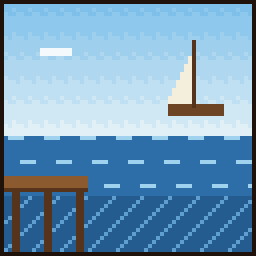

# Martin

{ .vm-fiche__decor }

✦ Pêcheur ✦

| | |
|---|---|
| Statut | Survivant |
| Chapitre | III — Les pierres et la rivière |
| Domaine | La pêche : poissons, encre, algues, cannes à pêche (enchantées aux rangs supérieurs), bateau, poissons cuits |
| Où le trouver | Plages, côtes rocheuses et rivières, à 225–450 blocs de la ville |
| Atelier | Un ponton au bord de l'eau |

> Passeur sur la rivière de Valmont. La nuit du drame, sa barque a sauvé une vingtaine d'enfants. Il n'en parle jamais.
>
> — *Sa biographie en jeu*

L'ancien passeur de la rivière rachète **vos prises** et vous vend de quoi mieux pêcher, jusqu'à la légendaire **Canne du vieux Martin**. Son atelier est un **ponton** : il lui faut de l'eau, mais presque pas de toit.

## Le retrouver

| | |
|---|---|
| Quête de la cité | **Le passeur de la rivière** (obligatoire au chapitre III) |
| Objectif | « Trouvez Martin sur les rives et installez-le près de l'eau. » |
| Paysages | Plage, côte rocheuse, plage enneigée, rivière |
| Distance | Entre 225 et 450 blocs du centre de la ville |

Lancez les recherches depuis **Alderic → Quêtes de la cité**, puis suivez la barre « 🗺 Martin » en haut de l'écran. Sur le chemin du retour, il nage et monte dans votre barque s'il le faut. Le déroulement complet est expliqué dans [Retrouver et installer un personnage](../recrutement.md).

!!! tip "Préparez son ponton pendant le voyage"

    Dès qu'un joueur l'a rencontré, vous pouvez déclarer un atelier **réservé à Martin** et le préparer pendant qu'il fait la route jusqu'à la ville.

!!! dialogue "Martin, à la première rencontre"

    Chut... vous allez effrayer le poisson.

    Martin. J'étais passeur sur la rivière de Valmont, autrefois.

    Valmont renaît au bord de l'eau ? Il faudra bien quelqu'un pour la nourrir de poisson. Allons-y.

## Son atelier

Un bâtiment de type **Atelier**, libre ou réservé à Martin (nom proposé : `Ponton`), construit **au bord de l'eau**.

| Exigence | Quantité |
|---|---|
| Tonneaux à poisson (tonneaux) | 2 |
| Blocs d'eau (accès à l'eau) | 4 |
| Exigences communes | 1 porte, un toit sur **20 %** du sol seulement, 2 sources de lumière |

- **L'eau naturelle compte** : un ponton construit au-dessus d'une rivière ou de la mer convient, à condition que la zone du bâtiment englobe au moins 4 blocs d'eau.
- **Toit réduit** : il suffit que 20 % du sol soit couvert, au lieu des 60 % habituels.
- **Bonus du métier** (+5 points chacun) : fumoir, feu de séchage (feu de camp), algues séchées (bloc d'algues séchées). Le feu de camp compte aussi comme source de lumière.

!!! dialogue "Martin, une fois installé"

    Un ponton et un séchoir à poissons ! Vous me gâtez.

    Ramenez-moi vos prises : je les achète, et je vous vends de quoi mieux pêcher.

## Ce qu'il rachète

Les prix sont ceux d'un **lot complet**, au prix plein (entrepôt rempli à moins de 40 %). La taille du lot **varie selon la prise** : 16 pour la plupart, 8 pour les poissons tropicaux, les poissons-globes et l'encre lumineuse, 64 pour les algues. Au menu **Entrepôt**, vous pouvez lui racheter son stock au double de ce prix.

| Ressource (nom affiché) | Lot | Prix plein du lot | Entrepôt de base |
|---|---|---|---|
| Morue crue (« Cod ») | 16 | 6 coins | 1 024 |
| Saumon cru (« Salmon ») | 16 | 8 coins | 1 024 |
| Poisson tropical (« Tropical Fish ») | 8 | 6 coins | 256 |
| Poisson-globe (« Pufferfish ») | 8 | 8 coins | 256 |
| Poche d'encre (« Ink Sac ») | 16 | 8 coins | 512 |
| Poche d'encre lumineuse (« Glow Ink Sac ») | 8 | 8 coins | 256 |
| Algue (« Kelp ») | 64 | 4 coins | 2 048 |
| Nénuphar (« Lily Pad ») | 16 | 4 coins | 256 |

## Ce qu'il vend

Le prix est celui **d'un achat**, qui donne la quantité indiquée. Les articles fabriqués puisent leurs matières dans un stock : s'il est vide, l'article est en rupture. Les articles **limités** se reconstituent avec le temps.

=== "★ Novice"

    | Article | Prix | Quantité | Matières ou disponibilité |
    |---|---|---|---|
    | Canne à pêche (« Fishing Rod ») | 3 coins | 1 | Limité : 4, +1 toutes les 30 min |
    | Morue cuite (« Cooked Cod ») | 7 coins | 8 | 8 morues crues de son stock |
    | Bateau en chêne (« Oak Boat ») | 2 coins | 1 | 2 bûches de chêne du stock de [Bastien](bastien.md) |

=== "★★ Apprenti"

    | Article | Prix | Quantité | Matières ou disponibilité |
    |---|---|---|---|
    | Saumon cuit (« Cooked Salmon ») | 10 coins | 8 | 8 saumons crus de son stock |
    | Bloc d'algues séchées (« Dried Kelp Block ») | 11 coins | 8 | 72 algues de son stock |

=== "★★★ Compagnon"

    | Article | Prix | Quantité | Matières ou disponibilité |
    |---|---|---|---|
    | Canne à pêche enchantée (« Fishing Rod » : Appât II, Chance de la mer II) | 25 coins | 1 | Limité : 2, +1 toutes les 120 min |
    | Seau de morue (« Cod Bucket ») | 12 coins | 1 | 1 morue crue de son stock + 3 lingots de fer du stock de [Thorvald](thorvald.md) |

=== "★★★★ Expert"

    | Article | Prix | Quantité | Matières ou disponibilité |
    |---|---|---|---|
    | Canne à pêche enchantée (« Fishing Rod » : Appât III, Chance de la mer III, Solidité III) | 80 coins | 1 | Limité : 1, +1 toutes les 240 min |
    | Seau de poisson tropical (« Tropical Fish Bucket ») | 13 coins | 1 | 1 poisson tropical de son stock + 3 lingots de fer du stock de [Thorvald](thorvald.md) |

=== "★★★★★ Maître"

    | Article | Prix | Quantité | Matières ou disponibilité |
    |---|---|---|---|
    | **Canne du vieux Martin** (canne à pêche : Appât III, Chance de la mer III, Solidité III, Raccommodage) | 250 coins | 1 | Limité : 1, +1 toutes les 24 h |

## Ses quêtes

Deux quêtes renouvelables par joueur, à accepter dans son menu **Quêtes**. Les quantités augmentent avec son rang (de ×1 au rang Novice à ×3 au rang Maître). Le fonctionnement général est décrit dans [Travailler avec les artisans](../artisans.md#4-les-quetes-des-artisans).

=== "📖 Quête principale"

    Deux objectifs tirés au hasard. Récompense : valeur des objets × 1,25. Délai de 20 minutes avant la suivante.

    | Objet demandé | Novice | Apprenti | Compagnon | Expert | Maître |
    |---|---|---|---|---|---|
    | Morue crue | 32 | 48 | 64 | 80 | 96 |
    | Saumon cru | 24 | 36 | 48 | 60 | 72 |
    | Algue | 128 | 192 | 256 | 320 | 384 |
    | Poche d'encre | 16 | 24 | 32 | 40 | 48 |
    | Nénuphar | — | 18 | 24 | 30 | 36 |

=== "✦ Quête spéciale"

    Deux objectifs tirés au hasard, objets ou créatures. Récompense : valeur × 1,5. Délai de 60 minutes avant la suivante.

    | Objectif | Novice | Apprenti | Compagnon | Expert | Maître |
    |---|---|---|---|---|---|
    | Poisson tropical | 12 | 18 | 24 | 30 | 36 |
    | Poisson-globe | 6 | 9 | 12 | 15 | 18 |
    | Poche d'encre lumineuse | — | 12 | 16 | 20 | 24 |
    | Tuer des noyés | 8 | 12 | 16 | 20 | 24 |
    | Tuer des gardiens | — | — | 6 | 8 | 9 |

## Ses récits

Cinq quêtes personnelles, une par rang, à faire **une seule fois** (menu **Quêtes → Récits**).

| Rang | Récit | Objectif | Récompense |
|---|---|---|---|
| ★ Novice | 🎣 Première prise | Pêcher 15 poissons à la canne (morue, saumon, poisson tropical ou poisson-globe) | 50 coins |
| ★★ Apprenti | 🐡 Le poisson-globe | Pêcher 3 poissons-globes à la canne | 80 coins |
| ★★★ Compagnon | 🌊 Les lumières sous l'eau | Plonger à Y = 30 ou plus bas dans un océan profond (toutes températures) | 120 coins |
| ★★★★ Expert | 💰 Pêche au trésor | Remonter 3 trésors à la ligne : livre enchanté, selle, étiquette, coquille de nautile, arc ou canne à pêche | 250 coins |
| ★★★★★ Maître | 🐟 Pêche miraculeuse | Pêcher 200 poissons à la canne | 400 coins |

## Ses rangs

Le rang de Martin est **commun à toute la ville** : chaque vente, achat et quête de chaque joueur le fait progresser.

| Rang | XP totale | Ce qui se débloque |
|---|---|---|
| ★ Novice | 0 | Canne à pêche, morue cuite, bateau en chêne ; récit « Première prise » |
| ★★ Apprenti | 300 | Saumon cuit, bloc d'algues séchées ; récit « Le poisson-globe » ; nénuphars et poches d'encre lumineuses dans ses quêtes |
| ★★★ Compagnon | 1 200 | Canne enchantée (Appât II), seau de morue ; récit « Les lumières sous l'eau » ; gardiens dans ses quêtes |
| ★★★★ Expert | 3 500 | Canne enchantée (Appât III), seau de poisson tropical ; récit « Pêche au trésor » |
| ★★★★★ Maître | 8 000 | Canne du vieux Martin ; récit « Pêche miraculeuse » |

Pour lui faire gagner de l'expérience : lui vendre vos prises (1 XP par lot + 1 XP par coin reçu), lui acheter des articles (1 XP par coin dépensé), valider ses quêtes (20 XP × son rang pour la principale, 50 XP × son rang pour la spéciale).

## Bon à savoir

- **Il dépend** de [Bastien](bastien.md) (bûches de chêne du bateau) et de [Thorvald](thorvald.md) (fer des seaux de poisson). Tant que Thorvald n'a pas rejoint la ville, ses seaux sont en rupture.
- **D'autres artisans puisent dans son stock** : [Agathe](agathe.md) (poches d'encre pour la teinture noire), [Frère Anselme](frere-anselme.md) (poissons-globes pour la potion de respiration aquatique), [Isabeau](isabeau.md) (poches d'encre pour le livre et plume), [Jack Sparrow](../legendes/jack-sparrow.md) (poches d'encre pour la prismarine sombre).
- Son récit « Pêche au trésor » et ses cannes enchantées vont de pair : plus la Chance de la mer est élevée, plus les trésors remontent souvent.
- Son entrepôt se vide d'environ 8 % par heure tant qu'un joueur est connecté : la demande en poisson revient toujours.
- Vous pouvez **travailler pour Martin** : +10 % sur ce que vous lui vendez, −15 % sur vos achats chez lui.
