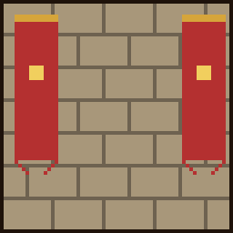

# Roland

{ .vm-fiche__decor }

✦ Capitaine de la garde ✦

| | |
|---|---|
| Statut | Survivant |
| Chapitre | VI — Les routes et la garde |
| Domaine | Le combat : chasse aux monstres, archerie (arcs, arbalètes, flèches à effets) et défense de la ville |
| Où le trouver | Plaines, forêts et taïgas, à 325–650 blocs de la ville |
| Atelier | Une caserne |

> Sergent de la garde de Valmont. Il a mené l'évacuation et perdu toute sa compagnie. Depuis, il escorte les convois contre les pillards.
>
> — *Sa biographie en jeu*

Le sergent sans compagnie a juré que Valmont ne brûlerait pas une seconde fois. Il paie les primes de vos chasses (la **chair putréfiée**), rachète **flèches, silex et plumes**, et vend arcs, arbalètes et flèches à effets. Surtout, il **forme la garde de Valmont** à partir des habitants de la ville.

## Le retrouver

| | |
|---|---|
| Quête de la cité | **Le sergent sans compagnie** (obligatoire au chapitre VI) |
| Objectif | « Trouvez Roland sur les routes et confiez-lui la garde de la ville. » |
| Paysages | Plaine, forêt, taïga |
| Distance | Entre 325 et 650 blocs du centre de la ville |

Lancez les recherches depuis **Alderic → Quêtes de la cité**, puis suivez la barre « 🗺 Roland » en haut de l'écran. Au-delà de 500 blocs, la barre reste vide : avancez vers les paysages indiqués jusqu'à ce qu'elle commence à se remplir. Le déroulement complet est expliqué dans [Retrouver et installer un personnage](../recrutement.md).

!!! tip "Préparez sa caserne pendant le voyage"

    Dès qu'un joueur l'a rencontré, vous pouvez déclarer un atelier **réservé à Roland** et le préparer pendant qu'il fait la route jusqu'à la ville.

!!! dialogue "Roland, à la première rencontre"

    Main sur la garde, voyageur. Tu viens en paix ?

    Roland, sergent de la garde de Valmont. J'ai perdu toute ma compagnie cette nuit-là.

    Je ne laisserai pas Valmont brûler une seconde fois. S'il lui faut un capitaine, en avant.

## Son atelier

Un bâtiment de type **Atelier**, libre ou réservé à Roland (nom proposé : `Caserne`).

| Exigence | Quantité |
|---|---|
| Cible d'entraînement (bloc cible) | 1 |
| Table d'archerie | 1 |
| Exigences communes | 1 porte, un toit sur 60 % du sol, 2 sources de lumière |

- **Bonus du métier** (+5 points chacun) : bannière de la garde (bannière), cloche d'alarme (cloche), meule.
- C'est aussi dans cet atelier, à côté de Roland, que s'entraînent les recrues de la garde.

!!! dialogue "Roland, une fois installé"

    Une caserne et une armurerie. La ville peut dormir tranquille.

    Rapportez les preuves de vos chasses : je paie les primes. Et j'équipe ceux qui défendent la ville.

## Ce qu'il rachète

Les prix sont ceux d'un **lot complet de 32 objets**, au prix plein (entrepôt rempli à moins de 40 %). Au menu **Entrepôt**, vous vous servez **gratuitement** dans son stock, qui fait partie de la réserve de la ville (clic : un lot, ++shift++ + clic : une pile) ; ce que vous y prenez, et ce que vous en fabriquez, est marqué non revendable.

| Ressource (nom affiché) | Prix plein du lot de 32 | Entrepôt de base |
|---|---|---|
| Chair putréfiée (« Rotten Flesh ») | 2 coins | 2 048 |
| Flèche (« Arrow ») | 4 coins | 1 024 |
| Silex (« Flint ») | 6 coins | 1 024 |
| Plume (« Feather ») | 8 coins | 1 024 |

La chair putréfiée est la « preuve de chasse » dont il paie la prime.

## Ce qu'il vend

Le prix est celui **d'un achat**, qui donne la quantité indiquée. Les articles fabriqués puisent leurs matières dans un stock : s'il est vide, l'article est en rupture. Les articles **limités** se reconstituent avec le temps.

=== "★ Novice"

    | Article | Prix | Quantité | Matières ou disponibilité |
    |---|---|---|---|
    | Flèche (« Arrow ») | 9 coins | 32 | 8 silex + 8 plumes de son stock + 1 bûche au choix du stock de [Bastien](bastien.md) |
    | Arc (« Bow ») | 3 coins | 1 | 3 ficelles du stock d'[Agathe](agathe.md) + 1 bûche au choix du stock de [Bastien](bastien.md) |

=== "★★ Apprenti"

    | Article | Prix | Quantité | Matières ou disponibilité |
    |---|---|---|---|
    | Arbalète (« Crossbow ») | 6 coins | 1 | 2 ficelles du stock d'[Agathe](agathe.md) + 1 lingot de fer du stock de [Thorvald](thorvald.md) + 1 bûche au choix du stock de [Bastien](bastien.md) |
    | Flèche spectrale (« Spectral Arrow ») | 20 coins | 8 | 4 flèches de son stock + 16 poudres lumineuses du stock de [Frère Anselme](frere-anselme.md) |

=== "★★★ Compagnon"

    | Article | Prix | Quantité | Matières ou disponibilité |
    |---|---|---|---|
    | Arc enchanté (« Bow » : Puissance III, Solidité II) | 30 coins | 1 | Limité : 2, +1 toutes les 2 h |
    | Flèche de lenteur (« Tipped Arrow », potion « Slowness ») | 15 coins | 8 | Limité : 4, +1 toutes les heures |
    | Flèche de poison (« Tipped Arrow », potion « Poison ») | 15 coins | 8 | Limité : 4, +1 toutes les heures |

=== "★★★★ Expert"

    | Article | Prix | Quantité | Matières ou disponibilité |
    |---|---|---|---|
    | Arbalète enchantée (« Crossbow » : Charge rapide III, Tir multiple I) | 60 coins | 1 | Limité : 1, +1 toutes les 4 h |
    | Arc enchanté (« Bow » : Puissance IV, Frappe I, Solidité III) | 80 coins | 1 | Limité : 1, +1 toutes les 4 h |
    | Flèche de dégâts (« Tipped Arrow », potion « Harming ») | 25 coins | 8 | Limité : 2, +1 toutes les 2 h |

=== "★★★★★ Maître"

    | Article | Prix | Quantité | Matières ou disponibilité |
    |---|---|---|---|
    | **Arc du capitaine** (arc, Puissance V, Frappe II, Flamme I, Infinité I, Solidité III) | 300 coins | 1 | Limité : 1, +1 toutes les 24 h |

« Bûche au choix » : n'importe laquelle des huit essences de surface que Bastien a en réserve.

## Ses quêtes

Deux quêtes renouvelables par joueur, à accepter dans son menu **Quêtes**. Les quantités augmentent avec son rang (de ×1 au rang Novice à ×3 au rang Maître). Le fonctionnement général est décrit dans [Travailler avec les artisans](../artisans.md#4-les-quetes-des-artisans).

=== "📖 Quête principale"

    Deux objectifs tirés au hasard. Récompense : valeur des objets × 1,25. Délai de 20 minutes avant la suivante.

    | Objet demandé | Novice | Apprenti | Compagnon | Expert | Maître |
    |---|---|---|---|---|---|
    | Chair putréfiée | 64 | 96 | 128 | 160 | 192 |
    | Flèche | 32 | 48 | 64 | 80 | 96 |
    | Plume | 32 | 48 | 64 | 80 | 96 |
    | Silex | 32 | 48 | 64 | 80 | 96 |

=== "✦ Quête spéciale"

    Ses quêtes spéciales sont uniquement des **contrats de chasse** : **trois** créatures tirées au hasard. Récompense : primes × 1,5. Délai de 60 minutes avant la suivante. Pendant un contrat, chaque monstre abattu s'affiche au-dessus de la barre d'objets (« ⚔ Roland — 3/15 »).

    | Objectif | Novice | Apprenti | Compagnon | Expert | Maître |
    |---|---|---|---|---|---|
    | Tuer des zombies | 15 | 23 | 30 | 38 | 45 |
    | Tuer des squelettes | 12 | 18 | 24 | 30 | 36 |
    | Tuer des creepers | 6 | 9 | 12 | 15 | 18 |
    | Tuer des araignées | 10 | 15 | 20 | 25 | 30 |
    | Tuer des sorcières | — | 5 | 6 | 8 | 9 |
    | Tuer des pillards | — | 12 | 16 | 20 | 24 |
    | Tuer des vagabonds | — | 9 | 12 | 15 | 18 |
    | Tuer des vindicateurs | — | — | 6 | 8 | 9 |
    | Tuer des phantoms | — | — | 10 | 13 | 15 |
    | Tuer des endermen | — | — | 10 | 13 | 15 |
    | Tuer des squelettes des marais | — | — | — | 15 | 18 |

    Exemple : au rang Novice, « 15 zombies + 12 squelettes + 6 creepers » rapporte environ **97 coins**.

## Ses récits

Cinq quêtes personnelles, une par rang, à faire **une seule fois** (menu **Quêtes → Récits**). Plusieurs récits reposent sur des succès Minecraft : un succès déjà obtenu valide le récit dès que vous l'acceptez.

| Rang | Récit | Objectif | Récompense |
|---|---|---|---|
| ★ Novice | 🌙 La ronde de nuit | Tuer 20 morts-vivants (zombies, zombies desséchés, noyés ou zombies-villageois) | 40 coins |
| ★★ Apprenti | ⚔ Les pillards | Tuer 10 pillards | 120 coins |
| ★★★ Compagnon | 🏹 Tireur d'élite | Abattre un squelette d'une flèche tirée à plus de 50 blocs | 200 coins |
| ★★★★ Expert | 🛡 Héros du village | Repousser un raid de pillards (victoire contre un raid de village) | 400 coins |
| ★★★★★ Maître | ☠ Chasseur de monstres | Obtenir le succès « Monsters Hunted » : tuer au moins une fois chaque monstre hostile | 800 coins |

## Ses rangs

Le rang de Roland est **commun à toute la ville** : chaque vente, achat et quête de chaque joueur le fait progresser. Chaque rang agrandit aussi la garde (voir [La garde de Valmont](#la-garde-de-valmont)).

| Rang | XP totale | Ce qui se débloque |
|---|---|---|
| ★ Novice | 0 | Flèches, arc ; récit « La ronde de nuit » ; rôle de garde Soldat |
| ★★ Apprenti | 500 | Arbalète, flèches spectrales ; récit « Les pillards » ; sorcières, pillards et vagabonds dans ses contrats ; rôle de garde Archer |
| ★★★ Compagnon | 2 000 | Arc enchanté, flèches de lenteur et de poison ; récit « Tireur d'élite » ; vindicateurs, phantoms et endermen dans ses contrats |
| ★★★★ Expert | 5 500 | Arbalète et arc enchantés, flèches de dégâts ; récit « Héros du village » ; squelettes des marais dans ses contrats ; rôle de garde Sergent |
| ★★★★★ Maître | 12 000 | Arc du capitaine ; récit « Chasseur de monstres » |

Pour lui faire gagner de l'expérience : lui vendre ses ressources (1 XP par lot + 1 XP par coin reçu), lui acheter des articles (1 XP par coin dépensé), valider ses quêtes (25 XP × son rang pour la principale, 60 XP × son rang pour la spéciale). Roland est aussi le seul artisan qui progresse grâce aux **sièges** : chaque siège repoussé lui rapporte 40 XP + 10 XP par palier de la ville (100 XP au chapitre VI). Voir [Les sièges](../../guide/sieges.md).

## La garde de Valmont

!!! nouveau "Fonctionnalité récente"

    La garde vient d'arriver sur le serveur et est encore en test : ses règles et ses chiffres sont susceptibles d'évoluer. Signalez tout comportement étrange à l'équipe.

Dans ses **Actions**, en plus des employés et de l'annexe de travail que propose chaque artisan (voir [Le travail des habitants](../../guide/habitants.md#le-travail-des-habitants)), Roland est le seul à former la **garde** : il transforme les habitants de Valmont en **gardes** qui patrouillent et défendent la ville. La garde est **commune à tous les joueurs** : chacun voit la même liste, peut lancer une formation ou renvoyer un garde.

Pour l'ouvrir, parlez à Roland, cliquez sur son **portrait**, puis sur **🛡 Actions → 🛡 La garde**. Avec les menus classiques, utilisez les commandes `/city garde` (bilan), `/city garde former <habitant> <rôle>` et `/city garde renvoyer <nom>`.

Trois conditions pour former une recrue :

- **Roland doit être installé dans son atelier.** Sans atelier, les formations en cours sont en pause et aucune nouvelle recrue ne peut être formée.
- **Il faut des habitants à former** : il en arrive un par lit d'habitation conforme (voir [Les habitants](../../guide/habitants.md)).
- **La garde ne doit pas être complète** : sa taille et le nombre de formations simultanées dépendent du rang de Roland.

### Les rôles

| Rôle | Rang de Roland | Formation | Vie | Combat | Équipement |
|---|---|---|---|---|---|
| Soldat | ★ Novice | 10 min | 30 PV (15 ❤) | Au contact | Épée en fer, casque, plastron, jambières et bottes en fer |
| Archer | ★★ Apprenti | 15 min | 24 PV (12 ❤) | À distance (arc) | Arc, chapeau en cuir, cotte de mailles, pantalon et bottes en cuir |
| Sergent | ★★★★ Expert | 25 min | 40 PV (20 ❤) | Au contact | Épée en diamant, casque en fer, plastron en diamant, jambières et bottes en fer |

### Taille de la garde

| Rang de Roland | Gardes au plus (gardes + recrues) | Formations en même temps |
|---|---|---|
| ★ Novice | 8 | 2 |
| ★★ Apprenti | 16 | 3 |
| ★★★ Compagnon | 25 | 4 |
| ★★★★ Expert | 36 | 5 |
| ★★★★★ Maître | 50 | 6 |

Pour faire grandir la garde, il faut donc faire monter Roland en rang.

### La formation

- Dans l'écran « La garde de Valmont », cliquez sur un habitant à l'anneau **vert**, puis choisissez son **rôle**. Un rôle d'un rang que Roland n'a pas atteint est verrouillé (« 🔒 Roland doit être au rang 2 »).
- La recrue rejoint l'atelier de Roland et s'entraîne à côté de lui, jour et nuit. Au-dessus de sa tête, un minuteur indique le temps restant.
- Le temps n'avance **que si au moins un joueur est connecté** et que Roland a son atelier ; sinon, le minuteur affiche « ⏸ » en rouge.
- En fin de formation, la recrue revêt l'uniforme de la garde, avec l'arme et l'armure de son rôle.

### Les gardes en service

- Ils patrouillent sur le terrain de la ville, de jour comme de nuit, sans jamais entrer dans les bâtiments.
- Ils repèrent les monstres à 16 blocs et les attaquent : soldats et sergents au contact, archers à l'arc jusqu'à 14 blocs. Ils ne poursuivent pas un monstre hors de la ville.
- Ils ne blessent ni les joueurs, ni les habitants, ni les animaux, et les joueurs ne peuvent pas les blesser.
- Un garde garde son lit d'habitant mais ne paie plus l'impôt de l'aube.
- **Pendant un siège**, la garde se poste du côté attaqué (soldats et sergents en première ligne, archers derrière), puis reprend ses rondes. Les sièges ont lieu tous les jours à 22 h (heure de Paris) à partir du chapitre IV, s'il y a au moins 2 joueurs connectés.
- Pour rendre un garde ou une recrue à la vie civile : ++shift++ + clic droit dessus dans la liste de la garde.
- **Un garde mort n'est pas remplacé automatiquement** : sa place se libère, et il faut former une nouvelle recrue.

Tout le détail (écran de la garde, combat, sièges) : [La garde de Valmont](../../guide/garde.md).

## Bon à savoir

- **Au chapitre VI**, deux quêtes de la cité vont avec lui : « Les routes marchandes » (« Chassez 15 pillards qui rançonnent les marchands. ») et « La milice » (« Éliminez 150 monstres pour aguerrir la milice de Roland. »). Un pillard abattu compte pour les deux. Il est recruté au même chapitre qu'[Edmond](edmond.md).
- **Il puise dans les stocks d'autres artisans** : la ficelle d'[Agathe](agathe.md) (arcs, arbalètes), les bûches de [Bastien](bastien.md), le fer de [Thorvald](thorvald.md) (arbalète) et la poudre lumineuse de [Frère Anselme](frere-anselme.md) (flèches spectrales). Un stock vide chez l'un d'eux met l'article en rupture.
- **Son silex et ses plumes servent ailleurs** : briquet de [Thorvald](thorvald.md), livre et plume d'[Isabeau](isabeau.md) (qui demande aussi des plumes dans ses quêtes).
- **Les habitants fournissent ses recrues** : plus la ville a de lits d'habitation conformes, plus la garde peut grandir.
- Son entrepôt se vide d'environ 8 % de sa capacité par heure tant qu'un joueur est connecté, sans descendre sous le quart de celle-ci : la demande en flèches et en preuves de chasse revient toujours.
- Vous pouvez **travailler pour Roland** : +10 % sur vos ventes chez lui, −15 % sur vos achats chez lui.

??? spoiler "Son rôle dans la suite de l'histoire"

    Au chapitre IX, avant l'assaut de la Porte du Néant, Alderic annonce : « Thorvald forge nos meilleures lames, Anselme prépare ses potions, Roland entraîne la garde. »

    La quête de la cité **La garde de Valmont** exige alors qu'il progresse : « Roland doit atteindre le rang Compagnon : la garde est prête. »
