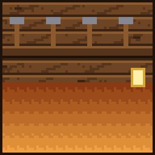

# Thorvald

{ .vm-fiche__decor }

✦ Forgeron ✦

| | |
|---|---|
| Statut | Survivant |
| Chapitre | V — Le marteau et le métier |
| Domaine | La forge : lingots de fer et de cuivre, fragments de netherite ; outils, armures (fer, mailles, diamant), enclumes, cloches, netherite |
| Où le trouver | Terres enneigées et taïgas, à 275–550 blocs de la ville |
| Atelier | Une forge |

> Forgeron venu des fjords du nord, il a forgé les portes de Valmont. Elles ont tenu une heure face au dragon : assez pour sauver des centaines de vies.
>
> — *Sa biographie en jeu*

Le forgeron du nord rachète vos **lingots de fer et de cuivre** et forge tout l'équipement de la ville : outils, armures de fer, de mailles et de diamant, enclumes, jusqu'à la **Lame de Valmont**. Ses lingots de fer servent aussi d'ingrédient à de **nombreux autres artisans** : sans fer chez Thorvald, une bonne partie des boutiques de la ville tombe en rupture.

## Le retrouver

| | |
|---|---|
| Quête de la cité | **Le forgeron du nord** (obligatoire au chapitre V) |
| Objectif | « Trouvez Thorvald dans les terres enneigées et offrez-lui une forge. » |
| Paysages | Taïga enneigée, taïga, plaines enneigées, bosquet, taïga d'épicéas ancienne |
| Distance | Entre 275 et 550 blocs du centre de la ville |

Lancez les recherches depuis **Alderic → Quêtes de la cité**, puis suivez la barre « 🗺 Thorvald » en haut de l'écran. Au-delà de 500 blocs, la barre reste vide : avancez vers les paysages indiqués jusqu'à ce qu'elle commence à se remplir. Le déroulement complet est expliqué dans [Retrouver et installer un personnage](../recrutement.md).

!!! tip "Préparez sa forge pendant le voyage"

    Dès qu'un joueur l'a rencontré, vous pouvez déclarer un atelier **réservé à Thorvald** et le préparer pendant qu'il fait la route jusqu'à la ville.

!!! dialogue "Thorvald, à la première rencontre"

    Halte. Tu marches sur ma neige.

    Thorvald, forgeron. Les portes de Valmont, c'est moi. Elles ont tenu une heure. Pas assez.

    Valmont se relève ? Alors elle aura des portes. Des vraies, cette fois. Je viens. Ne parle pas trop en route.

## Son atelier

Un bâtiment de type **Atelier**, libre ou réservé à Thorvald (nom proposé : `Forge`).

| Exigence | Quantité |
|---|---|
| Enclume | 1 |
| Haut-fourneau | 1 |
| Table de forgeron | 1 |
| Exigences communes | 1 porte, un toit sur 60 % du sol, 2 sources de lumière |

- **Enclume acceptée** : intacte, ébréchée ou endommagée.
- **Bonus du métier** (+5 points chacun) : meule, chaudron de lave, chaîne.

!!! dialogue "Thorvald, une fois installé"

    *frappe l'enclume* Elle chante juste. Bonne forge.

    Apporte des lingots. Je forge outils et armures. Et je paie le fer au prix du fer.

## Ce qu'il rachète

Les prix sont ceux d'un **lot complet**, dont la taille dépend de la ressource, au prix plein (entrepôt rempli à moins de 40 %). Les fragments de netherite se vendent un par un. Au menu **Entrepôt**, vous vous servez **gratuitement** dans son stock, qui fait partie de la réserve de la ville (clic : un lot, ++shift++ + clic : une pile) ; ce que vous y prenez, et ce que vous en fabriquez, est marqué non revendable.

| Ressource (nom affiché) | Lot | Prix plein du lot | Entrepôt de base |
|---|---|---|---|
| Lingot de fer (« Iron Ingot ») | 16 | 24 coins | 1 024 |
| Lingot de cuivre (« Copper Ingot ») | 32 | 10 coins | 1 024 |
| Fragment de netherite (« Netherite Scrap ») | 1 | 30 coins | 32 |

Il rachète les **lingots**, pas les minerais bruts : le fer brut et le cuivre brut se vendent à [Godefroy](godefroy.md).

## Ce qu'il vend

Le prix est celui **d'un achat**, qui donne la quantité indiquée. Les articles fabriqués puisent leurs matières dans un stock : s'il est vide, l'article est en rupture. Les articles **limités** se reconstituent avec le temps.

=== "★ Novice"

    | Article | Prix | Quantité | Matières ou disponibilité |
    |---|---|---|---|
    | Seau (« Bucket ») | 11 coins | 1 | 3 lingots de fer de son stock |
    | Cisailles (« Shears ») | 7 coins | 1 | 2 lingots de fer de son stock |
    | Pelle en fer (« Iron Shovel ») | 4 coins | 1 | 1 lingot de fer de son stock |
    | Épée en fer (« Iron Sword ») | 7 coins | 1 | 2 lingots de fer de son stock |
    | Hache en fer (« Iron Axe ») | 11 coins | 1 | 3 lingots de fer de son stock |
    | Pioche en fer (« Iron Pickaxe ») | 11 coins | 1 | 3 lingots de fer de son stock |
    | Houe en fer (« Iron Hoe ») | 7 coins | 1 | 2 lingots de fer de son stock |
    | Bouclier (« Shield ») | 5 coins | 1 | 1 lingot de fer de son stock + 2 bûches au choix du stock de [Bastien](bastien.md) |
    | Briquet (« Flint And Steel ») | 4 coins | 1 | 1 lingot de fer de son stock + 1 silex du stock de [Roland](roland.md) |

=== "★★ Apprenti"

    | Article | Prix | Quantité | Matières ou disponibilité |
    |---|---|---|---|
    | Casque en fer (« Iron Helmet ») | 18 coins | 1 | 5 lingots de fer de son stock |
    | Plastron en fer (« Iron Chestplate ») | 28 coins | 1 | 8 lingots de fer de son stock |
    | Jambières en fer (« Iron Leggings ») | 25 coins | 1 | 7 lingots de fer de son stock |
    | Bottes en fer (« Iron Boots ») | 14 coins | 1 | 4 lingots de fer de son stock |
    | Barreaux de fer (« Iron Bars ») | 21 coins | 16 | 6 lingots de fer de son stock |
    | Chaîne (« Chain ») | 14 coins | 4 | 4 lingots de fer de son stock |
    | Chaudron (« Cauldron ») | 25 coins | 1 | 7 lingots de fer de son stock |
    | Paratonnerre (« Lightning Rod ») | 3 coins | 1 | 3 lingots de cuivre de son stock |

=== "★★★ Compagnon"

    | Article | Prix | Quantité | Matières ou disponibilité |
    |---|---|---|---|
    | Enclume (« Anvil ») | 107 coins | 1 | 31 lingots de fer de son stock |
    | Table de forgeron (« Smithing Table ») | 8 coins | 1 | 2 lingots de fer de son stock + 1 bûche au choix du stock de [Bastien](bastien.md) |
    | Casque de mailles (« Chainmail Helmet ») | 20 coins | 1 | 5 lingots de fer de son stock |
    | Cotte de mailles (« Chainmail Chestplate ») | 32 coins | 1 | 8 lingots de fer de son stock |
    | Jambières de mailles (« Chainmail Leggings ») | 28 coins | 1 | 7 lingots de fer de son stock |
    | Bottes de mailles (« Chainmail Boots ») | 16 coins | 1 | 4 lingots de fer de son stock |

    L'armure de mailles ne se fabrique pas à l'établi : Thorvald est l'un des rares moyens de s'en procurer.

=== "★★★★ Expert"

    | Article | Prix | Quantité | Matières ou disponibilité |
    |---|---|---|---|
    | Épée en diamant (« Diamond Sword ») | 56 coins | 1 | 2 diamants du stock de [Godefroy](godefroy.md) |
    | Pioche en diamant (« Diamond Pickaxe ») | 83 coins | 1 | 3 diamants du stock de [Godefroy](godefroy.md) |
    | Hache en diamant (« Diamond Axe ») | 83 coins | 1 | 3 diamants du stock de [Godefroy](godefroy.md) |
    | Pelle en diamant (« Diamond Shovel ») | 28 coins | 1 | 1 diamant du stock de [Godefroy](godefroy.md) |
    | Casque en diamant (« Diamond Helmet ») | 138 coins | 1 | 5 diamants du stock de [Godefroy](godefroy.md) |
    | Plastron en diamant (« Diamond Chestplate ») | 221 coins | 1 | 8 diamants du stock de [Godefroy](godefroy.md) |
    | Jambières en diamant (« Diamond Leggings ») | 194 coins | 1 | 7 diamants du stock de [Godefroy](godefroy.md) |
    | Bottes en diamant (« Diamond Boots ») | 111 coins | 1 | 4 diamants du stock de [Godefroy](godefroy.md) |
    | Cloche (« Bell ») — « Coulée pour la cathédrale. » | 34 coins | 1 | 4 lingots d'or du stock de [Béatrice](beatrice.md) + 2 lingots de fer de son stock |

=== "★★★★★ Maître"

    | Article | Prix | Quantité | Matières ou disponibilité |
    |---|---|---|---|
    | Modèle de forge : amélioration en netherite (« Netherite Upgrade Smithing Template ») | 350 coins | 1 | Limité : 1, +1 toutes les 12 h |
    | Lingot de netherite (« Netherite Ingot ») | 299 coins | 1 | 4 fragments de netherite de son stock + 4 lingots d'or du stock de [Béatrice](beatrice.md) |
    | **Lame de Valmont** (épée en diamant, Tranchant V, Solidité III, Butin III) | 450 coins | 1 | 2 diamants du stock de [Godefroy](godefroy.md) ; limité : 1, +1 toutes les 24 h |

« Bûche au choix » : n'importe laquelle des huit essences de surface que Bastien a en réserve.

## Ses quêtes

Deux quêtes renouvelables par joueur, à accepter dans son menu **Quêtes**. Les quantités augmentent avec son rang (de ×1 au rang Novice à ×3 au rang Maître). Le fonctionnement général est décrit dans [Travailler avec les artisans](../artisans.md#4-les-quetes-des-artisans).

=== "📖 Quête principale"

    Deux objectifs tirés au hasard. Récompense : valeur des objets × 1,25. Délai de 20 minutes avant la suivante.

    | Objet demandé | Novice | Apprenti | Compagnon | Expert | Maître |
    |---|---|---|---|---|---|
    | Lingot de fer | 32 | 48 | 64 | 80 | 96 |
    | Lingot de cuivre | 64 | 96 | 128 | 160 | 192 |
    | Charbon | 48 | 72 | 96 | 120 | 144 |

    Les lingots livrés rejoignent son entrepôt ; le charbon, qu'il ne rachète pas, n'y entre pas.

=== "✦ Quête spéciale"

    Deux objectifs tirés au hasard, objets ou créatures. Récompense : valeur × 1,5. Délai de 60 minutes avant la suivante.

    | Objectif | Novice | Apprenti | Compagnon | Expert | Maître |
    |---|---|---|---|---|---|
    | Fer brut | — | 72 | 96 | 120 | 144 |
    | Charbon | — | 192 | 256 | 320 | 384 |
    | Fragment de netherite | — | — | — | — | 3 |
    | Tuer des zombies | 10 | 15 | 20 | 25 | 30 |
    | Tuer des squelettes | 8 | 12 | 16 | 20 | 24 |
    | Tuer des squelettes wither | — | — | — | 8 | 9 |

## Ses récits

Cinq quêtes personnelles, une par rang, à faire **une seule fois** (menu **Quêtes → Récits**). Ses récits reposent sur des succès Minecraft : un succès déjà obtenu valide le récit dès que vous l'acceptez.

| Rang | Récit | Objectif | Récompense |
|---|---|---|---|
| ★ Novice | 🔥 L'épreuve du feu | Fondre du fer | 30 coins |
| ★★ Apprenti | 🛡 Armure de fer | Revêtir une pièce d'armure de fer | 60 coins |
| ★★★ Compagnon | ⚒ L'enclume | Forger une enclume (l'acheter ne compte pas) | 120 coins |
| ★★★★ Expert | 💎 Couvert de diamants | Porter une armure complète de diamant | 250 coins |
| ★★★★★ Maître | 🔨 Couvert de débris | Porter une armure complète de netherite | 800 coins |

Pour « Couvert de diamants », le succès du jeu de base s'obtiendrait dès la première pièce d'armure en diamant à vérifier.

## Ses rangs

Le rang de Thorvald est **commun à toute la ville** : chaque vente, achat et quête de chaque joueur le fait progresser. Ses seuils sont les plus élevés des sept premiers artisans.

| Rang | XP totale | Ce qui se débloque |
|---|---|---|
| ★ Novice | 0 | Outils en fer, seau, cisailles, bouclier, briquet ; récit « L'épreuve du feu » |
| ★★ Apprenti | 600 | Armure en fer, barreaux, chaînes, chaudron, paratonnerre ; récit « Armure de fer » ; fer brut et charbon dans ses quêtes spéciales |
| ★★★ Compagnon | 2 500 | Enclume, table de forgeron, armure de mailles ; récit « L'enclume » |
| ★★★★ Expert | 7 000 | Outils et armure en diamant, cloche ; récit « Couvert de diamants » ; squelettes wither dans ses quêtes |
| ★★★★★ Maître | 15 000 | Modèle de forge netherite, lingot de netherite, Lame de Valmont ; récit « Couvert de débris » ; fragments de netherite dans ses quêtes |

Pour lui faire gagner de l'expérience : lui vendre des lingots ou des fragments (1 XP par lot + 1 XP par coin reçu), lui acheter des articles (1 XP par coin dépensé), valider ses quêtes (25 XP × son rang pour la principale, 60 XP × son rang pour la spéciale).

## Bon à savoir

- **Au chapitre V**, la quête « L'arsenal » demande : « Constituez une réserve de 192 lingots de fer chez Thorvald. » Vendez-lui vos lingots de fer : la quête est acquise dès que son stock atteint 192, même s'il baisse ensuite. D'ici là, chaque achat qui consomme son fer (chez lui ou chez un autre artisan) fait baisser la réserve.
- **Il puise dans les stocks d'autres artisans** : les diamants de [Godefroy](godefroy.md) (tout l'équipement en diamant et la Lame de Valmont), les bûches de [Bastien](bastien.md) (bouclier, table de forgeron), le silex de [Roland](roland.md) (briquet) et l'or de [Béatrice](beatrice.md) (cloche, lingot de netherite). Tant que l'un de ces stocks est vide, les articles concernés sont en rupture.
- **Son fer alimente toute la ville** : Hache du charbonnier de [Bastien](bastien.md), Houe d'abondance d'[Hélène](helene.md), tailleur de pierre de [Brennan](brennan.md), seaux de poisson de [Martin](martin.md), selle et armure de cheval d'[Edmond](edmond.md), arbalète de [Roland](roland.md), boussole et carte d'[Isabeau](isabeau.md), pistons, entonnoir et crafteur de [Doc Brown](../legendes/doc-brown.md), boussole de récupération de [Gandalf](../legendes/gandalf.md) (sans le mod Iron's Spells). [Béatrice](beatrice.md) prend aussi son cuivre pour sa longue-vue.
- Son entrepôt se vide d'environ 8 % de sa capacité par heure tant qu'un joueur est connecté, sans descendre sous le quart de celle-ci : la demande en lingots revient toujours.
- Vous pouvez **travailler pour Thorvald** : +10 % sur vos ventes de lingots, −15 % sur vos achats chez lui.

??? spoiler "Son rôle dans la suite de l'histoire"

    Les rangs de Thorvald rythment la fin de la trame. Plusieurs quêtes de la cité dépendent de lui :

    | Chapitre | Quête de la cité | Objectif |
    |---|---|---|
    | VI — Les routes et la garde | Le maître forgeron | « Thorvald doit atteindre le rang Compagnon. » |
    | VIII — L'or, le verre et le feu | La cloche de la cathédrale | « Livrez 1 cloche (Thorvald sait en couler). » Sa cloche (rang Expert) peut être livrée au chantier. |
    | IX — La Porte du Néant | Les lames de la vengeance | « Thorvald doit atteindre le rang Expert : il forge les armes de l'assaut. » |
    | X — La nouvelle Valmont | ★ Maître forgeron (haut fait facultatif) | « Thorvald atteint le rang Maître. » |

    Avant l'assaut de la Porte, Alderic annonce : « Thorvald forge nos meilleures lames, Anselme prépare ses potions, Roland entraîne la garde. »

    Le tome I des *Chroniques de Valmont*, vendu par [Isabeau](isabeau.md), raconte la Nuit Noire : « Un dragon noir surgit du Néant. Les portes de Thorvald tinrent une heure. Puis Valmont brûla. »
