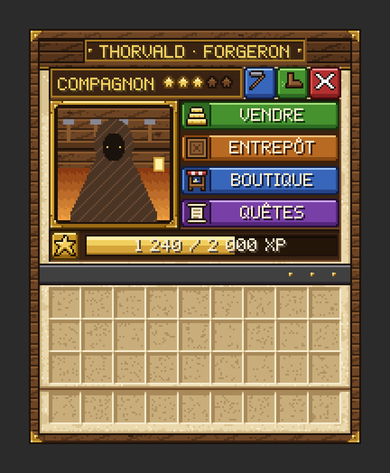

# Rejoindre le serveur

**MyCivilisation** est un serveur Minecraft **médiéval et coopératif**, entièrement en français. Tous les joueurs y rebâtissent ensemble une seule ville, Valmont, en suivant une histoire en dix chapitres.
{ .chapeau }

## Fiche du serveur

| | |
|---|---|
| **Nom** | MyCivilisation |
| **Ville commune** | Valmont, ancienne capitale des Marches |
| **Genre** | Survie coopérative médiévale : construction de ville, histoire, commerce avec des personnages, défense de la cité |
| **Version de Minecraft** | 1.21.1 |
| **Type de serveur** | Hybride : mods (NeoForge) et plugins (Paper / Bukkit) |
| **Langue** | Français : menus, dialogues et quêtes |
| **Monnaie** | Les **coins** : une bourse par joueur, une caisse commune pour la ville |
| **Adresse** | `92.159.232.157:25567` |
| **Pack de ressources** | Activé : le serveur vous le propose à la connexion |
| **Modpack** | [Télécharger l'archive des mods](https://mega.nz/file/a1p0BBSC#MVPOLpJXNfgisEHr8nsketEz0Y3jvv_eqjSwgzxvJuY) (voir [Installer le modpack](modpack.md)) |

!!! equipe "À compléter par l'équipe du serveur"

    Reste à préciser sur cette page la façon d'obtenir le **pack de musiques** d'ambiance (voir plus bas).

## Se connecter, étape par étape { #se-connecter }

1. **Installez le modpack.** Votre jeu doit avoir **NeoForge 1.21.1** et les **mêmes mods** que le serveur : le modpack s'en charge, voir [Installer le modpack](modpack.md).
2. **Ajoutez le serveur** dans le menu *Multijoueur* de Minecraft (*Ajouter un serveur*), avec l'adresse **`92.159.232.157:25567`**. Laissez l'option *Packs de ressources du serveur* sur **Activé** ou **Demander**.
3. **Acceptez le pack de ressources** proposé à la connexion (voir ci-dessous) : c'est lui qui affiche les menus illustrés.
4. **Parlez à Alderic**, le maire, au cœur de Valmont. La suite est expliquée dans les [premiers pas](../guide/index.md).

Les mods de contenu ajoutent au monde des créatures, des objets et des structures absentes de Minecraft « vanilla ». Plusieurs d'entre eux sont liés à des personnages de l'histoire, et leurs structures servent de cibles aux raids : voir [Mods et plugins](mods-et-plugins.md).

## Le pack de ressources « Valmont »

À votre arrivée, le serveur vous propose un pack de ressources : *« Menus illustrés des habitants de Valmont (aucun bloc modifié) »*.

-   { .vm-icone } **Si vous l'acceptez**

    ---

    Les menus des personnages deviennent des **écrans en pixel art**, avec portraits, rubans et boutons illustrés. Le panneau **Quêtes** s'affiche à gauche de l'écran et des panneaux d'information apparaissent avec la touche ++tab++.

-   { .vm-icone } **Si vous le refusez**

    ---

    Vous pouvez quand même jouer : **les mêmes fonctions** passent par des menus « classiques », en fenêtres de coffre avec des objets.

- Le pack **ne modifie aucun bloc ni aucun objet** : seuls les menus des personnages changent. Coffres, fours, villageois et autres menus de Minecraft restent normaux.
- Vous pouvez changer d'avis à tout moment : `/city ui valmont` pour les menus illustrés, `/city ui classique` pour les menus classiques.

<figure markdown>
  { width="300" loading="lazy" }
  <figcaption>L'accueil d'un artisan avec le pack de ressources — illustration, données d'exemple</figcaption>
</figure>

### Les musiques d'ambiance

Le monde de Valmont joue de petites musiques lors de certains moments (atteindre un sommet, voler au-dessus des nuages, contempler le coucher du soleil en bateau : voir [Événements d'ambiance](../guide/ambiances.md)). Ces musiques **ne font pas partie** du pack des menus : elles demandent un autre pack de ressources du serveur. Sans lui, le message s'affiche mais vous n'entendez rien.

!!! equipe "Pack de musiques"

    La façon dont ce second pack est distribué aux joueurs reste à préciser.

## Ce qui rend ce serveur particulier

- **Une seule ville pour tout le serveur.** La progression est collective : chapitres, caisse, stocks des marchands et progrès sont partagés.
- **Le fil rouge suit Minecraft** : le bois, la nourriture, la pierre, la mine, la forge, puis les routes et la garde, le savoir… et des dangers toujours plus grands.
- **Des personnages incarnés** : Alderic le maire, 14 survivants à retrouver et 16 « légendes de passage » facultatives.
- **Une ville vivante** : des habitants s'installent dans vos maisons, paient l'impôt, peuvent être formés comme gardes, et la ville subit des **sièges** tous les soirs à 22 h.
- **Des expéditions** : depuis le menu d'Alderic, partez en **raid** contre un camp, un fort, un château ou un navire, pour remplir la caisse de la ville.
- **En ville, vous êtes protégé** : invulnérable (sauf pendant un siège), et aucun bloc n'y est endommagé par les monstres ni par les catastrophes.

[Lire les règles d'or](regles.md){ .md-button .md-button--primary }
[Faire mes premiers pas](../guide/index.md){ .md-button }
